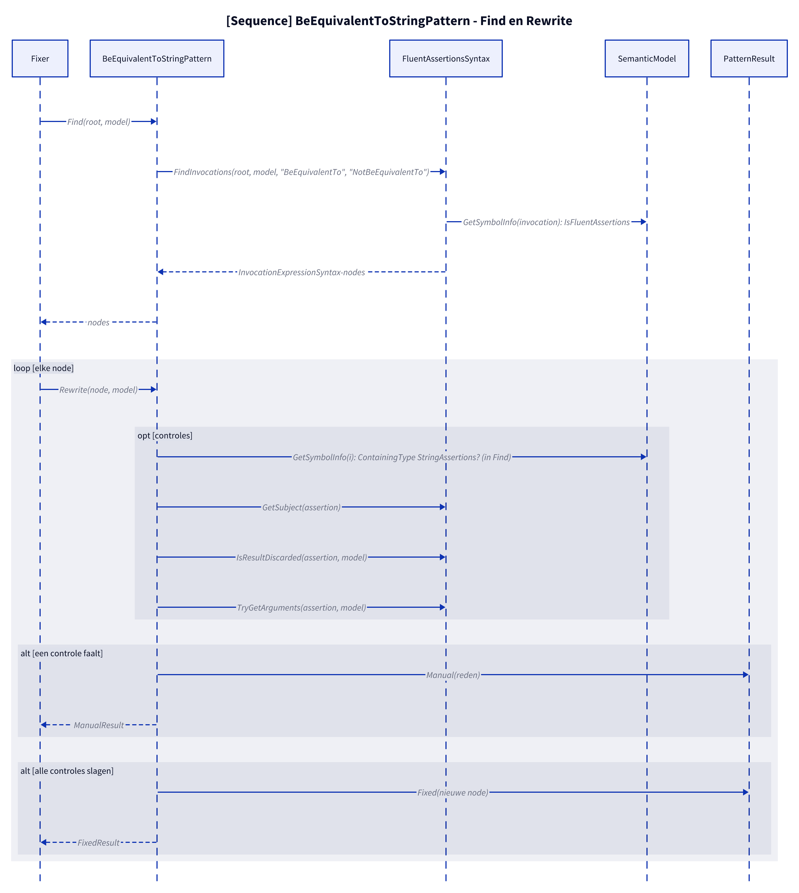
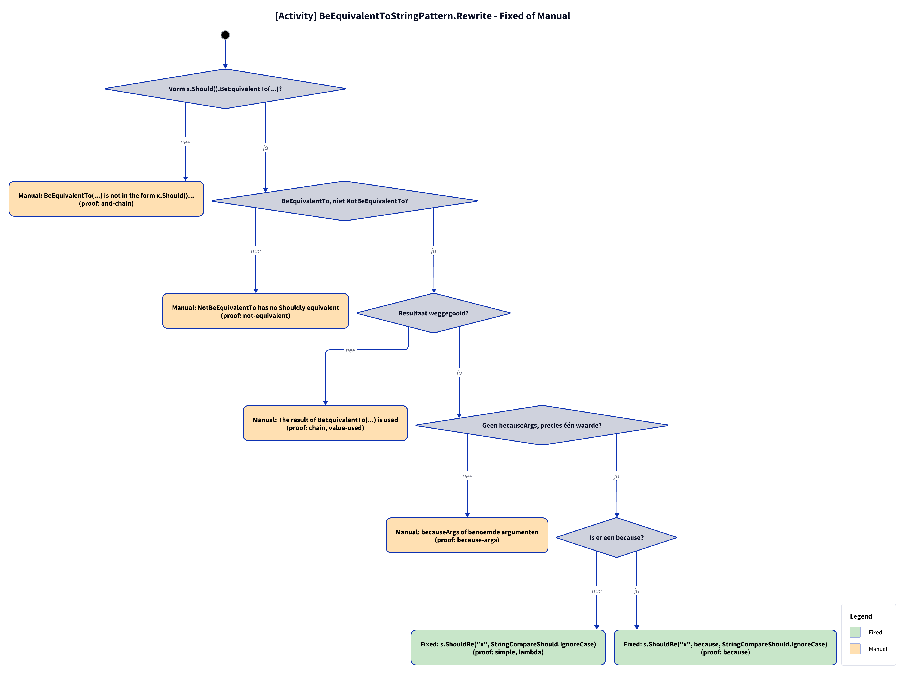

# Models: fa.be-equivalent-to-string

s.Should().BeEquivalentTo("x") to s.ShouldBe("x", StringCompareShould.IgnoreCase). Facts from `src/Unshackle.Core/Fixes/FluentAssertions/Patterns/BeEquivalentToStringPattern.cs`.

**Figure 1.** Classes around `BeEquivalentToStringPattern`: what it implements, uses and creates. Left out: `Fixer`, `IFix` and the usings handling (see [../modellen/klassen.md](../modellen/klassen.md)).

<!-- kingmadoc:diagram img/fa-be-equivalent-to-string-modellen-1.d2 -->

| Element | Path | Role |
| --- | --- | --- |
| `IPattern` | `src/Unshackle.Core/Abstractions/IPattern.cs` | Contract: `Find` and `Rewrite` |
| `BeEquivalentToStringPattern` | `src/Unshackle.Core/Fixes/FluentAssertions/Patterns/BeEquivalentToStringPattern.cs` | This pattern, Id `fa.be-equivalent-to-string` |
| `FluentAssertionsSyntax` | `src/Unshackle.Core/Fixes/FluentAssertions/FluentAssertionsSyntax.cs` | Shared building blocks: `FindInvocations`, `GetSubject`, `IsResultDiscarded`, `TryGetArguments`, `Invoke` |
| `FluentAssertionPattern` | `src/Unshackle.Core/Fixes/FluentAssertions/FluentAssertionPattern.cs` | Template Method: `Rewrite` does the shared checks, `BeEquivalentToStringPattern.RewriteAssertion` the rest |
| `PatternResult`, `FixedResult`, `ManualResult` | `src/Unshackle.Core/Models/` | Outcome: `Fixed` with new node(s) and namespaces, or `Manual` with a reason |
| «FluentAssertions» recognised | - | `StringAssertions.BeEquivalentTo(expected[, because])`; `StringAssertions.NotBeEquivalentTo(...)` |
| «Shouldly» created | - | `ShouldBe(expected[, because], StringCompareShould.IgnoreCase)` |
| Recognised types | - | `StringAssertions (only string overloads)` |

**Figure 2.** `Fixer` calls `Find` and `Rewrite` per node; `FluentAssertionPattern.Rewrite` → `RewriteAssertion` does the checks via `FluentAssertionsSyntax` and `SemanticModel` and returns `Fixed` or `Manual`. Left out: replacing the node and the usings by the `Fixer`.

<!-- kingmadoc:diagram img/fa-be-equivalent-to-string-modellen-2.d2 -->

| Step | Place | What happens |
| --- | --- | --- |
| Find | `BeEquivalentToStringPattern.Find` | `FluentAssertionsSyntax.FindInvocations` looks for calls `BeEquivalentTo`, `NotBeEquivalentTo` whose symbol lies in a FluentAssertions namespace; only `StringAssertions` remains |
| Checks | `FluentAssertionPattern.Rewrite` | `IsInsideAssertionScope`; `GetSubject(assertion)`; `IsResultDiscarded(assertion, model)`; `TryGetArguments(assertion, model)` (becauseArgs → `string.Format`) |
| Rewrite | `BeEquivalentToStringPattern.RewriteAssertion` | `NotBeEquivalentTo` → Manual; exactly one value; `ShouldBe(.., IgnoreCase)` |
| Manual | `PatternResult.Manual` | The first failing check gives a `ManualResult` with a reason (see figure 3) |
| Fixed | `PatternResult.Fixed` | New node; the `Fixer` handles trivia and usings |

**Figure 3.** Decision tree of `FluentAssertionPattern.Rewrite` → `RewriteAssertion`: 4 questions in the order of the code, every leaf names the proof in `src/Unshackle.Tests/Proofs/FluentAssertions/BeEquivalentToString/` that proves it (`<name>.before.cs` with `.after.cs` or `.manual.txt`).

<!-- kingmadoc:diagram img/fa-be-equivalent-to-string-modellen-3.d2 -->

| Question or selector | If no: Manual reason | Proof |
| --- | --- | --- |
| Shape x.Should().BeEquivalentTo(...)? | BeEquivalentTo(...) is not in the form x.Should()... | `and-chain` |
| Result discarded? | The result of BeEquivalentTo(...) is used | `chain`, `value-used` |
| Arguments splittable (becauseArgs only with a constant because)? | named arguments, or becauseArgs whose because is no constant format string | no proof (`because-args` is sinds TAAK-097 Fixed) |
| BeEquivalentTo, not NotBeEquivalentTo? | NotBeEquivalentTo has no Shouldly equivalent | `not-equivalent` |

| Condition | Fixed form | Proofs |
| --- | --- | --- |
| nee | `s.ShouldBe("x", StringCompareShould.IgnoreCase)` | `simple`, `lambda`, `edge-interpolated` |
| ja | `s.ShouldBe("x", because, StringCompareShould.IgnoreCase)`; becauseArgs → `string.Format(CultureInfo.InvariantCulture, because, args)` | `because`, `because-args` |

## See also

- [fa-be-equivalent-to-string-plan.md](fa-be-equivalent-to-string-plan.md) - plan
- [fa-be-equivalent-to-string-verify.md](fa-be-equivalent-to-string-verify.md) - verification
- `src/Unshackle.Core/Fixes/FluentAssertions/Patterns/BeEquivalentToStringPattern.cs` - the pattern
- `src/Unshackle.Tests/Proofs/FluentAssertions/BeEquivalentToString/` - the proofs
- [../modellen/pattern-beslissing.md](../modellen/pattern-beslissing.md) - generic decision of a pattern
- [../README.md](../README.md)
