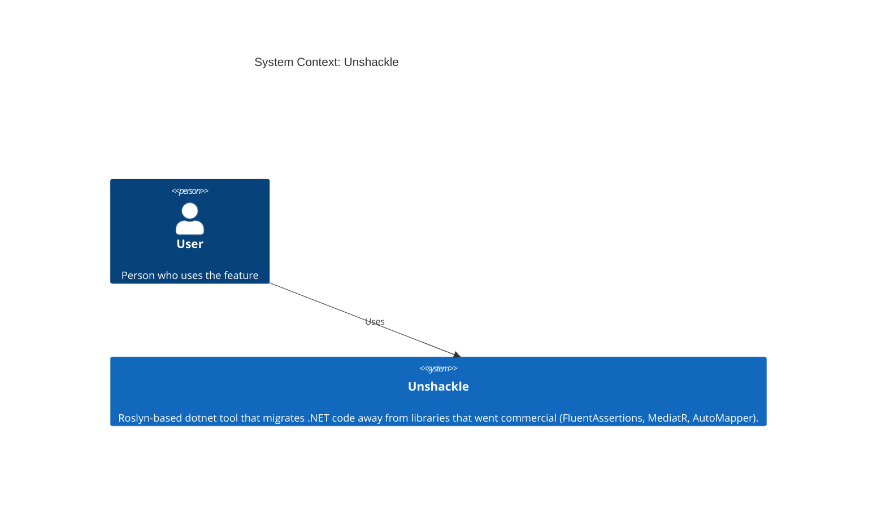
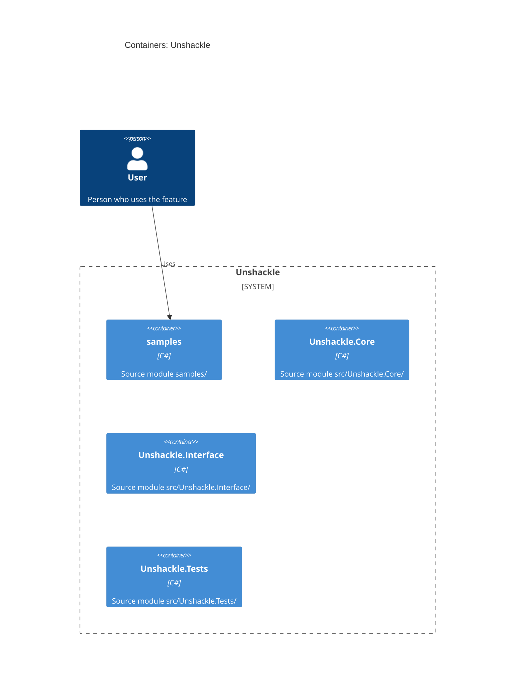

# Feature: fa.be-equivalent-to-string: s.Should().BeEquivalentTo("x") wordt s.ShouldBe("x", StringCompareShould.IgnoreCase)

| | |
|---|---|
| **Project** | Unshackle |
| **Status** | Approved |
| **Generated** | 2026-10-11 by KingmaDoc |

> Opgesteld uit TAAK-009. Alles gemarkeerd als _(inferred)_ komt uit de codebase-analyse.

## One-sentence summary

fa.be-equivalent-to-string: `BeEquivalentTo(string)` op een string wordt `ShouldBe(expected, StringCompareShould.IgnoreCase)`; `NotBeEquivalentTo` en ketens zijn Manual.

## Scope (in / out)

**In scope**

- `s.Should().BeEquivalentTo("x")` (met optionele `because` zonder `becauseArgs`) als losse assertion op een `string`.
- `Manual(reden)` voor `NotBeEquivalentTo`, `becauseArgs`, ketens en gebruikt resultaat.

**Out of scope**

- `BeEquivalentTo` op objecten en collecties (rij 14, `fa.be-equivalent-to-object`): Find matcht alleen `StringAssertions`.
- Beheer van `using`-directives: de `Fixer` doet dat via `IFix`.

## Requirements

- **REQ-1**: WHEN `s.Should().BeEquivalentTo("x")` op een string staat THE SYSTEM SHALL het herschrijven naar `s.ShouldBe("x", StringCompareShould.IgnoreCase)`; beide negeren alleen hoofdletters (ordinal), whitespace en regeleinden blijven significant (proof `src/Unshackle.Tests/Proofs/FluentAssertions/BeEquivalentToString/simple.*.cs`).
- **REQ-2**: WHEN een `because` zonder `becauseArgs` staat THE SYSTEM SHALL die als `customMessage` tussen expected en `StringCompareShould.IgnoreCase` zetten, want zo is de Shouldly-overload (proof `src/Unshackle.Tests/Proofs/FluentAssertions/BeEquivalentToString/because.*.cs`).
- **REQ-3**: WHEN de assertion de body van een void-lambda is THE SYSTEM SHALL het herschrijven (proof `src/Unshackle.Tests/Proofs/FluentAssertions/BeEquivalentToString/lambda.*.cs`).
- **REQ-4**: IF `NotBeEquivalentTo` wordt gebruikt THEN THE SYSTEM SHALL Manual geven, omdat `ShouldNotBe` geen hoofdletterongevoelige string-overload heeft (proof `src/Unshackle.Tests/Proofs/FluentAssertions/BeEquivalentToString/not-equivalent.*`).
- **REQ-5**: IF `becauseArgs` gebruikt worden THEN THE SYSTEM SHALL Manual geven (proof `src/Unshackle.Tests/Proofs/FluentAssertions/BeEquivalentToString/because-args.*`).
- **REQ-6**: IF het resultaat wordt gebruikt (`.And`/`.Which`, variabele) THEN THE SYSTEM SHALL Manual geven (proofs `src/Unshackle.Tests/Proofs/FluentAssertions/BeEquivalentToString/chain.*`, `value-used.*`).
- **REQ-7**: IF de assertion zelf een vervolg op een andere assertion is THEN THE SYSTEM SHALL Manual geven (proof `src/Unshackle.Tests/Proofs/FluentAssertions/BeEquivalentToString/and-chain.*`).

## Assumptions

- FA 7.2.2 `StringAssertions.BeEquivalentTo(string, because, becauseArgs)` is ordinal hoofdletterongevoelig; bevestigd met een proefprogramma (ABC/abc, é/É en Dž/dž gelijk; leading/trailing whitespace, \r\n versus \n, İ/i en ß/SS verschillend) en identiek aan Shouldly `IgnoreCase`.
- FA 7.2.2 heeft geen `options =>`-overload voor strings.
- Shouldly heeft `ShouldBe(string, string, string customMessage, StringCompareShould)`; bewezen door de compileercheck van de after-proofs.
- Een `null`-subject of `null`-verwachting gedraagt zich gelijk (beide slagen alleen bij null/null).
- De `Fixer` beheert `using Shouldly;`/`using FluentAssertions;` via `IFix`.

## Risks

- Foutmelding krijgt "Additional Info:" in plaats van FA's "because"-voorvoegsel: gedocumenteerd verschil.
- Een niet-string-subject valt buiten Find en blijft ongemoeid.

## C4 Context (Mermaid)

Who uses the system and which external systems it depends on.

## C4 Container (Mermaid)

The runnable units inside the system _(inferred from source directories)_.

## Open questions

- Geen.
