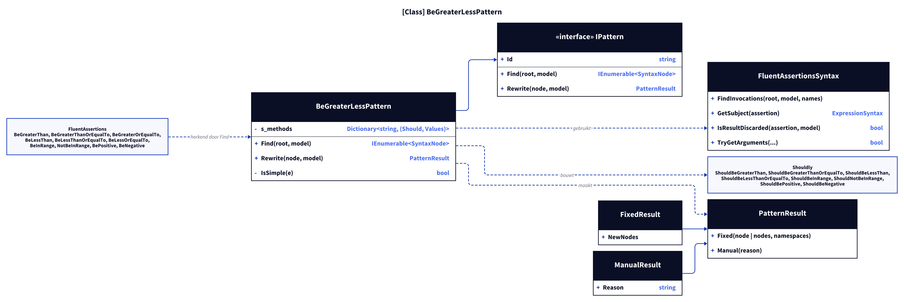
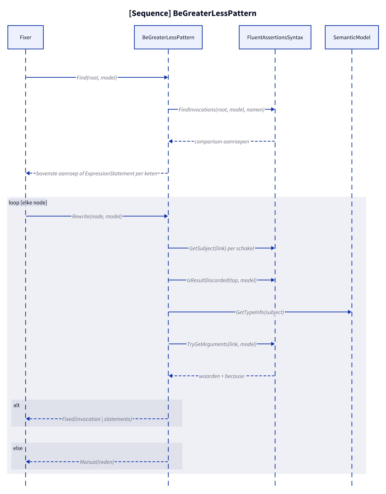
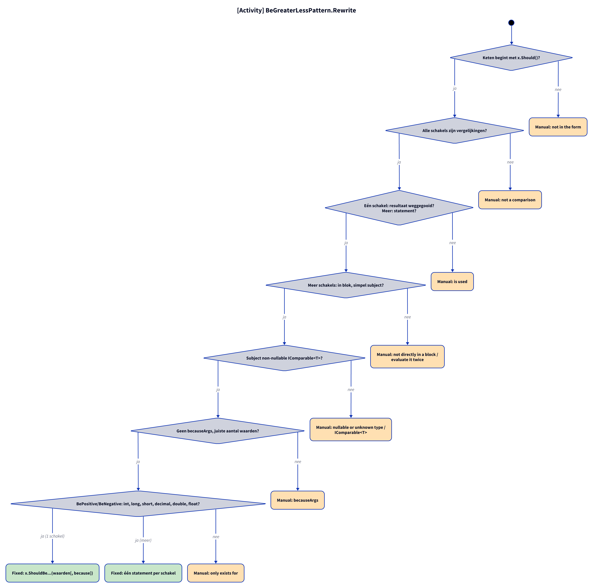

# Modellen: fa.be-greater-less

Feiten uit `src/Unshackle.Core/Fixes/FluentAssertions/Patterns/BeGreaterLessPattern.cs`.

## Figuur 1: klassen

**Figure 1.** `BeGreaterLessPattern`, zijn contract en de helpers; rechts de FluentAssertions-methoden die hij herkent en de Shouldly-methoden die hij maakt.

<!-- kingmadoc:diagram img/fa-be-greater-less-modellen-1.d2 -->

| Element | Rol |
| ------- | --- |
| `BeGreaterLessPattern` | Vindt de vergelijkingen (`Find`) en bouwt `Should...`-aanroepen (`Rewrite`); een `.And`-keten wordt een lijst statements |
| `FluentAssertionsSyntax` | Gedeelde stappen: onderwerp (`GetSubject`), weggegooid resultaat, `because`-argumenten |
| `PatternResult` | `Fixed` met één of meer nodes, of `Manual(reden)` |
| FA- en Shouldly-methoden | Vaste vertaaltabel `s_methods`; aliassen `BeGreaterOrEqualTo` en `BeLessOrEqualTo` vallen samen met hun lange naam |

## Figuur 2: sequence

**Figure 2.** Eén document: `Find` klimt langs `.And` naar de bovenste aanroep (of het statement), `Rewrite` loopt de keten terug naar `Should()`.

<!-- kingmadoc:diagram img/fa-be-greater-less-modellen-2.d2 -->

| Stap | Methode in de code | Wat gebeurt er |
| ---- | ------------------ | -------------- |
| Vinden | `Find` | Elke vergelijking klimt via `.And` naar de top; dubbele nodes vallen weg (`Distinct`) |
| Subject | `FluentAssertionsSyntax.GetSubject` | Eerste schakel moet `x.Should()` hebben |
| Type | `SemanticModel.GetTypeInfo` | Niet-nullable en `IComparable<T>` van zichzelf |
| Argumenten | `TryGetArguments` | Waarden en `because`; `becauseArgs` geeft Manual |

## Figuur 3: beslisboom

**Figure 3.** Elke vraag in `Rewrite`; de bladeren zijn de Shouldly-vorm of de Manual-reden, met de proof in de tabel.

<!-- kingmadoc:diagram img/fa-be-greater-less-modellen-3.d2 -->

| Blad | Voorwaarde | Proof (`Proofs/FluentAssertions/BeGreaterLess/`) |
| ---- | ---------- | ------------------------------------------------ |
| Fixed, 1 aanroep | losse vergelijking, `because` mee | `simple`, `because`, `in-range`, `sign`, `comparable`, `lambda` |
| Fixed, statements | `.And`-keten van vergelijkingen | `and-chain` |
| Manual "is used" | resultaat gebruikt | `value-used`, `chain-used`, `chain-lambda` |
| Manual "not a comparison" | andere assertion in keten | `chain-other` |
| Manual "not directly in a block" | keten onder `if` zonder blok | `chain-no-block` |
| Manual "evaluate it twice" | subject is een aanroep | `chain-subject-call` |
| Manual "nullable or has an unknown type" | `int?` | `nullable` |
| Manual "becauseArgs" | format-argumenten | `because-args` |
| Manual "only exists for" | `BePositive` op `byte` | `sign-byte` |

## Zie ook

- [fa-be-greater-less-plan.md](fa-be-greater-less-plan.md)
- [fa-be-greater-less-verify.md](fa-be-greater-less-verify.md)
- `src/Unshackle.Core/Fixes/FluentAssertions/Patterns/BeGreaterLessPattern.cs`
- `src/Unshackle.Tests/Proofs/FluentAssertions/BeGreaterLess/`
