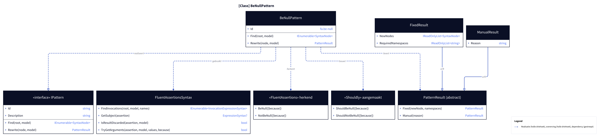
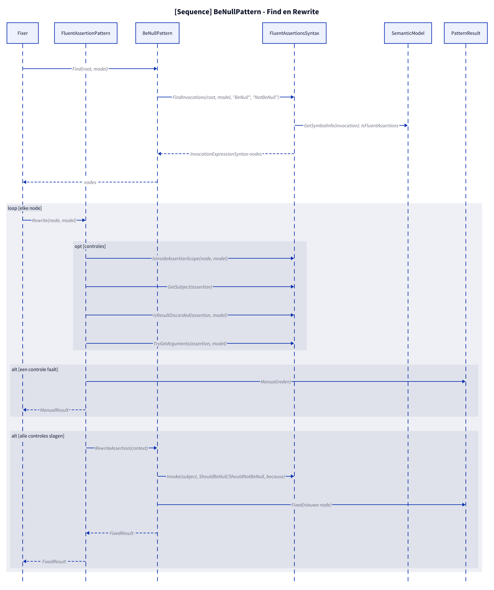
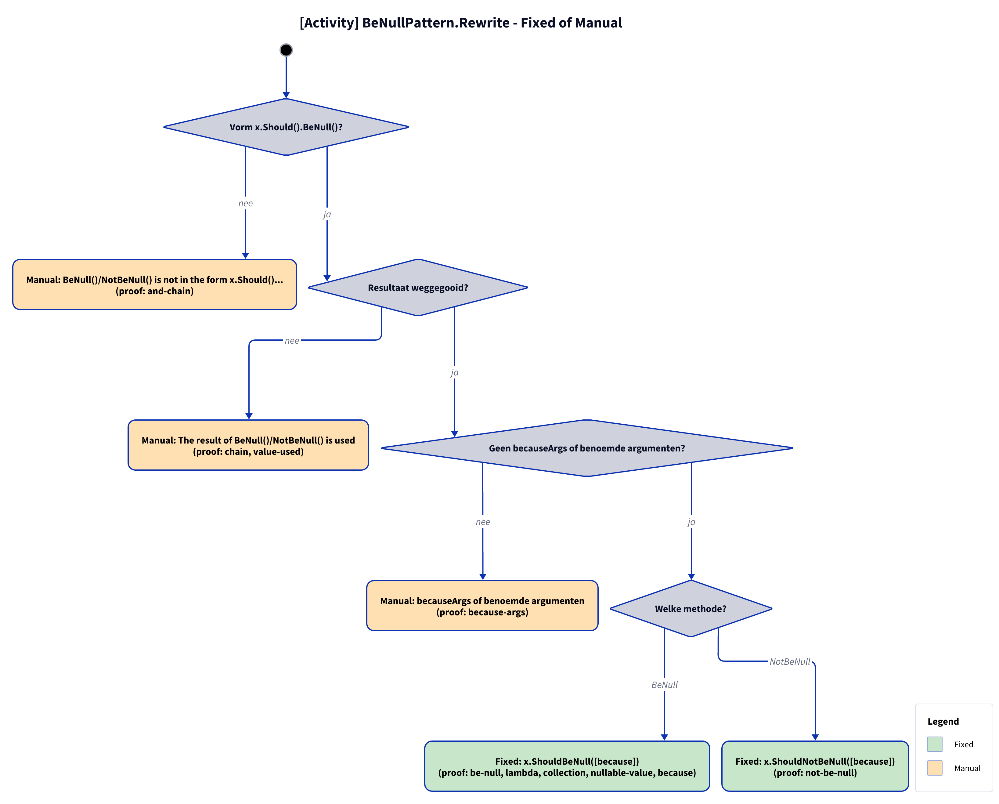

# Models: fa.be-null

x.Should().BeNull() to x.ShouldBeNull(). Facts from `src/Unshackle.Core/Fixes/FluentAssertions/Patterns/BeNullPattern.cs`.

**Figure 1.** Classes around `BeNullPattern`: what it implements, uses and creates. Left out: `Fixer`, `IFix` and the usings handling (see [../modellen/klassen.md](../modellen/klassen.md)).

<!-- kingmadoc:diagram img/fa-be-null-modellen-1.d2 -->

| Element | Path | Role |
| --- | --- | --- |
| `IPattern` | `src/Unshackle.Core/Abstractions/IPattern.cs` | Contract: `Find` and `Rewrite` |
| `FluentAssertionPattern` | `src/Unshackle.Core/Fixes/FluentAssertions/FluentAssertionPattern.cs` | Template Method: `Rewrite` does the shared checks and calls `RewriteAssertion(AssertionContext)` |
| `BeNullPattern` | `src/Unshackle.Core/Fixes/FluentAssertions/Patterns/BeNullPattern.cs` | This pattern, Id `fa.be-null`; only `Find` and `RewriteAssertion` |
| `FluentAssertionsSyntax` | `src/Unshackle.Core/Fixes/FluentAssertions/FluentAssertionsSyntax.cs` | Shared building blocks: `FindInvocations`, `IsInsideAssertionScope`, `GetSubject`, `IsResultDiscarded`, `TryGetArguments`, `Invoke` |
| `PatternResult`, `FixedResult`, `ManualResult` | `src/Unshackle.Core/Models/` | Outcome: `Fixed` with new node(s) and namespaces, or `Manual` with a reason |
| «FluentAssertions» recognised | - | `BeNull([because])`; `NotBeNull([because])` |
| «Shouldly» created | - | `ShouldBeNull([because])`; `ShouldNotBeNull([because])` |

**Figure 2.** `Fixer` calls `Find` and `Rewrite` per node; `FluentAssertionPattern.Rewrite` does the checks via `FluentAssertionsSyntax` and then calls `BeNullPattern.RewriteAssertion`, which returns `Fixed`. Left out: replacing the node and the usings by the `Fixer`.

<!-- kingmadoc:diagram img/fa-be-null-modellen-2.d2 -->

| Step | Place | What happens |
| --- | --- | --- |
| Find | `BeNullPattern.Find` | `FluentAssertionsSyntax.FindInvocations` looks for calls `BeNull`, `NotBeNull` whose symbol lies in a FluentAssertions namespace |
| Checks | `FluentAssertionPattern.Rewrite` | `IsInsideAssertionScope(node, model)`; `GetSubject(assertion)`; `IsResultDiscarded(assertion, model)`; `TryGetArguments(assertion, model)` |
| Rewrite | `BeNullPattern.RewriteAssertion` | `Invoke(subject, ShouldBeNull/ShouldNotBeNull, because)` |
| Manual | `PatternResult.Manual` | The first failing check gives a `ManualResult` with a reason (see figure 3) |
| Fixed | `PatternResult.Fixed` | New node; the `Fixer` handles trivia and usings |

**Figure 3.** Decision tree of `FluentAssertionPattern.Rewrite` and `RewriteAssertion`: 4 questions in the order of the code, every leaf names the proof in `src/Unshackle.Tests/Proofs/FluentAssertions/BeNull/` that proves it (`<name>.before.cs` with `.after.cs` or `.manual.txt`).

<!-- kingmadoc:diagram img/fa-be-null-modellen-3.d2 -->

| Question or selector | If no: Manual reason | Proof |
| --- | --- | --- |
| Outside an AssertionScope? | Inside an AssertionScope (a scope that `fa.assertion-scope` does not convert) | - |
| Shape x.Should().BeNull()? | BeNull()/NotBeNull() is not in the form x.Should()... | `and-chain` |
| Result discarded? | The result of BeNull()/NotBeNull() is used | `chain`, `value-used`, `edge-not-null-and` |
| No named arguments; becauseArgs only with a constant `because`? | named arguments, or becauseArgs whose because is no constant format string | - (`because-args` is Fixed, TAAK-097) |

| Condition | Fixed form | Proofs |
| --- | --- | --- |
| BeNull | `x.ShouldBeNull([because])` | `be-null`, `lambda`, `collection`, `nullable-value`, `because`, `edge-expression-bodied`, `edge-null-conditional` |
| NotBeNull | `x.ShouldNotBeNull([because])` | `not-be-null`, `edge-null-forgiving` |
| becauseArgs with a constant `because` | `because` becomes `string.Format(CultureInfo.InvariantCulture, because, args)` | `because-args` |

## See also

- [fa-be-null-plan.md](fa-be-null-plan.md) - plan
- [fa-be-null-verify.md](fa-be-null-verify.md) - verification
- `src/Unshackle.Core/Fixes/FluentAssertions/Patterns/BeNullPattern.cs` - the pattern
- `src/Unshackle.Tests/Proofs/FluentAssertions/BeNull/` - the proofs
- [../modellen/pattern-beslissing.md](../modellen/pattern-beslissing.md) - generic decision of a pattern
- [../README.md](../README.md)
