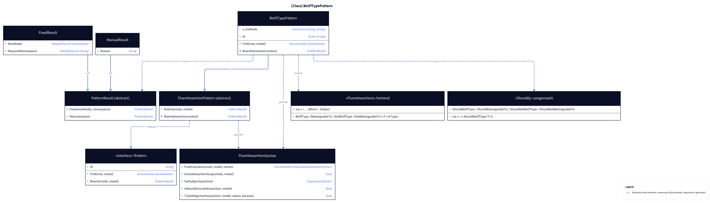
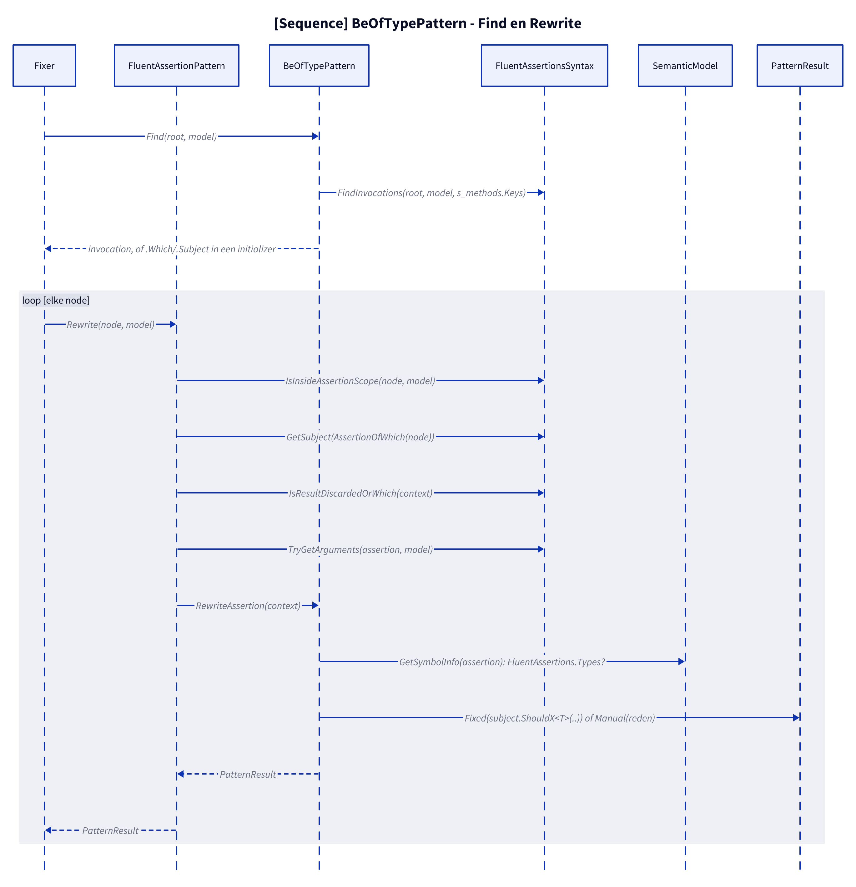
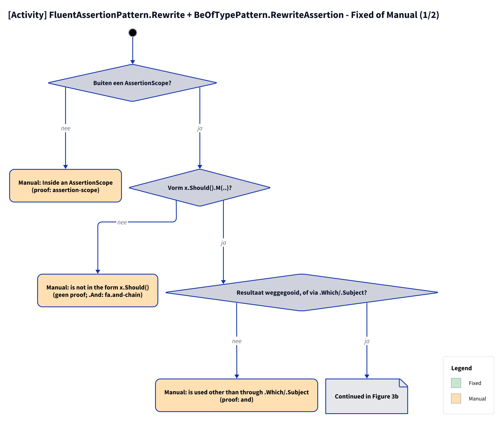

# Models: fa.be-of-type

`x.Should().BeOfType<T>()` and family to `x.ShouldBeOfType<T>()`. Facts from `src/Unshackle.Core/Fixes/FluentAssertions/Patterns/BeOfTypePattern.cs`.

**Figure 1.** Classes around `BeOfTypePattern`. Left out: `Fixer`, `IFix` and the usings (see [../modellen/klassen.md](../modellen/klassen.md)).

<!-- kingmadoc:diagram img/fa-be-of-type-modellen-1.d2 -->

| Element | Path | Role |
| --- | --- | --- |
| `IPattern` | `src/Unshackle.Core/Abstractions/IPattern.cs` | Contract |
| `FluentAssertionPattern` | `src/Unshackle.Core/Fixes/FluentAssertions/FluentAssertionPattern.cs` | Template Method: `Rewrite` does scope, shape, result and arguments and calls `RewriteAssertion` |
| `BeOfTypePattern` | `src/Unshackle.Core/Fixes/FluentAssertions/Patterns/BeOfTypePattern.cs` | This pattern, Id `fa.be-of-type`; `s_methods` maps the four FA names to Shouldly |
| `FluentAssertionsSyntax` | `src/Unshackle.Core/Fixes/FluentAssertions/FluentAssertionsSyntax.cs` | `FindInvocations`, `WithWhich`, `AssertionOfWhich`, `IsInsideAssertionScope`, `GetSubject`, `IsResultDiscardedOrWhich`, `TryGetArguments` |
| `PatternResult`, `FixedResult`, `ManualResult` | `src/Unshackle.Core/Models/` | Outcome |

**Figure 2.** `Find` returns the invocation, or the `.Which`/`.Subject` member access if it is in an initializer.

<!-- kingmadoc:diagram img/fa-be-of-type-modellen-2.d2 -->

| Step | Place | What happens |
| --- | --- | --- |
| Find | `BeOfTypePattern.Find` | `FindInvocations` on the four names, via `WithWhich` the `.Which`/`.Subject` node if it follows |
| Checks | `FluentAssertionPattern.Rewrite` | scope, shape, use of the result (`IsResultDiscardedOrWhich`), becauseArgs |
| Rewrite | `BeOfTypePattern.RewriteAssertion` | Types namespace, number of arguments, then `Fixed` |
| Fixed | `PatternResult.Fixed` | `subject.ShouldBeOfType<T>([because])` (also for `.Which`: Shouldly returns the cast value) |

**Figure 3.** Decision tree of `FluentAssertionPattern.Rewrite` and `BeOfTypePattern.RewriteAssertion`; proofs in `src/Unshackle.Tests/Proofs/FluentAssertions/BeOfType/`.

<!-- kingmadoc:diagram img/fa-be-of-type-modellen-3.d2 -->

| Question | If no: Manual reason | Proof |
| --- | --- | --- |
| Outside an AssertionScope? | Inside an AssertionScope | `assertion-scope` |
| Shape `x.Should().M(..)`? | is not in the form x.Should() | no proof; `.And.BeOfType` goes via `fa.and-chain` |
| Result discarded or via `.Which`/`.Subject`? | is used other than through .Which/.Subject | `and` (`which-chain`, `which-multiple` are Fixed, TAAK-096) |
| No named arguments; becauseArgs only with a constant `because`? | named arguments, or becauseArgs whose because is no constant format string | no proof (`because-args` is Fixed, TAAK-097) |
| Not from `FluentAssertions.Types`? | on a Type asserts the type itself | `type-subject` |
| Right arguments? | unexpected arguments | no proof |

Fixed: `simple`, `because`, `because-args` (`string.Format(...)`), `type-argument`, `which`, `which-chain` (`obj.ShouldBeOfType<Dto>().Name`), `which-multiple`, `nullable`.

## See also

- [fa-be-of-type-plan.md](fa-be-of-type-plan.md) - plan
- [fa-be-of-type-verify.md](fa-be-of-type-verify.md) - verification
- `src/Unshackle.Core/Fixes/FluentAssertions/Patterns/BeOfTypePattern.cs` - the pattern
- `src/Unshackle.Tests/Proofs/FluentAssertions/BeOfType/` - the proofs
- [../README.md](../README.md)
