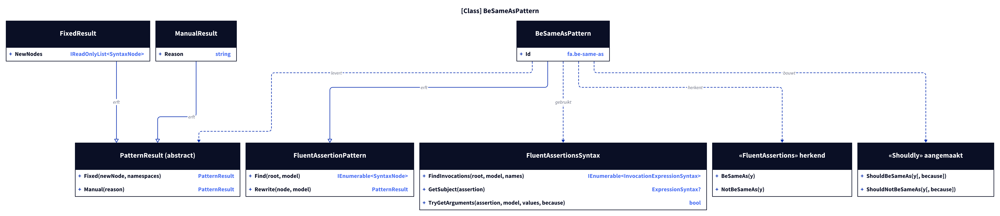
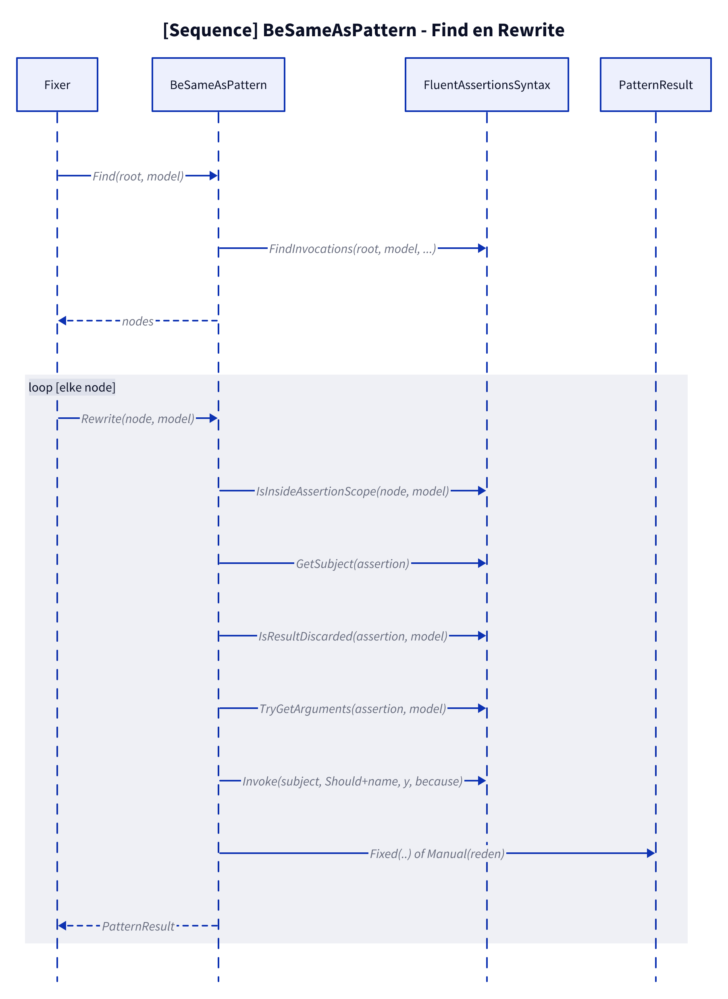
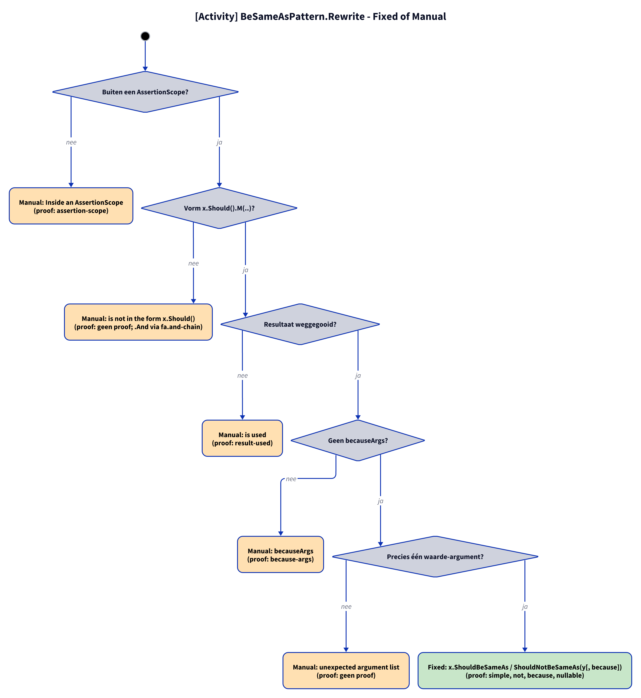

# Models: fa.be-same-as

`x.Should().BeSameAs(y)` becomes `x.ShouldBeSameAs(y)`; `NotBeSameAs` becomes `ShouldNotBeSameAs`. Facts from `src/Unshackle.Core/Fixes/FluentAssertions/Patterns/BeSameAsPattern.cs`.

**Figure 1.** Classes around `BeSameAsPattern`. Omitted: `Fixer`, `IFix` and the usings (see [../modellen/klassen.md](../modellen/klassen.md)).

<!-- kingmadoc:diagram img/fa-be-same-as-modellen-1.d2 -->

| Element | Path | Role |
| --- | --- | --- |
| `FluentAssertionPattern` | `src/Unshackle.Core/Fixes/FluentAssertions/FluentAssertionPattern.cs` | Template Method: `Rewrite` does the shared checks and calls `RewriteAssertion` |
| `BeSameAsPattern` | `src/Unshackle.Core/Fixes/FluentAssertions/Patterns/BeSameAsPattern.cs` | This pattern, Id `fa.be-same-as` |
| `FluentAssertionsSyntax` | `src/Unshackle.Core/Fixes/FluentAssertions/FluentAssertionsSyntax.cs` | Shared checks |
| `PatternResult`, `FixedResult`, `ManualResult` | `src/Unshackle.Core/Models/` | Outcome |

**Figure 2.** Order of `Find` and `Rewrite`.

<!-- kingmadoc:diagram img/fa-be-same-as-modellen-2.d2 -->

| Step | Location | What happens |
| --- | --- | --- |
| Find | `BeSameAsPattern.Find` | `FindInvocations` on the FA names |
| Checks | `FluentAssertionPattern.Rewrite` | `IsInsideAssertionScope`, `GetSubject`, `IsResultDiscarded`, `TryGetArguments` |
| Rewrite | `BeSameAsPattern.RewriteAssertion` | number of values, `Invoke(subject, "Should" + naam, y, because)` |
| Outcome | `PatternResult.Fixed` / `Manual` | Shouldly call or reason |

**Figure 3.** Decision tree of `FluentAssertionPattern.Rewrite` and `BeSameAsPattern.RewriteAssertion`; proofs in `src/Unshackle.Tests/Proofs/FluentAssertions/BeSameAs/`.

<!-- kingmadoc:diagram img/fa-be-same-as-modellen-3.d2 -->

| Question | If no: Manual reason | Proof |
| --- | --- | --- |
| Outside an AssertionScope? | Inside an AssertionScope | `assertion-scope` |
| Form x.Should().M(..)? | is not in the form x.Should() | `no proof; .And via fa.and-chain` |
| Result discarded? | is used | `result-used` |
| No named arguments; becauseArgs only with a constant `because`? | named arguments, or becauseArgs whose because is no constant format string | no proof (`because-args` is Fixed, TAAK-097) |
| Exactly one value argument? | unexpected argument list | `no proof` |
| Fixed | `x.ShouldBeSameAs / ShouldNotBeSameAs(y[, because])` | simple, not, because, because-args, nullable |

## See also

- [fa-be-same-as-plan.md](fa-be-same-as-plan.md) - plan
- [fa-be-same-as-verify.md](fa-be-same-as-verify.md) - verification
- `src/Unshackle.Core/Fixes/FluentAssertions/Patterns/BeSameAsPattern.cs` - the pattern
- `src/Unshackle.Tests/Proofs/FluentAssertions/BeSameAs/` - the proofs
- [../README.md](../README.md)
