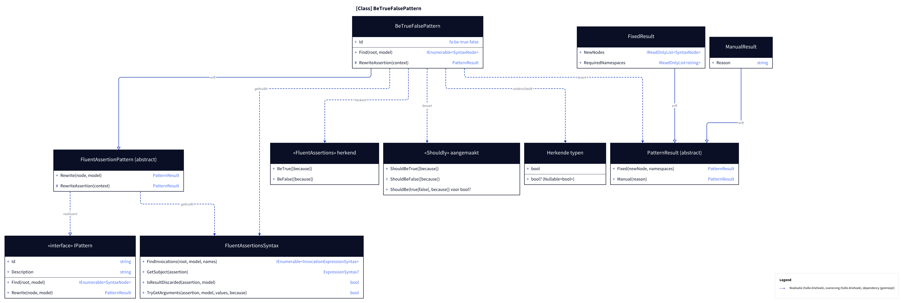
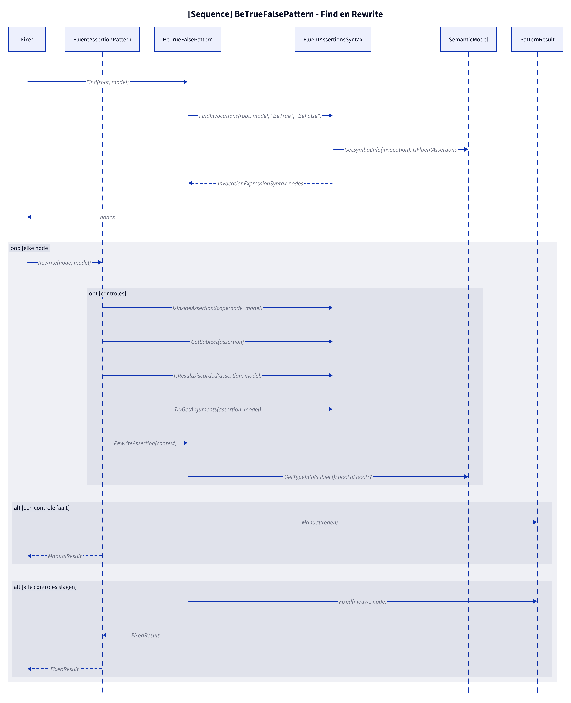
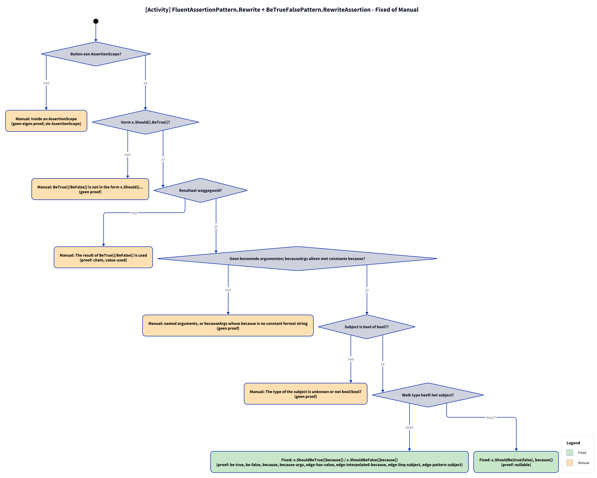

# Modellen: fa.be-true-false

x.Should().BeTrue() naar x.ShouldBeTrue(). Feiten uit `src/Unshackle.Core/Fixes/FluentAssertions/Patterns/BeTrueFalsePattern.cs`.

**Figure 1.** Klassen rond `BeTrueFalsePattern`: wat hij implementeert, gebruikt en aanmaakt. Weggelaten: `Fixer`, `IFix` en de usings-afhandeling (zie [../modellen/klassen.md](../modellen/klassen.md)).

<!-- kingmadoc:diagram img/fa-be-true-false-modellen-1.d2 -->

| Element | Pad | Rol |
| --- | --- | --- |
| `IPattern` | `src/Unshackle.Core/Abstractions/IPattern.cs` | Contract: `Find` en `Rewrite` |
| `FluentAssertionPattern` | `src/Unshackle.Core/Fixes/FluentAssertions/FluentAssertionPattern.cs` | Template Method: `Rewrite` doet de gedeelde controles en roept `RewriteAssertion(AssertionContext)` aan |
| `BeTrueFalsePattern` | `src/Unshackle.Core/Fixes/FluentAssertions/Patterns/BeTrueFalsePattern.cs` | Dit patroon, Id `fa.be-true-false` |
| `FluentAssertionsSyntax` | `src/Unshackle.Core/Fixes/FluentAssertions/FluentAssertionsSyntax.cs` | Gedeelde bouwstenen: `FindInvocations`, `IsInsideAssertionScope`, `GetSubject`, `IsResultDiscarded`, `TryGetArguments`, `Invoke` |
| `PatternResult`, `FixedResult`, `ManualResult` | `src/Unshackle.Core/Models/` | Uitkomst: `Fixed` met nieuwe node(s) en namespaces, of `Manual` met reden |
| «FluentAssertions» herkend | - | `BeTrue([because])`; `BeFalse([because])` |
| «Shouldly» aangemaakt | - | `ShouldBeTrue([because])`; `ShouldBeFalse([because])`; `ShouldBe(true|false[, because]) voor bool?` |
| Herkende typen | - | `bool`; `bool? (Nullable<bool>)` |

**Figure 2.** `Fixer` roept `Find` en per node `Rewrite` aan; `FluentAssertionPattern.Rewrite` doet de gedeelde controles en roept daarna `BeTrueFalsePattern.RewriteAssertion` aan (type-check, `Fixed` of `Manual`). Weggelaten: het vervangen van de node en de usings door de `Fixer`.

<!-- kingmadoc:diagram img/fa-be-true-false-modellen-2.d2 -->

| Stap | Plek | Wat gebeurt er |
| --- | --- | --- |
| Find | `BeTrueFalsePattern.Find` | `FluentAssertionsSyntax.FindInvocations` zoekt aanroepen `BeTrue`, `BeFalse` waarvan het symbool in een FluentAssertions-namespace ligt |
| Controles | `FluentAssertionPattern.Rewrite` | `IsInsideAssertionScope(node, model)`; `GetSubject(assertion)`; `IsResultDiscarded(assertion, model)`; `TryGetArguments(assertion, model)` |
| Herschrijven | `BeTrueFalsePattern.RewriteAssertion` | `GetTypeInfo(subject)`: `bool` of `bool?`, dan `Invoke(...)` |
| Manual | `PatternResult.Manual` | Eerste mislukte controle geeft `ManualResult` met reden (zie figuur 3) |
| Fixed | `PatternResult.Fixed` | Nieuwe node; trivia en usings regelt de `Fixer` |

**Figure 3.** Beslisboom van `FluentAssertionPattern.Rewrite` en `RewriteAssertion`: 5 vragen in de volgorde van de code, elk blad noemt de proof in `src/Unshackle.Tests/Proofs/FluentAssertions/BeTrueFalse/` die het bewijst (`<naam>.before.cs` met `.after.cs` of `.manual.txt`).

<!-- kingmadoc:diagram img/fa-be-true-false-modellen-3.d2 -->

| Vraag of selector | Bij nee: Manual-reden | Proof |
| --- | --- | --- |
| Buiten een AssertionScope? | Inside an AssertionScope (scope die `fa.assertion-scope` niet omzet) | - |
| Vorm x.Should().BeTrue()? | BeTrue()/BeFalse() is not in the form x.Should()... | geen proof, bewaakt in code |
| Resultaat weggegooid? | The result of BeTrue()/BeFalse() is used | `chain`, `value-used` |
| Geen benoemde argumenten; becauseArgs alleen met constante `because`? | named arguments, or becauseArgs whose because is no constant format string | - (`because-args` is Fixed, TAAK-097) |
| Subject is bool of bool?? | The type of the subject is unknown or not bool/bool? | geen proof, bewaakt in code |

| Voorwaarde | Fixed-vorm | Proofs |
| --- | --- | --- |
| bool | `x.ShouldBeTrue([because]) / x.ShouldBeFalse([because])` | `be-true`, `be-false`, `because`, `because-args` (`string.Format(...)`), `edge-has-value`, `edge-interpolated-because`, `edge-linq-subject`, `edge-pattern-subject` |
| bool? | `x.ShouldBe(true|false[, because])` | `nullable` |

## Zie ook

- [fa-be-true-false-plan.md](fa-be-true-false-plan.md) - plan
- [fa-be-true-false-verify.md](fa-be-true-false-verify.md) - verificatie
- `src/Unshackle.Core/Fixes/FluentAssertions/Patterns/BeTrueFalsePattern.cs` - het patroon
- `src/Unshackle.Tests/Proofs/FluentAssertions/BeTrueFalse/` - de proofs
- [../modellen/pattern-beslissing.md](../modellen/pattern-beslissing.md) - generieke beslissing van een pattern
- [../README.md](../README.md)
