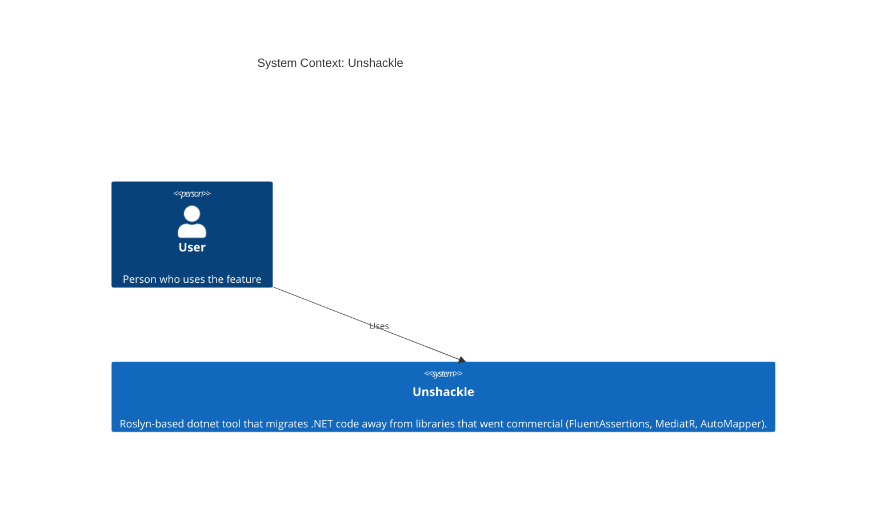
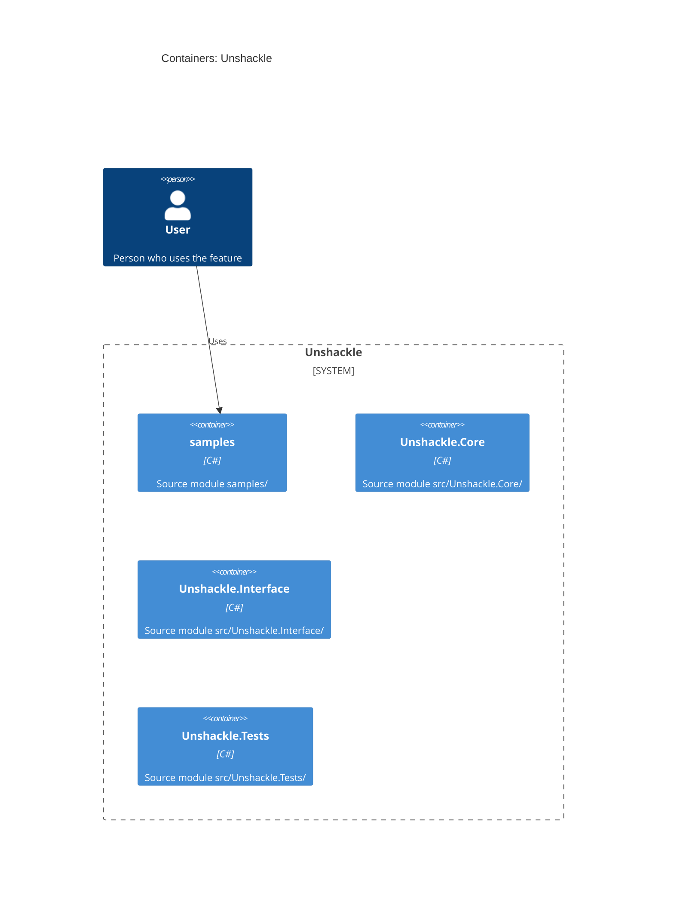

# Feature: fa.be-true-false: x.Should().BeTrue()/BeFalse() wordt x.ShouldBeTrue()/ShouldBeFalse() (bool) of…

| | |
|---|---|
| **Project** | Unshackle |
| **Status** | Approved |
| **Generated** | 2026-10-10T23:36+02:00 by KingmaDoc 0.3.0.dev9 |

> Opgesteld uit TAAK-003 (onderzoek vooraf, aangepast aan het echte contract bij realisatie).
> Alles gemarkeerd als _(inferred)_ komt uit de codebase-analyse.

## One-sentence summary

fa.be-true-false: x.Should().BeTrue()/BeFalse() wordt x.ShouldBeTrue()/ShouldBeFalse() (bool) of…

**Full description:** fa.be-true-false: x.Should().BeTrue()/BeFalse() wordt x.ShouldBeTrue()/ShouldBeFalse() (bool) of x.ShouldBe(true/false) (bool?).

## Scope (in / out)

**In scope**

- `x.Should().BeTrue()` / `BeFalse()` (met optionele `because` zonder `becauseArgs`) als losse assertion op `bool` en `bool?`.
- `bool` wordt `ShouldBeTrue`/`ShouldBeFalse`; `bool?` wordt `ShouldBe(true)`/`ShouldBe(false)`, want Shouldly heeft geen `bool?`-overload.
- `Manual(reden)` voor `becauseArgs`, ketens, gebruikt resultaat en onbekende types.

**Out of scope**

- `NotBeTrue`/`NotBeFalse` (alleen `bool?`, andere semantiek bij `null`) en `Be(true)` (patroon `fa.should-be`).
- Ketens met `.And`/`.Which` splitsen.
- Beheer van `using`-directives: de `Fixer` doet dat via `IFix`.

## Requirements

- **REQ-1**: WHEN `x.Should().BeTrue()` op een `bool` staat THE SYSTEM SHALL het herschrijven naar `x.ShouldBeTrue()` (proof `src/Unshackle.Tests/Proofs/FluentAssertions/BeTrueFalse/be-true.*.cs`).
- **REQ-2**: WHEN `x.Should().BeFalse()` op een `bool` staat, ook op een subject met haakjes zoals `(a == b)`, THE SYSTEM SHALL het herschrijven naar `x.ShouldBeFalse()` (proof `src/Unshackle.Tests/Proofs/FluentAssertions/BeTrueFalse/be-false.*.cs`).
- **REQ-3**: WHEN `BeTrue`/`BeFalse` een `because` zonder `becauseArgs` heeft THE SYSTEM SHALL die als `customMessage` overnemen (proof `src/Unshackle.Tests/Proofs/FluentAssertions/BeTrueFalse/because.*.cs`).
- **REQ-4**: WHEN het subject een `bool?` is THE SYSTEM SHALL `x.ShouldBe(true)` resp. `x.ShouldBe(false)` bouwen, met `because` als tweede argument (proof `src/Unshackle.Tests/Proofs/FluentAssertions/BeTrueFalse/nullable.*.cs`).
- **REQ-5**: IF `becauseArgs` of benoemde argumenten gebruikt worden THEN THE SYSTEM SHALL Manual geven (proof `src/Unshackle.Tests/Proofs/FluentAssertions/BeTrueFalse/because-args.*`).
- **REQ-6**: IF de assertion in een keten staat (`.BeTrue().And...`) THEN THE SYSTEM SHALL Manual geven (proof `src/Unshackle.Tests/Proofs/FluentAssertions/BeTrueFalse/chain.*`).
- **REQ-7**: IF het resultaat van `BeTrue`/`BeFalse` als waarde wordt gebruikt (`var c = ...`) THEN THE SYSTEM SHALL Manual geven (proof `src/Unshackle.Tests/Proofs/FluentAssertions/BeTrueFalse/value-used.*`).
- **REQ-8**: IF het type van het subject onbekend is of niet `bool`/`bool?` THEN THE SYSTEM SHALL Manual geven. _Geen proof: before compileert dan niet; alleen via code bewaakt._

## Assumptions

- _(inferred)_ Built on the existing stack: C#.
- Shouldly 4.3.0 heeft `ShouldBeTrue(bool, string)`/`ShouldBeFalse(bool, string)` maar geen `bool?`-overload (via reflectie gecontroleerd).
- `ShouldBe(true)` op `bool?` faalt ook bij `null`, gelijk aan FA `BeTrue()`.
- `customMessage` is een kale string zonder `{0}`-formatting.
- De `Fixer` zet `using Shouldly;` erbij en haalt `using FluentAssertions;` weg via `IFix`; het pattern beheert geen usings.

## Risks

- Foutmelding krijgt "Additional Info:" in plaats van FA's "because"-voorvoegsel: gedocumenteerd verschil, geen Manual.
- Een eigen `BeTrue` buiten FluentAssertions wordt niet herschreven: `FindInvocations` controleert de namespace van het symbool.
- Subject-expressie wordt ongewijzigd overgenomen (haakjes staan al in de bron voor `.Should()`).

## C4 Context (Mermaid)

Who uses the system and which external systems it depends on.



## C4 Container (Mermaid)

The runnable units inside the system _(inferred from source directories)_.



## Open questions

- Geen open vragen. `NotBeTrue`/`NotBeFalse` op `bool?` kunnen later een eigen patroon worden.

**Answered while planning**

- [x] Wat lost dit op en voor wie? Developers die van FluentAssertions af willen; sample: `OrderTests.cs:62`.
- [x] Wie of wat triggert het? De `Fixer` draait het patroon per document.
- [x] Externe systemen? Roslyn (SemanticModel); geen datastore.
- [x] Welke modules veranderen? `Unshackle.Core` (patroon en registratie) en `Unshackle.Tests` (proofs).
- [x] Hoe weten we dat het werkt? `ProofTests` draait alle 7 proofs.

## Appendix: codebase context _(inferred)_

- **Tech stack:** C#
- **Entry points:** `src/Unshackle.Interface/Program.cs`
- **Config files:** _none found_
- **Test directories:** _none found_

| Language | Files |
|---|---|
| csharp | 88 |
| markdown | 28 |
| json | 2 |
| yaml | 2 |
| shell | 1 |

<details>
<summary>File tree (161 files)</summary>

```text
unshackle/
├── .claude/
│   ├── hooks/
│   │   └── check-pattern-docs.sh
│   ├── skills/
│   │   ├── taak-oppakken/
│   │   │   └── …
│   │   ├── taak-specifiek/
│   │   │   └── …
│   │   └── taak-start/
│   │       └── …
│   └── settings.json
├── .github/
│   └── workflows/
│       └── ci.yml
├── .vibe-wise/
│   ├── profile.md
│   ├── progress.md
│   └── project-map.md
├── claude/
│   ├── docs/
│   │   ├── agent-werkwijze.md
│   │   ├── code-standaarden.md
│   │   ├── design-patterns.md
│   │   ├── INDEX.md
│   │   └── patroon-loop.md
│   └── tasks/
│       ├── archief/
│       │   └── …
│       ├── patroon-queue.md
│       └── TAAK-003-fa-be-true-false.md
├── docs/
│   └── projectinfo/
│       ├── architectuur/
│       │   └── …
│       ├── patterns/
│       │   └── …
│       ├── beslissingen.md
│       ├── project.md
│       └── README.md
├── samples/
│   ├── SampleShop/
│   │   ├── SampleShop.Tests/
│   │   │   └── …
│   │   ├── SampleShop/
│   │   │   └── …
│   │   └── SampleShop.slnx
│   ├── .editorconfig
│   ├── Directory.Build.props
│   └── Directory.Packages.props
├── src/
│   ├── Unshackle.Core/
│   │   ├── Abstractions/
│   │   │   └── …
│   │   ├── Fixes/
│   │   │   └── …
│   │   ├── Models/
│   │   │   └── …
│   │   ├── Fixer.cs
│   │   ├── Unshackle.Core.csproj
│   │   └── UsingDirectives.cs
│   ├── Unshackle.DataAccess/
│   │   ├── Reports/
│   │   │   └── …
│   │   ├── Solutions/
│   │   │   └── …
│   │   └── Unshackle.DataAccess.csproj
│   ├── Unshackle.Interface/
│   │   ├── Commands/
│   │   │   └── …
│   │   ├── Output/
│   │   │   └── …
│   │   ├── Program.cs
│   │   └── Unshackle.Interface.csproj
│   └── Unshackle.Tests/
│       ├── Core/
│       │   └── …
│       ├── DataAccess/
│       │   └── …
│       ├── Helpers/
│       │   └── …
│       ├── Integration/
│       │   └── …
│       ├── Interface/
│       │   └── …
│       ├── Proofs/
│       │   └── …
│       ├── ProofFix.cs
│       ├── ProofTests.cs
│       └── Unshackle.Tests.csproj
├── .editorconfig
├── .featuredoc.yml
├── .gitignore
├── CLAUDE.md
├── Directory.Build.props
├── Directory.Packages.props
├── global.json
├── LICENSE
├── README.md
└── Unshackle.slnx
```

</details>
