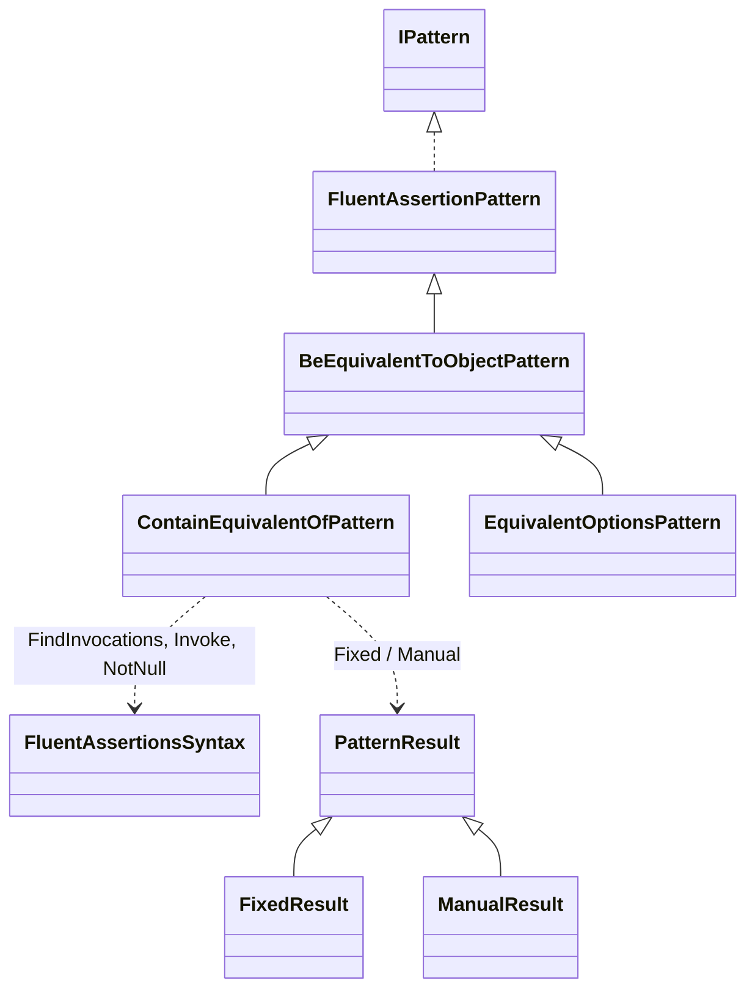
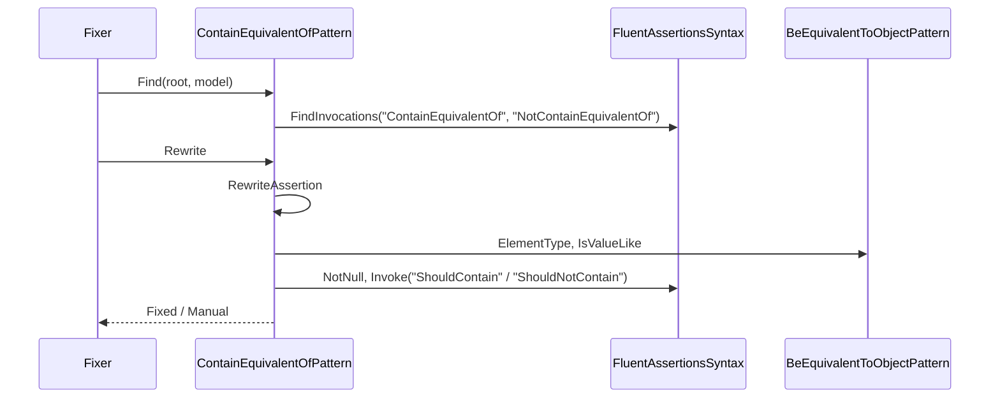
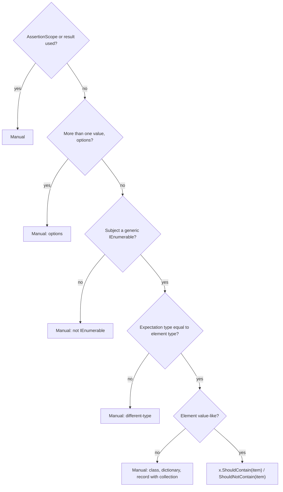

# Models: fa.contain-equivalent-of

`ContainEquivalentOf(item)` becomes `ShouldContain(item)` for value items. Facts from `src/Unshackle.Core/Fixes/FluentAssertions/Patterns/ContainEquivalentOfPattern.cs`. Diagrams written by hand in Mermaid (kingmadoc/d2 unavailable).

**Figure 1.** Classes around `ContainEquivalentOfPattern`.

| Element | Path | Role |
| --- | --- | --- |
| `BeEquivalentToObjectPattern` | `src/Unshackle.Core/Fixes/FluentAssertions/Patterns/BeEquivalentToObjectPattern.cs` | Provides `ElementType`, `IsValueLike`, `IsLeaf` |
| `ContainEquivalentOfPattern` | `src/Unshackle.Core/Fixes/FluentAssertions/Patterns/ContainEquivalentOfPattern.cs` | This pattern, Id `fa.contain-equivalent-of` |
| `FluentAssertionsSyntax` | `src/Unshackle.Core/Fixes/FluentAssertions/FluentAssertionsSyntax.cs` | Helper methods |
| `PatternResult` etc. | `src/Unshackle.Core/Models/` | Outcome |

**Figure 2.** Order.

| Step | Location | What happens |
| --- | --- | --- |
| Find | `Find` | All `ContainEquivalentOf`/`NotContainEquivalentOf` on FA |
| Type check | `RewriteAssertion` | Element and expectation type via `ElementType` and `GetTypeInfo` |
| Value item | `IsValueLike` | Leaf, sealed record, record struct, struct with leaf members |
| Rewrite | `FluentAssertionsSyntax.Invoke` | `ShouldContain(item, because)` with `NotNull` on the subject |

**Figure 3.** Decision tree.

| Question | Outcome | Proof |
| --- | --- | --- |
| AssertionScope? | Manual | `assertion-scope` |
| Result used? | Manual | `which` |
| Options? | Manual | `options` |
| Different expectation type? | Manual | `different-type` |
| Not a value item? | Manual | `class`, `record-unsealed`, `record-list-member`, `dictionary` |
| Plain case | Fixed | `simple`, `strings`, `sealed-record`, `record-struct`, `because`, `nullable-subject` |

## See also

- [fa-contain-equivalent-of-plan.md](fa-contain-equivalent-of-plan.md)
- [fa-contain-equivalent-of-verify.md](fa-contain-equivalent-of-verify.md)
- `src/Unshackle.Core/Fixes/FluentAssertions/Patterns/ContainEquivalentOfPattern.cs`
- `src/Unshackle.Tests/Proofs/FluentAssertions/ContainEquivalentOf/`
