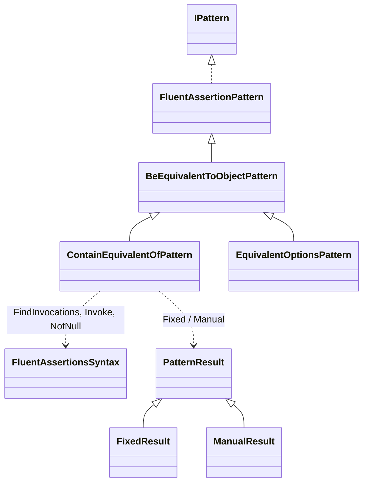
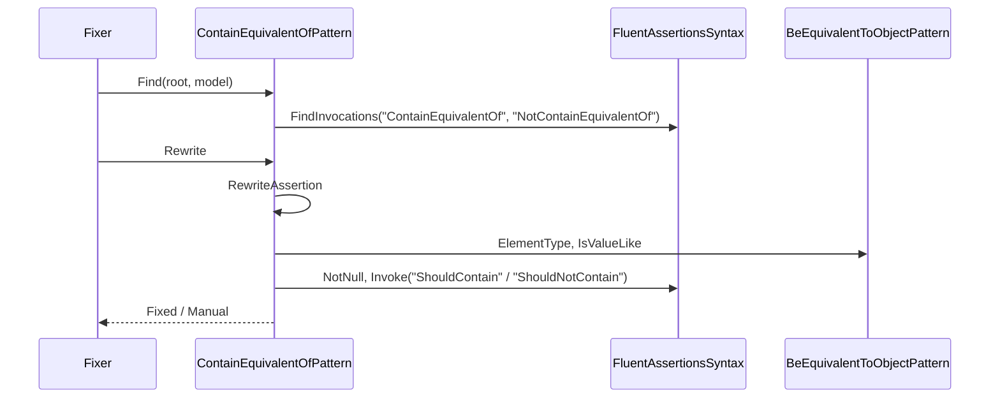
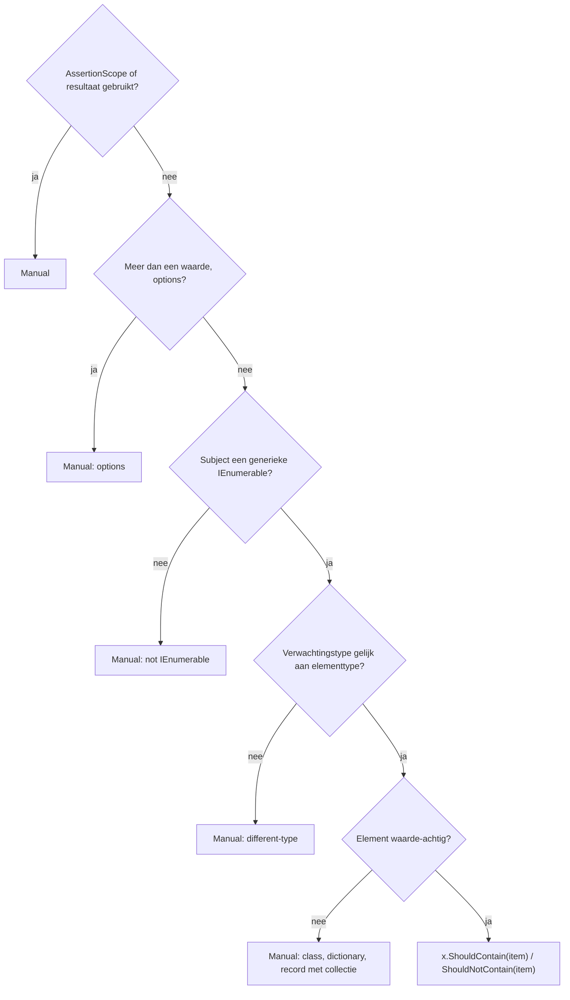

# Modellen: fa.contain-equivalent-of

`ContainEquivalentOf(item)` wordt `ShouldContain(item)` voor waarde-items. Feiten uit `src/Unshackle.Core/Fixes/FluentAssertions/Patterns/ContainEquivalentOfPattern.cs`. Diagrammen met de hand in Mermaid (kingmadoc/d2 ontbreken).

**Figure 1.** Klassen rond `ContainEquivalentOfPattern`.

| Element | Pad | Rol |
| --- | --- | --- |
| `BeEquivalentToObjectPattern` | `src/Unshackle.Core/Fixes/FluentAssertions/Patterns/BeEquivalentToObjectPattern.cs` | Levert `ElementType`, `IsValueLike`, `IsLeaf` |
| `ContainEquivalentOfPattern` | `src/Unshackle.Core/Fixes/FluentAssertions/Patterns/ContainEquivalentOfPattern.cs` | Dit patroon, Id `fa.contain-equivalent-of` |
| `FluentAssertionsSyntax` | `src/Unshackle.Core/Fixes/FluentAssertions/FluentAssertionsSyntax.cs` | Hulpmethodes |
| `PatternResult` e.a. | `src/Unshackle.Core/Models/` | Uitkomst |

**Figure 2.** Volgorde.

| Stap | Plek | Wat gebeurt er |
| --- | --- | --- |
| Find | `Find` | Alle `ContainEquivalentOf`/`NotContainEquivalentOf` op FA |
| Typecheck | `RewriteAssertion` | Element- en verwachtingstype via `ElementType` en `GetTypeInfo` |
| Waarde-item | `IsValueLike` | Leaf, sealed record, record struct, struct met leaf-leden |
| Herschrijven | `FluentAssertionsSyntax.Invoke` | `ShouldContain(item, because)` met `NotNull` op het subject |

**Figure 3.** Beslisboom.

| Vraag | Uitkomst | Proof |
| --- | --- | --- |
| AssertionScope? | Manual | `assertion-scope` |
| Resultaat gebruikt? | Manual | `which` |
| Options? | Manual | `options` |
| Ander verwachtingstype? | Manual | `different-type` |
| Geen waarde-item? | Manual | `class`, `record-unsealed`, `record-list-member`, `dictionary` |
| Gewoon geval | Fixed | `simple`, `strings`, `sealed-record`, `record-struct`, `because`, `nullable-subject` |

## Zie ook

- [fa-contain-equivalent-of-plan.md](fa-contain-equivalent-of-plan.md)
- [fa-contain-equivalent-of-verify.md](fa-contain-equivalent-of-verify.md)
- `src/Unshackle.Core/Fixes/FluentAssertions/Patterns/ContainEquivalentOfPattern.cs`
- `src/Unshackle.Tests/Proofs/FluentAssertions/ContainEquivalentOf/`
