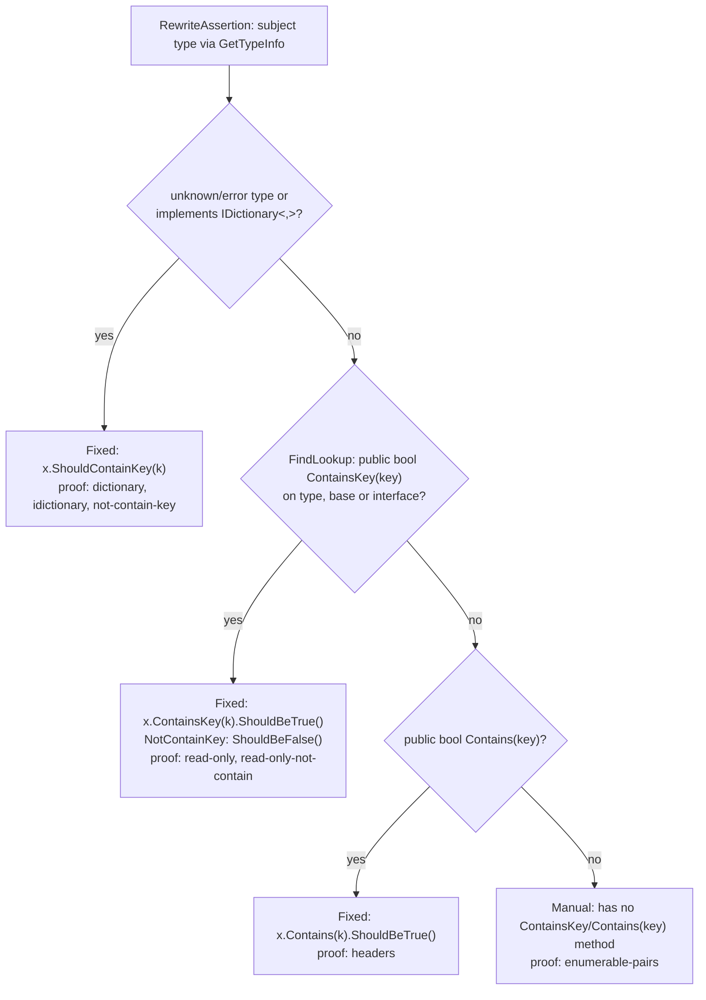

# Models: fa.contain-key

Facts from `src/Unshackle.Core/Fixes/FluentAssertions/Patterns/ContainKeyPattern.cs`.

## Figure 1: classes

**Figure 1.** `ContainKeyPattern`, its contract and the helpers; on the right the FluentAssertions methods it recognises and the Shouldly methods it creates.

<!-- kingmadoc:diagram img/fa-contain-key-modellen-1.d2 -->

| Element | Role |
| ------- | ---- |
| `FluentAssertionPattern` | Template Method: `Rewrite` does scope, shape, result and arguments and calls the pattern's hooks |
| `ContainKeyPattern` | Finds the eight dictionary methods (`Find`), refuses plurals and values in `RewriteBeforeArguments` and builds `ShouldContainKey`/`ShouldNotContainKey` (`RewriteAssertion`) |
| `FluentAssertionsSyntax` | Shared steps: subject, discarded result, `because` arguments |
| `PatternResult` | `Fixed` with the new call, or `Manual(reason)` |
| FA and Shouldly methods | Only the single-key assertions have a Shouldly form |

## Figure 2: sequence

**Figure 2.** One document: `Find` collects the calls, `FluentAssertionPattern.Rewrite` and the hooks of `ContainKeyPattern` decide per call between `Fixed` and `Manual`.

<!-- kingmadoc:diagram img/fa-contain-key-modellen-2.d2 -->

| Step | Method in the code | What happens |
| ---- | ------------------ | ------------ |
| Find | `Find` | `FindInvocations` with the eight names |
| Scope | `IsInsideAssertionScope` | In a non-converted `AssertionScope` gives Manual |
| Subject | `GetSubject` | Must be `x.Should()`, otherwise Manual |
| Result | `IsResultDiscarded` | A used result (`.And`, `.WhoseValue`) gives Manual |
| Plurals/values | `ContainKeyPattern.RewriteBeforeArguments` | `…Keys`, `…Value(s)` give Manual before the argument split (which would see `params` as becauseArgs) |
| Arguments | `TryGetArguments` | Key and `because`; becauseArgs with a constant `because` become `string.Format(...)`, otherwise Manual |
| Build | `ContainKeyPattern.RewriteAssertion` | `NotNull(subject)` + `Should[Not]ContainKey(k[, because])` |

## Figure 3: decision tree

**Figure 3.** Every question in `FluentAssertionPattern.Rewrite`, `RewriteBeforeArguments` and `RewriteAssertion`, in the order of the code; the leaves are the Shouldly form or the Manual reason.

<!-- kingmadoc:diagram img/fa-contain-key-modellen-3.d2 -->

| Leaf | Condition | Proof (`Proofs/FluentAssertions/ContainKey/`) |
| ---- | --------- | --------------------------------------------- |
| Fixed | standalone `ContainKey`, `Dictionary` / `IReadOnlyDictionary` / `IDictionary` | `dictionary`, `read-only`, `idictionary`, `edge-nested-generic` |
| Fixed | `NotContainKey` | `not-contain-key` |
| Fixed | with `because` (also becauseArgs, TAAK-097), in a lambda | `because`, `because-args`, `lambda` |
| Fixed | nullable subject: `x.ShouldNotBeNull().ShouldContainKey(k)` | `nullable` |
| Manual "is not in the form" | after `.And` | `and-chain` |
| Manual "several keys" | `ContainKeys`, `NotContainKeys` | `keys`, `not-contain-keys` |
| Manual "has no Shouldly equivalent" | `ContainValue(s)`, `NotContainValue` | `contain-value`, `contain-values`, `not-contain-value` |
| Manual "is used" | `.And`, `.WhoseValue` | `chain`, `which` |
| Manual "named arguments, or becauseArgs whose because is no constant format string" | named arguments or a non-constant `because` | no proof |
| Manual "Inside an AssertionScope" | a scope that `fa.assertion-scope` does not convert | `AssertionScope/` |

## Figure 4: extension TAAK-168 (type-dependent form)

**Figure 4.** Since TAAK-168 `RewriteAssertion` looks at the subject type: Shouldly's `ShouldContainKey` only exists for `IDictionary<,>`.

| Element | Role |
| ------- | ---- |
| `IsGenericDictionary` | Looks for `System.Collections.Generic.IDictionary<TKey, TValue>` in the type and its interfaces |
| `FindLookup` | Looks for `ContainsKey`, then `Contains` (one parameter, bool, public, non-generic) whose parameter implicitly accepts the key |
| `NotNullReceiver` | Puts `ShouldNotBeNull()` around a possibly-null subject, as with the other receivers |

## See also

- [fa-contain-key-plan.md](fa-contain-key-plan.md)
- [fa-contain-key-verify.md](fa-contain-key-verify.md)
- `src/Unshackle.Core/Fixes/FluentAssertions/Patterns/ContainKeyPattern.cs`
- `src/Unshackle.Tests/Proofs/FluentAssertions/ContainKey/`
