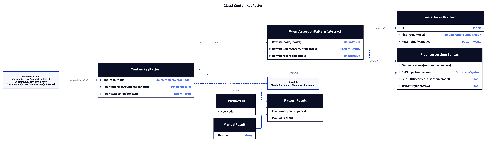
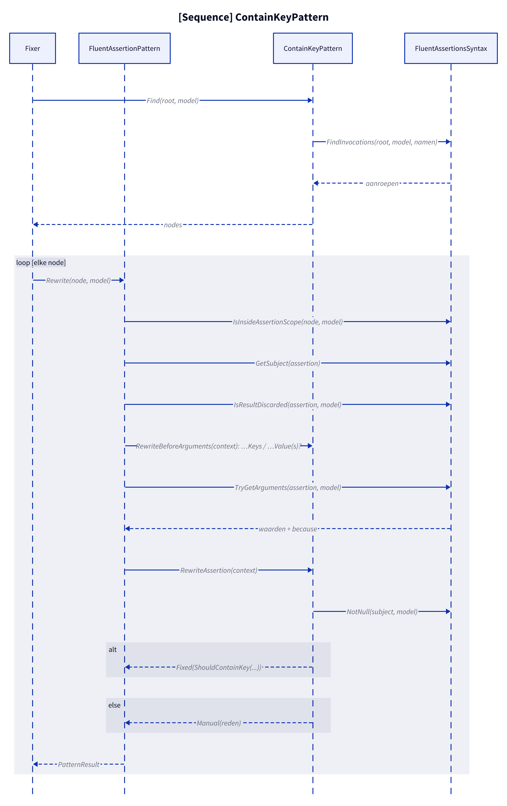
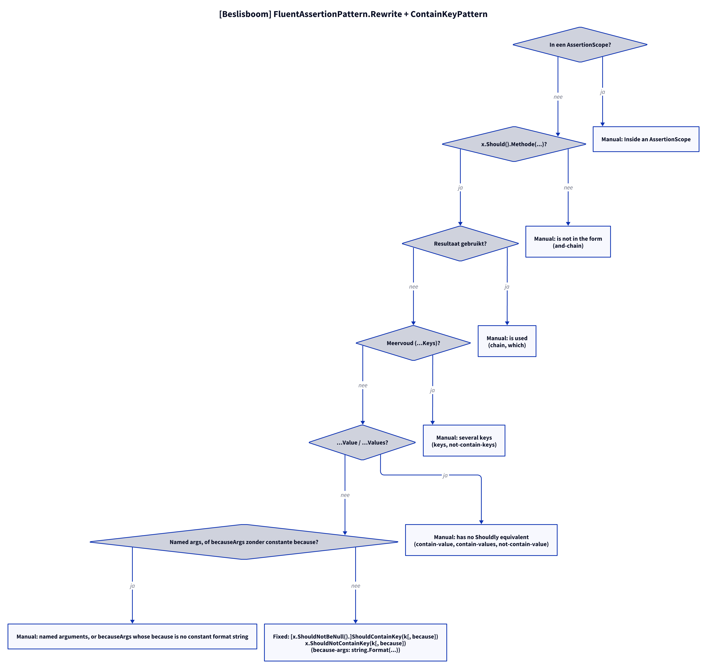

# Modellen: fa.contain-key

Feiten uit `src/Unshackle.Core/Fixes/FluentAssertions/Patterns/ContainKeyPattern.cs`.

## Figuur 1: klassen

**Figure 1.** `ContainKeyPattern`, zijn contract en de helpers; rechts de FluentAssertions-methoden die hij herkent en de Shouldly-methoden die hij maakt.

<!-- kingmadoc:diagram img/fa-contain-key-modellen-1.d2 -->

| Element | Rol |
| ------- | --- |
| `FluentAssertionPattern` | Template Method: `Rewrite` doet scope, vorm, resultaat en argumenten en roept de hooks van het patroon aan |
| `ContainKeyPattern` | Vindt de acht dictionary-methoden (`Find`), weigert meervoud en waarden in `RewriteBeforeArguments` en bouwt `ShouldContainKey`/`ShouldNotContainKey` (`RewriteAssertion`) |
| `FluentAssertionsSyntax` | Gedeelde stappen: onderwerp, weggegooid resultaat, `because`-argumenten |
| `PatternResult` | `Fixed` met de nieuwe aanroep, of `Manual(reden)` |
| FA- en Shouldly-methoden | Alleen de enkelvoudige sleutel-assertions hebben een Shouldly-vorm |

## Figuur 2: sequence

**Figure 2.** Eén document: `Find` verzamelt de aanroepen, `FluentAssertionPattern.Rewrite` en de hooks van `ContainKeyPattern` beslissen per aanroep tussen `Fixed` en `Manual`.

<!-- kingmadoc:diagram img/fa-contain-key-modellen-2.d2 -->

| Stap | Methode in de code | Wat gebeurt er |
| ---- | ------------------ | -------------- |
| Vinden | `Find` | `FindInvocations` met de acht namen |
| Scope | `IsInsideAssertionScope` | In een niet-omgezette `AssertionScope` geeft Manual |
| Subject | `GetSubject` | Moet `x.Should()` zijn, anders Manual |
| Resultaat | `IsResultDiscarded` | Gebruikt resultaat (`.And`, `.WhoseValue`) geeft Manual |
| Meervoud/waarden | `ContainKeyPattern.RewriteBeforeArguments` | `…Keys`, `…Value(s)` geven Manual vóór de argumentsplitsing (die `params` als becauseArgs zou zien) |
| Argumenten | `TryGetArguments` | Sleutel en `because`; becauseArgs met constante `because` worden `string.Format(...)`, anders Manual |
| Bouwen | `ContainKeyPattern.RewriteAssertion` | `NotNull(subject)` + `Should[Not]ContainKey(k[, because])` |

## Figuur 3: beslisboom

**Figure 3.** Elke vraag in `FluentAssertionPattern.Rewrite`, `RewriteBeforeArguments` en `RewriteAssertion`, in de volgorde van de code; de bladeren zijn de Shouldly-vorm of de Manual-reden.

<!-- kingmadoc:diagram img/fa-contain-key-modellen-3.d2 -->

| Blad | Voorwaarde | Proof (`Proofs/FluentAssertions/ContainKey/`) |
| ---- | ---------- | --------------------------------------------- |
| Fixed | losse `ContainKey`, `Dictionary` / `IReadOnlyDictionary` / `IDictionary` | `dictionary`, `read-only`, `idictionary`, `edge-nested-generic` |
| Fixed | `NotContainKey` | `not-contain-key` |
| Fixed | met `because` (ook becauseArgs, TAAK-097), in lambda | `because`, `because-args`, `lambda` |
| Fixed | nullable subject: `x.ShouldNotBeNull().ShouldContainKey(k)` | `nullable` |
| Manual "is not in the form" | na `.And` | `and-chain` |
| Manual "several keys" | `ContainKeys`, `NotContainKeys` | `keys`, `not-contain-keys` |
| Manual "has no Shouldly equivalent" | `ContainValue(s)`, `NotContainValue` | `contain-value`, `contain-values`, `not-contain-value` |
| Manual "is used" | `.And`, `.WhoseValue` | `chain`, `which` |
| Manual "named arguments, or becauseArgs whose because is no constant format string" | benoemde argumenten of niet-constante `because` | geen proof |
| Manual "Inside an AssertionScope" | scope die `fa.assertion-scope` niet omzet | `AssertionScope/` |

## Zie ook

- [fa-contain-key-plan.md](fa-contain-key-plan.md)
- [fa-contain-key-verify.md](fa-contain-key-verify.md)
- `src/Unshackle.Core/Fixes/FluentAssertions/Patterns/ContainKeyPattern.cs`
- `src/Unshackle.Tests/Proofs/FluentAssertions/ContainKey/`
