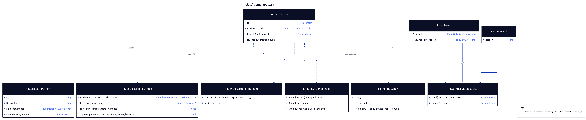
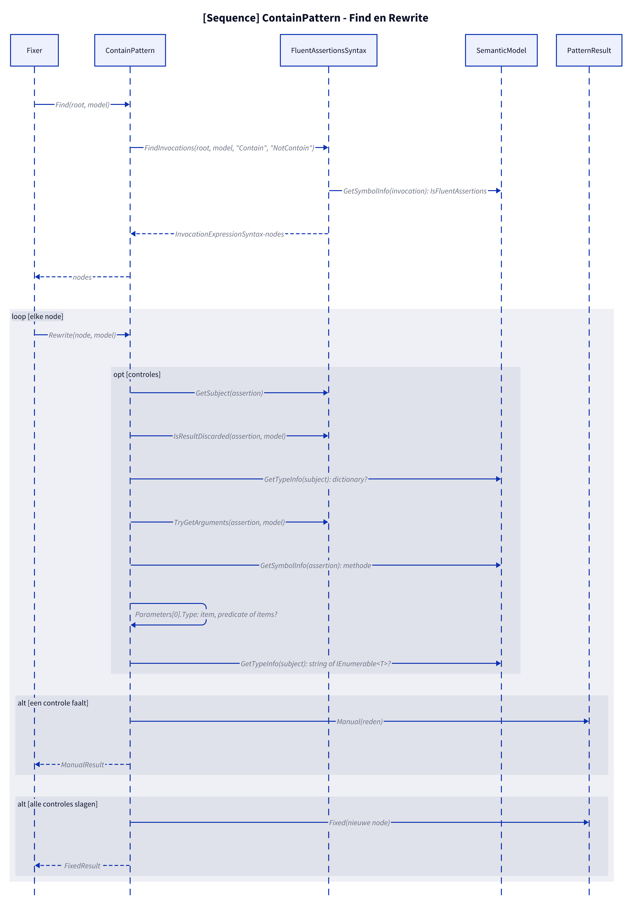
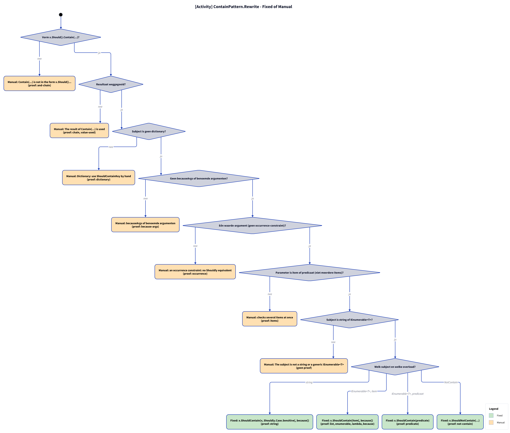

# Modellen: fa.contain

x.Should().Contain(item) naar x.ShouldContain(item). Feiten uit `src/Unshackle.Core/Fixes/FluentAssertions/Patterns/ContainPattern.cs`.

**Figure 1.** Klassen rond `ContainPattern`: wat hij implementeert, gebruikt en aanmaakt. Weggelaten: `Fixer`, `IFix` en de usings-afhandeling (zie [../modellen/klassen.md](../modellen/klassen.md)).

<!-- kingmadoc:diagram img/fa-contain-modellen-1.d2 -->

| Element | Pad | Rol |
| --- | --- | --- |
| `IPattern` | `src/Unshackle.Core/Abstractions/IPattern.cs` | Contract: `Find` en `Rewrite` |
| `ContainPattern` | `src/Unshackle.Core/Fixes/FluentAssertions/Patterns/ContainPattern.cs` | Dit patroon, Id `fa.contain`; privé: `IsGenericEnumerable(type)` |
| `FluentAssertionsSyntax` | `src/Unshackle.Core/Fixes/FluentAssertions/FluentAssertionsSyntax.cs` | Gedeelde bouwstenen: `FindInvocations`, `GetSubject`, `IsResultDiscarded`, `TryGetArguments` |
| `PatternResult`, `FixedResult`, `ManualResult` | `src/Unshackle.Core/Models/` | Uitkomst: `Fixed` met nieuwe node(s) en namespaces, of `Manual` met reden |
| «FluentAssertions» herkend | - | `Contain(T item | Expression predicate | string)`; `NotContain(...)` |
| «Shouldly» aangemaakt | - | `ShouldContain(item | predicate)`; `ShouldNotContain(...)`; `ShouldContain(text, Case.Sensitive)` |
| Herkende typen | - | `string`; `IEnumerable<T>`; `IDictionary / IReadOnlyDictionary (Manual)` |

**Figure 2.** `Fixer` roept `Find` en per node `Rewrite` aan; `Rewrite` doet de controles via `FluentAssertionsSyntax` en `SemanticModel` en levert `Fixed` of `Manual`. Weggelaten: het vervangen van de node en de usings door de `Fixer`.

<!-- kingmadoc:diagram img/fa-contain-modellen-2.d2 -->

| Stap | Plek | Wat gebeurt er |
| --- | --- | --- |
| Find | `ContainPattern.Find` | `FluentAssertionsSyntax.FindInvocations` zoekt aanroepen `Contain`, `NotContain` waarvan het symbool in een FluentAssertions-namespace ligt |
| Controles | `ContainPattern.Rewrite` | `GetSubject(assertion)`; `IsResultDiscarded(assertion, model)`; `GetTypeInfo(subject)`; `TryGetArguments(assertion, model)`; `GetSymbolInfo(assertion)`; `Parameters[0].Type`; `GetTypeInfo(subject)` |
| Manual | `PatternResult.Manual` | Eerste mislukte controle geeft `ManualResult` met reden (zie figuur 3) |
| Fixed | `PatternResult.Fixed` | Nieuwe node; trivia en usings regelt de `Fixer` |

**Figure 3.** Beslisboom van `Rewrite`: 7 vragen in de volgorde van de code, elk blad noemt de proof in `src/Unshackle.Tests/Proofs/FluentAssertions/Contain/` die het bewijst (`<naam>.before.cs` met `.after.cs` of `.manual.txt`).

<!-- kingmadoc:diagram img/fa-contain-modellen-3.d2 -->

| Vraag of selector | Bij nee: Manual-reden | Proof |
| --- | --- | --- |
| Vorm x.Should().Contain(...)? | Contain(...) is not in the form x.Should()... | `and-chain` |
| Resultaat weggegooid? | The result of Contain(...) is used | `chain`, `value-used` |
| Subject is geen dictionary? | Dictionary: use ShouldContainKey by hand | `dictionary` |
| Geen becauseArgs of benoemde argumenten? | becauseArgs of benoemde argumenten | `because-args` |
| Eén waarde-argument (geen occurrence-constraint)? | an occurrence constraint: no Shouldly equivalent | `occurrence` |
| Parameter is item of predicaat (niet meerdere items)? | checks several items at once | `items` |
| Subject is string of IEnumerable<T>? | The subject is not a string or a generic IEnumerable<T> | geen proof, bewaakt in code |

| Voorwaarde | Fixed-vorm | Proofs |
| --- | --- | --- |
| string | `x.ShouldContain(v, Shouldly.Case.Sensitive[, because])` | `string` |
| IEnumerable<T>, item | `x.ShouldContain(item[, because])` | `list`, `enumerable`, `lambda`, `because` |
| IEnumerable<T>, predicaat | `x.ShouldContain(predicate)` | `predicate` |
| NotContain | `x.ShouldNotContain(...)` | `not-contain` |

## Zie ook

- [fa-contain-plan.md](fa-contain-plan.md) - plan
- [fa-contain-verify.md](fa-contain-verify.md) - verificatie
- `src/Unshackle.Core/Fixes/FluentAssertions/Patterns/ContainPattern.cs` - het patroon
- `src/Unshackle.Tests/Proofs/FluentAssertions/Contain/` - de proofs
- [../modellen/pattern-beslissing.md](../modellen/pattern-beslissing.md) - generieke beslissing van een pattern
- [../README.md](../README.md)
