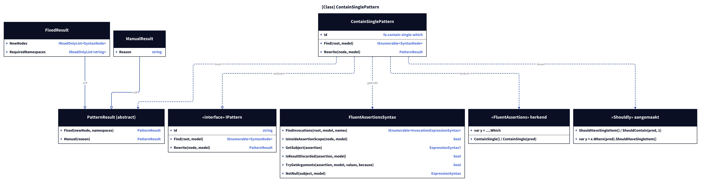
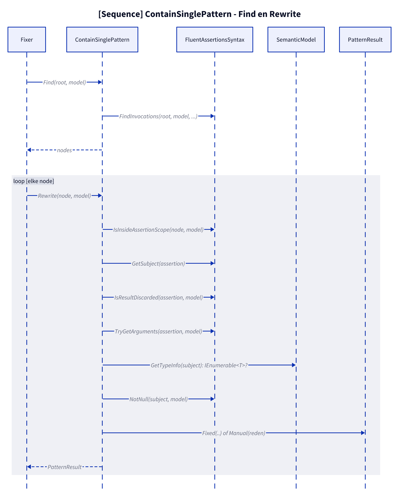
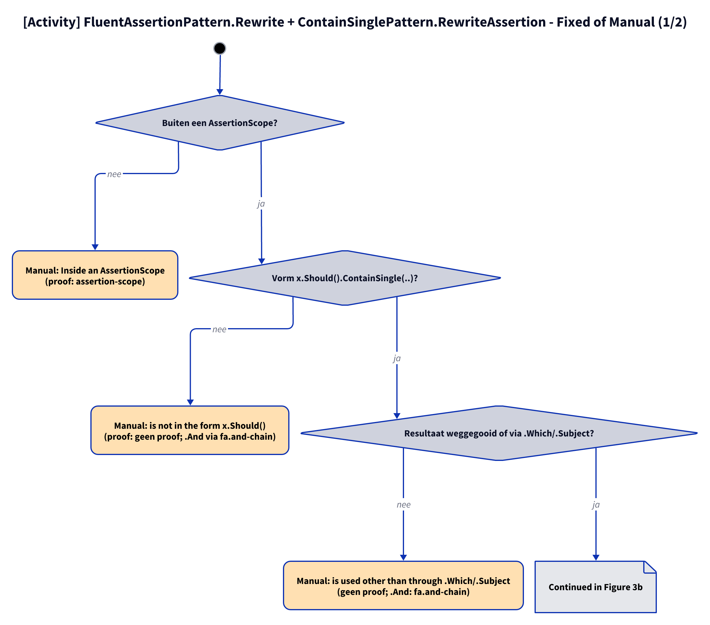
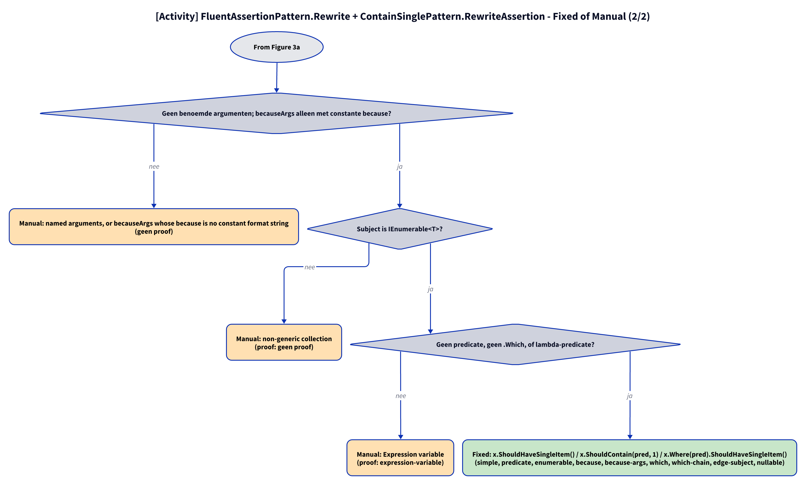

# Models: fa.contain-single-which

`x.Should().ContainSingle()` becomes `x.ShouldHaveSingleItem()`, `ContainSingle(pred)` becomes `x.ShouldContain(pred, 1)` and `var y = ….ContainSingle(pred).Which` becomes `var y = x.Where(pred).ShouldHaveSingleItem()`. Facts from `src/Unshackle.Core/Fixes/FluentAssertions/Patterns/ContainSinglePattern.cs`.

**Figure 1.** Classes around `ContainSinglePattern`. Left out: `Fixer`, `IFix` and the usings (see [../modellen/klassen.md](../modellen/klassen.md)).

<!-- kingmadoc:diagram img/fa-contain-single-which-modellen-1.d2 -->

| Element | Path | Role |
| --- | --- | --- |
| `IPattern` | `src/Unshackle.Core/Abstractions/IPattern.cs` | Contract |
| `FluentAssertionPattern` | `src/Unshackle.Core/Fixes/FluentAssertions/FluentAssertionPattern.cs` | Template Method: `Rewrite` does scope, shape, result and arguments and calls `RewriteAssertion` |
| `ContainSinglePattern` | `src/Unshackle.Core/Fixes/FluentAssertions/Patterns/ContainSinglePattern.cs` | This pattern, Id `fa.contain-single-which` |
| `FluentAssertionsSyntax` | `src/Unshackle.Core/Fixes/FluentAssertions/FluentAssertionsSyntax.cs` | Shared checks |
| `PatternResult`, `FixedResult`, `ManualResult` | `src/Unshackle.Core/Models/` | Outcome |

**Figure 2.** Sequence of `Find` and `Rewrite`.

<!-- kingmadoc:diagram img/fa-contain-single-which-modellen-2.d2 -->

| Step | Place | What happens |
| --- | --- | --- |
| Find | `ContainSinglePattern.Find` | `FindInvocations` on `ContainSingle`, via `WithWhich` the `.Which`/`.Subject` node if it follows |
| Checks | `FluentAssertionPattern.Rewrite` | scope, shape, use of the result (`IsResultDiscardedOrWhich`), arguments |
| Rewrite | `ContainSinglePattern.RewriteAssertion` | type `IEnumerable<T>`, `NotNull(subject)`, predicate and `.Which` |
| Outcome | `PatternResult.Fixed` / `Manual` | Shouldly call or reason |

**Figure 3a.** Decision tree of `FluentAssertionPattern.Rewrite` and `ContainSinglePattern.RewriteAssertion`; proofs in `src/Unshackle.Tests/Proofs/FluentAssertions/ContainSingle/`. Split into Figures 3a–3b (at most 12 arrows each).

<!-- kingmadoc:diagram img/fa-contain-single-which-modellen-3.d2 -->

**Figure 3b.** Continuation of Figure 3a from its "Continued in Figure 3b" node.

<!-- kingmadoc:diagram img/fa-contain-single-which-modellen-4.d2 -->

| Question | If no: Manual reason | Proof |
| --- | --- | --- |
| Outside an AssertionScope? | Inside an AssertionScope | `assertion-scope` |
| Shape x.Should().ContainSingle(..)? | is not in the form x.Should() | `no proof; .And via fa.and-chain` |
| Result discarded or via `.Which`/`.Subject`? | is used other than through .Which/.Subject | no proof (`which-chain` is Fixed, TAAK-096) |
| No named arguments; becauseArgs only with a constant `because`? | named arguments, or becauseArgs whose because is no constant format string | no proof (`because-args` is Fixed, TAAK-097) |
| Subject is IEnumerable<T>? | non-generic collection | `no proof` |
| No predicate, no .Which, or a lambda predicate? | Expression variable | `expression-variable` |
| Fixed | `x.ShouldHaveSingleItem() / x.ShouldContain(pred, 1) / x.Where(pred).ShouldHaveSingleItem()` | simple, predicate, enumerable, because, because-args, which, which-chain (`x.ShouldHaveSingleItem().Price`), edge-subject, nullable |

## See also

- [fa-contain-single-which-plan.md](fa-contain-single-which-plan.md) - plan
- [fa-contain-single-which-verify.md](fa-contain-single-which-verify.md) - verification
- `src/Unshackle.Core/Fixes/FluentAssertions/Patterns/ContainSinglePattern.cs` - the pattern
- `src/Unshackle.Tests/Proofs/FluentAssertions/ContainSingle/` - the proofs
- [../README.md](../README.md)
