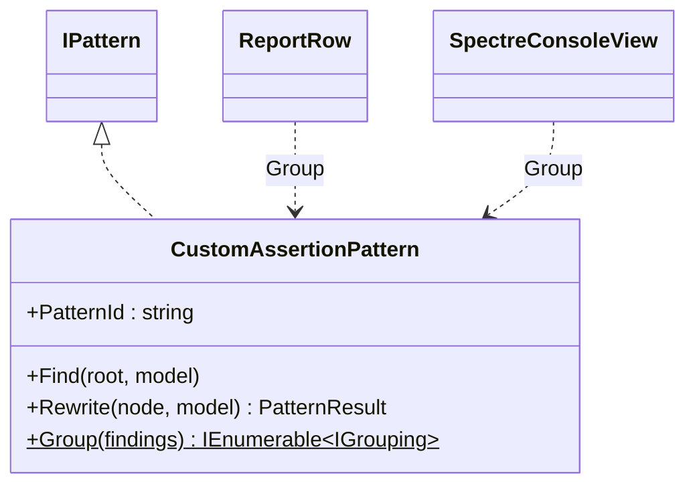
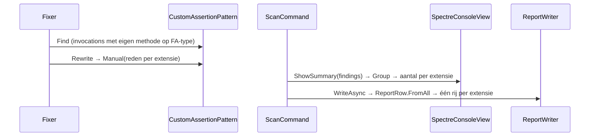
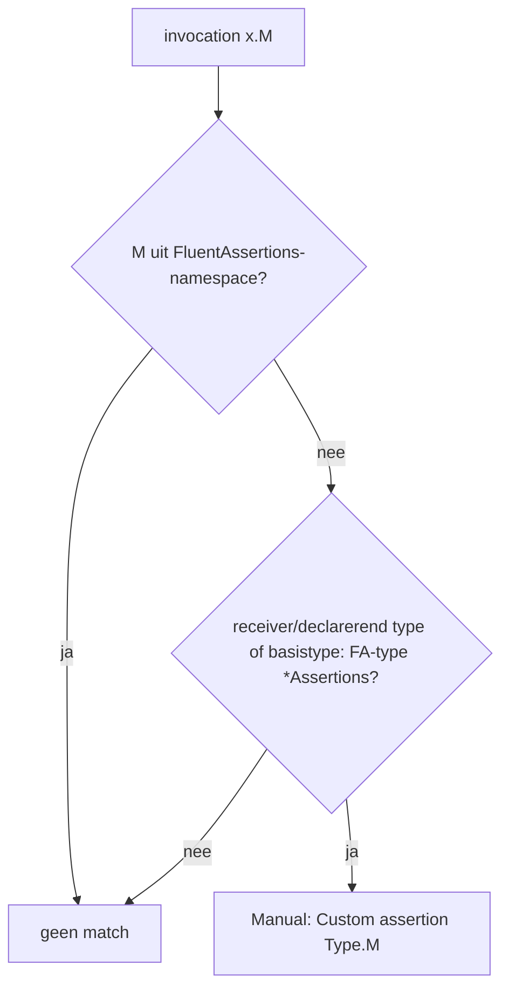

# Modellen: fa.custom-assertion

Feiten uit `src/Unshackle.Core/Fixes/FluentAssertions/Patterns/CustomAssertionPattern.cs`, `ReportRow.FromAll` en `SpectreConsoleView.ShowSummary`.

## Figuur 1: klassen

## Figuur 2: sequence

## Figuur 3: beslisboom

