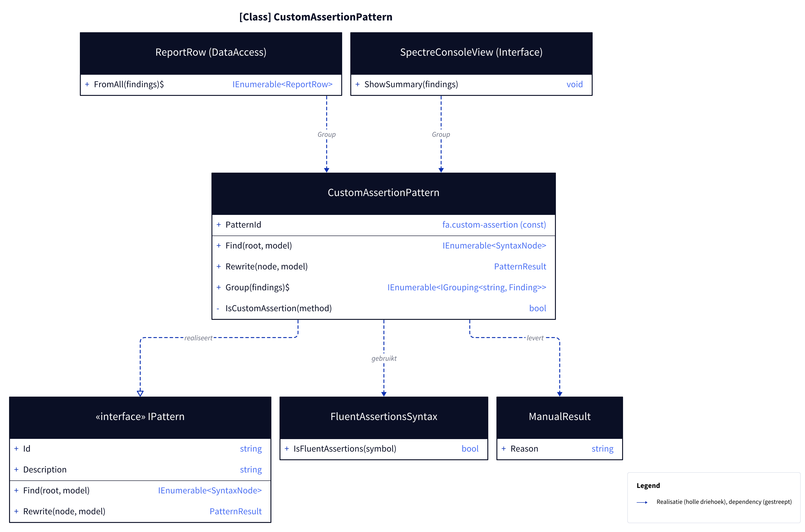
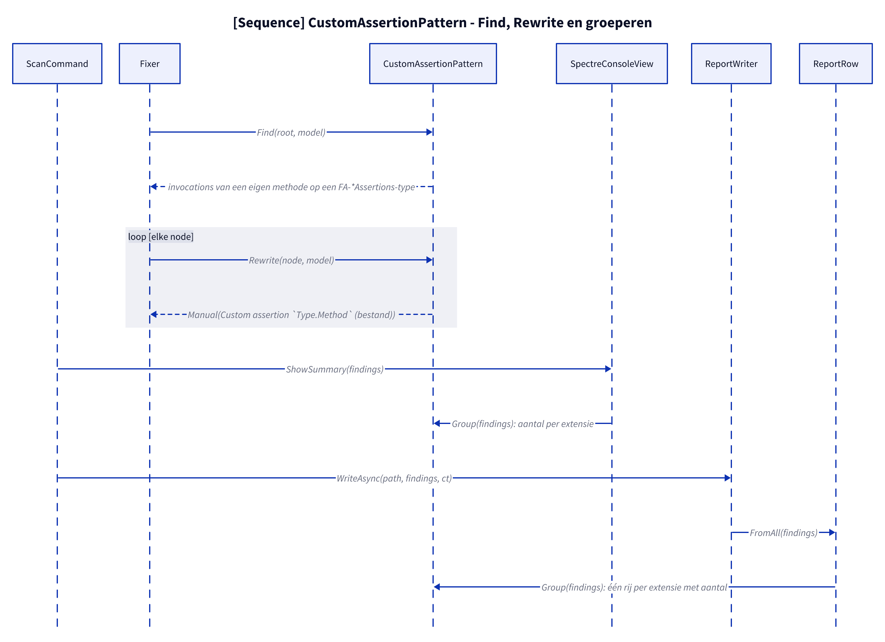
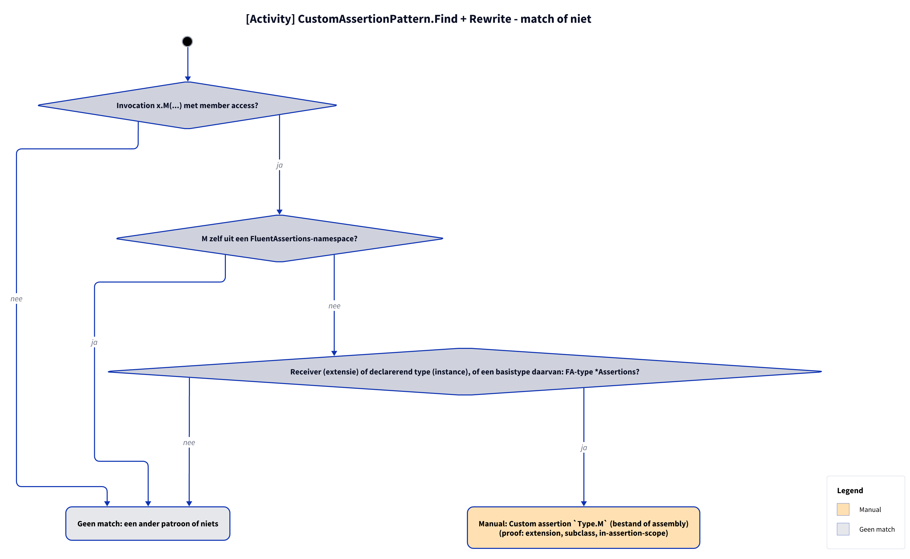

# Models: fa.custom-assertion

Own assertions on a FluentAssertions type (`result.Should().BeFailure()`) become Manual, grouped per extension. Facts from `src/Unshackle.Core/Fixes/FluentAssertions/Patterns/CustomAssertionPattern.cs`, `ReportRow.FromAll` and `SpectreConsoleView.ShowSummary`.

**Figure 1.** Classes around `CustomAssertionPattern`: it implements `IPattern` directly (not `FluentAssertionPattern`), only returns `ManualResult`, and report and console group via `Group`. Left out: `Fixer`, `IFix` and the report writers (see [../modellen/klassen.md](../modellen/klassen.md)).

<!-- kingmadoc:diagram img/fa-custom-assertion-modellen-1.d2 -->

| Element                  | Path                                                                           | Role                                                                                |
| ------------------------ | ------------------------------------------------------------------------------ | ----------------------------------------------------------------------------------- |
| `IPattern`               | `src/Unshackle.Core/Abstractions/IPattern.cs`                                  | Contract: `Find` and `Rewrite`                                                       |
| `CustomAssertionPattern` | `src/Unshackle.Core/Fixes/FluentAssertions/Patterns/CustomAssertionPattern.cs` | This pattern, Id `fa.custom-assertion`; `Group` bundles the Manual findings per reason |
| `FluentAssertionsSyntax` | `src/Unshackle.Core/Fixes/FluentAssertions/FluentAssertionsSyntax.cs`          | `IsFluentAssertions(symbol)`                                                        |
| `ReportRow`              | `src/Unshackle.DataAccess/Reports/ReportRow.cs`                                | `FromAll`: one row per extension with a count                                       |
| `SpectreConsoleView`     | `src/Unshackle.Interface/Output/SpectreConsoleView.cs`                         | `ShowSummary`: count and reason per extension                                       |

**Figure 2.** `Fixer` calls `Find` and `Rewrite` per node, which always returns `Manual`; then console and report group the findings via `Group`. Left out: collecting the findings by the `Fixer`.

<!-- kingmadoc:diagram img/fa-custom-assertion-modellen-2.d2 -->

| Step    | Place                            | What happens                                                                                               |
| ------- | -------------------------------- | ---------------------------------------------------------------------------------------------------------- |
| Find    | `CustomAssertionPattern.Find`    | Invocations with member access for which `IsCustomAssertion` holds                                         |
| Rewrite | `CustomAssertionPattern.Rewrite` | Manual "Custom assertion `Type.M` (file): ..."; the reason is the same for every call of one method       |
| Console | `SpectreConsoleView.ShowSummary` | `Group(findings)`, descending by count, one advice header                                                  |
| Report  | `ReportRow.FromAll`              | `Group(all)`: one row (at the first call) with a count; other calls drop out                               |

**Figure 3.** Decision tree of `Find` (`IsCustomAssertion`) and `Rewrite`; proofs in `src/Unshackle.Tests/Proofs/FluentAssertions/CustomAssertion/` (`<name>.before.cs` with `.manual.txt`).

<!-- kingmadoc:diagram img/fa-custom-assertion-modellen-3.d2 -->

| Question                                                              | If no                                            | Proof                 |
| --------------------------------------------------------------------- | ------------------------------------------------ | --------------------- |
| Invocation with member access?                                        | no match                                         | -                     |
| M not itself from FluentAssertions?                                   | no match (the other patterns handle FA methods)  | all other FA proofs   |
| Receiver or declaring type (or base type) is an FA type `*Assertions`? | no match                                        | -                     |

| Condition                                                                         | Outcome                                               | Proofs               |
| --------------------------------------------------------------------------------- | ----------------------------------------------------- | -------------------- |
| Extension method on an FA assertions type                                         | Manual: Custom assertion `ResultAssertions.BeFailure` | `extension`          |
| Instance method of a subclass                                                     | Manual: Custom assertion `OrderAssertions.BeShipped`  | `subclass`           |
| In an `AssertionScope` (the scope is not converted: the call is not an FA method) | Manual with the same custom reason                    | `in-assertion-scope` |

## Conversion path (TAAK-275)

Figures 1-3 show the Manual path. Since TAAK-275 the pattern is an `ISolutionFinder`/`ISolutionPattern` and converts plain `ReferenceTypeAssertions` classes; the diagrams are not redrawn yet.

| Element | Path | Role |
| --- | --- | --- |
| `CustomAssertionPlans` | `src/Unshackle.Core/Fixes/FluentAssertions/CustomAssertionPlans.cs` | One decision per class per solution snapshot: shape, every mention (SymbolFinder), every `Should()` use, Shouldly name clash, inactive `#if` code, at least one call |
| `CustomAssertionAnalyzer` | `src/Unshackle.Core/Fixes/FluentAssertions/CustomAssertionAnalyzer.cs` | Shape check and the extension class text (`CustomAssertionShape`) |
| `CustomAssertionChain` | `src/Unshackle.Core/Fixes/FluentAssertions/CustomAssertionChain.cs` | `x.Should().A().And.B()` as subject and links |

| Found node | Rewrite when the plan converts | Otherwise |
| --- | --- | --- |
| The assertions class | static class of `ShouldFoo` extensions (`using Shouldly`) | not found |
| Its `Should()` extension (or holder class with only that member) | removed | not found |
| A call `x.Should().Foo(...)` | `x.ShouldFoo(values, because)` | Manual "Custom assertion `C.Foo` (file): no automatic Shouldly form because ..." |
| An `.And` chain statement | one statement per link; x hoisted when not safe to evaluate twice | same Manual |

## See also

- [fa-custom-assertion-plan.md](fa-custom-assertion-plan.md) - plan
- [fa-custom-assertion-verify.md](fa-custom-assertion-verify.md) - verification
- `src/Unshackle.Core/Fixes/FluentAssertions/Patterns/CustomAssertionPattern.cs` - the pattern
- `src/Unshackle.Tests/Proofs/FluentAssertions/CustomAssertion/` - the proofs
- [../README.md](../README.md)
