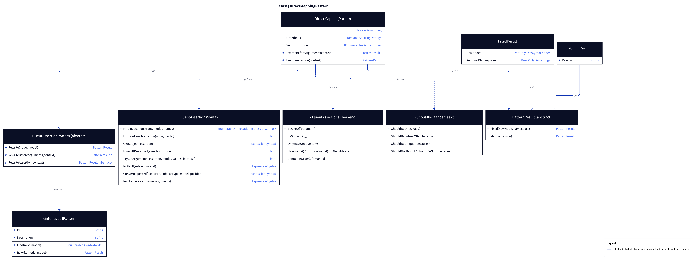
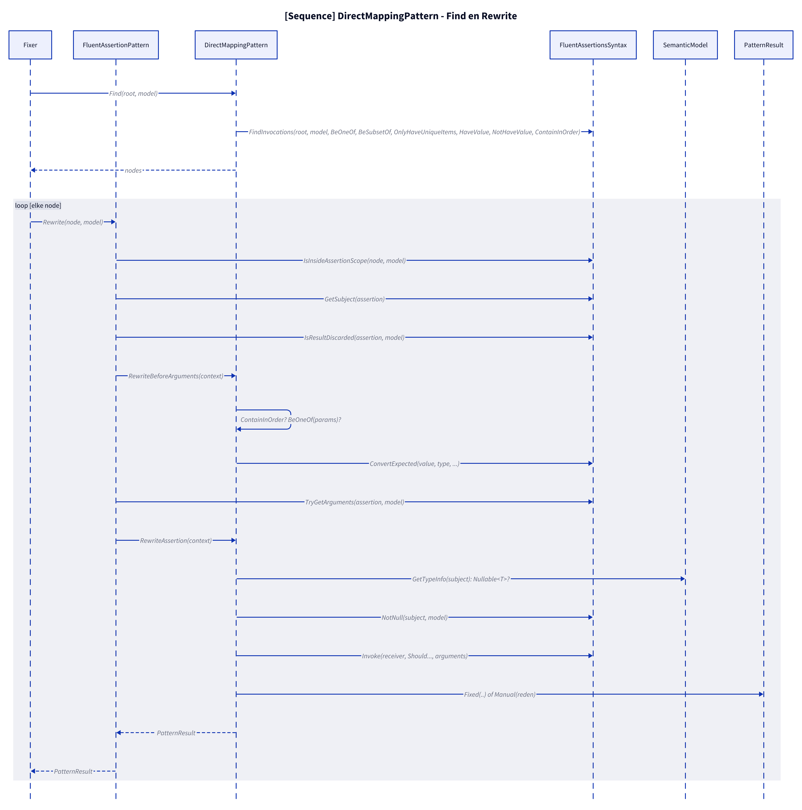
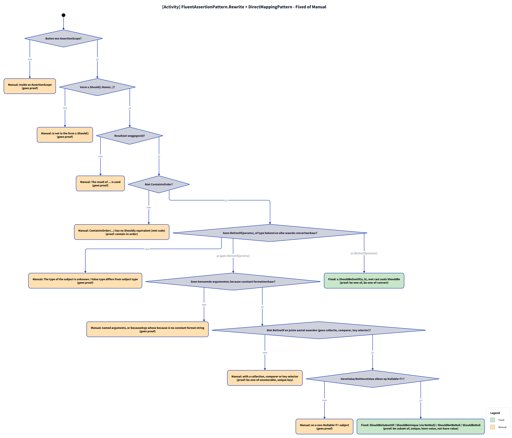

# Modellen: fa.direct-mapping

`BeOneOf` → `ShouldBeOneOf`, `BeSubsetOf` → `ShouldBeSubsetOf`, `OnlyHaveUniqueItems` → `ShouldBeUnique`, `HaveValue`/`NotHaveValue` → `ShouldNotBeNull`/`ShouldBeNull`; `ContainInOrder` → Manual met code. Feiten uit `src/Unshackle.Core/Fixes/FluentAssertions/Patterns/DirectMappingPattern.cs`.

**Figure 1.** Klassen: wat het patroon erft, gebruikt en aanmaakt. Weggelaten: `Fixer`, `IFix` en de usings (zie [../modellen/klassen.md](../modellen/klassen.md)).

<!-- kingmadoc:diagram img/fa-direct-mapping-modellen-1.d2 -->

| Element | Pad | Rol |
| --- | --- | --- |
| `IPattern` | `src/Unshackle.Core/Abstractions/IPattern.cs` | Contract: `Find` en `Rewrite` |
| `FluentAssertionPattern` | `src/Unshackle.Core/Fixes/FluentAssertions/FluentAssertionPattern.cs` | Template Method: `Rewrite` doet scope, vorm, resultaat en because(-args), dan `RewriteAssertion` |
| `DirectMappingPattern` | `src/Unshackle.Core/Fixes/FluentAssertions/Patterns/DirectMappingPattern.cs` | Dit patroon, Id `fa.direct-mapping`; `RewriteBeforeArguments` (ContainInOrder, BeOneOf(params)), `RewriteAssertion`; `s_methods` |
| `FluentAssertionsSyntax` | `src/Unshackle.Core/Fixes/FluentAssertions/FluentAssertionsSyntax.cs` | `FindInvocations`, `IsInsideAssertionScope`, `GetSubject`, `IsResultDiscarded`, `TryGetArguments`, `NotNull`, `ConvertExpected`, `Invoke` |
| `PatternResult`, `FixedResult`, `ManualResult` | `src/Unshackle.Core/Models/` | Uitkomst |
| «FluentAssertions» herkend | - | `BeOneOf(params)`, `BeSubsetOf`, `OnlyHaveUniqueItems`, `HaveValue`/`NotHaveValue` op `Nullable<T>`, `ContainInOrder` (Manual) |
| «Shouldly» aangemaakt | - | `ShouldBeOneOf`, `ShouldBeSubsetOf`, `ShouldBeUnique`, `ShouldNotBeNull`, `ShouldBeNull` |

**Figure 2.** `Fixer` roept `Find` en per node `FluentAssertionPattern.Rewrite` aan; die doet de gedeelde controles en roept de eigen stappen van het patroon aan. Weggelaten: het vervangen van de node door de `Fixer`.

<!-- kingmadoc:diagram img/fa-direct-mapping-modellen-2.d2 -->

| Stap | Plek | Wat gebeurt er |
| --- | --- | --- |
| Find | `DirectMappingPattern.Find` | `FindInvocations` op de zes FA-namen |
| Gedeelde controles | `FluentAssertionPattern.Rewrite` | `IsInsideAssertionScope`, `GetSubject`, `IsResultDiscarded` |
| Vóór de argumentsplitsing | `DirectMappingPattern.RewriteBeforeArguments` | `ContainInOrder` → Manual met code; `BeOneOf(params)` → `ShouldBeOneOf` met `ConvertExpected` |
| Argumenten | `FluentAssertionPattern.Rewrite` | `TryGetArguments` (becauseArgs met constante because → `string.Format(CultureInfo.InvariantCulture, ...)`) |
| Eigen controles | `DirectMappingPattern.RewriteAssertion` | aantal waarden, `Nullable<T>`, `NotNull` bij `BeSubsetOf`/`OnlyHaveUniqueItems` |

**Figure 3.** Beslisboom in de volgorde van de code; proofs in `src/Unshackle.Tests/Proofs/FluentAssertions/DirectMapping/`.

<!-- kingmadoc:diagram img/fa-direct-mapping-modellen-3.d2 -->

| Vraag | Bij nee: Manual-reden | Proof |
| --- | --- | --- |
| Buiten een AssertionScope? | Inside an AssertionScope | geen proof |
| Vorm x.Should().Name(..)? | is not in the form x.Should() | geen proof |
| Resultaat weggegooid? | The result of ... is used | geen proof |
| Niet ContainInOrder? | ContainInOrder(...) has no Shouldly equivalent (met code) | contain-in-order |
| Geen BeOneOf(params), of type bekend en elke waarde converteerbaar? | The type of the subject is unknown / Value type differs from subject type | geen proof |
| Geen benoemde argumenten; because constant formatteerbaar? | named arguments, or becauseArgs whose because is no constant format string | geen proof |
| Niet BeOneOf en juiste aantal waarden (geen collectie, comparer, key selector)? | with a collection, comparer or key selector | be-one-of-enumerable, unique-key |
| HaveValue/NotHaveValue alleen op Nullable<T>? | on a non-Nullable<T> subject | geen proof |

| Voorwaarde | Fixed-vorm | Proofs |
| --- | --- | --- |
| `BeOneOf(params)` | `x.ShouldBeOneOf(a, b)` met cast zoals `ShouldBe` | `be-one-of`, `be-one-of-convert` |
| overige namen | `ShouldBeSubsetOf(y)` / `ShouldBeUnique()` (subject via `NotNull`) / `ShouldNotBeNull()` / `ShouldBeNull()` | `be-subset-of`, `unique`, `have-value`, `not-have-value` |

## Zie ook

- [fa-direct-mapping-plan.md](fa-direct-mapping-plan.md) - plan
- [fa-direct-mapping-verify.md](fa-direct-mapping-verify.md) - verificatie
- `src/Unshackle.Tests/Proofs/FluentAssertions/DirectMapping/` - de proofs
