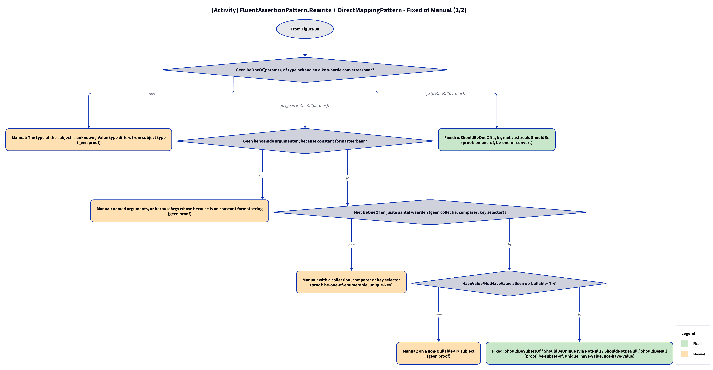

# Models: fa.direct-mapping

`BeOneOf` → `ShouldBeOneOf`, `BeSubsetOf` → `ShouldBeSubsetOf`, `OnlyHaveUniqueItems` → `ShouldBeUnique`, `HaveValue`/`NotHaveValue` → `ShouldNotBeNull`/`ShouldBeNull`; `ContainInOrder` → Manual with code. Facts from `src/Unshackle.Core/Fixes/FluentAssertions/Patterns/DirectMappingPattern.cs`.

**Figure 1.** Classes: what the pattern inherits, uses and creates. Left out: `Fixer`, `IFix` and the usings (see [../modellen/klassen.md](../modellen/klassen.md)).

<!-- kingmadoc:diagram img/fa-direct-mapping-modellen-1.d2 -->

| Element | Path | Role |
| --- | --- | --- |
| `IPattern` | `src/Unshackle.Core/Abstractions/IPattern.cs` | Contract: `Find` and `Rewrite` |
| `FluentAssertionPattern` | `src/Unshackle.Core/Fixes/FluentAssertions/FluentAssertionPattern.cs` | Template Method: `Rewrite` does scope, shape, result and because(-args), then `RewriteAssertion` |
| `DirectMappingPattern` | `src/Unshackle.Core/Fixes/FluentAssertions/Patterns/DirectMappingPattern.cs` | This pattern, Id `fa.direct-mapping`; `RewriteBeforeArguments` (ContainInOrder, BeOneOf(params)), `RewriteAssertion`; `s_methods` |
| `FluentAssertionsSyntax` | `src/Unshackle.Core/Fixes/FluentAssertions/FluentAssertionsSyntax.cs` | `FindInvocations`, `IsInsideAssertionScope`, `GetSubject`, `IsResultDiscarded`, `TryGetArguments`, `NotNull`, `ConvertExpected`, `Invoke` |
| `PatternResult`, `FixedResult`, `ManualResult` | `src/Unshackle.Core/Models/` | Outcome |
| «FluentAssertions» recognised | - | `BeOneOf(params)`, `BeSubsetOf`, `OnlyHaveUniqueItems`, `HaveValue`/`NotHaveValue` on `Nullable<T>`, `ContainInOrder` (Manual) |
| «Shouldly» created | - | `ShouldBeOneOf`, `ShouldBeSubsetOf`, `ShouldBeUnique`, `ShouldNotBeNull`, `ShouldBeNull` |

**Figure 2.** `Fixer` calls `Find` and per node `FluentAssertionPattern.Rewrite`; that does the shared checks and calls the pattern's own steps. Left out: replacing the node by the `Fixer`.

<!-- kingmadoc:diagram img/fa-direct-mapping-modellen-2.d2 -->

| Step | Place | What happens |
| --- | --- | --- |
| Find | `DirectMappingPattern.Find` | `FindInvocations` on the six FA names |
| Shared checks | `FluentAssertionPattern.Rewrite` | `IsInsideAssertionScope`, `GetSubject`, `IsResultDiscarded` |
| Before the argument split | `DirectMappingPattern.RewriteBeforeArguments` | `ContainInOrder` → Manual with code; `BeOneOf(params)` → `ShouldBeOneOf` with `ConvertExpected` |
| Arguments | `FluentAssertionPattern.Rewrite` | `TryGetArguments` (becauseArgs with a constant because → `string.Format(CultureInfo.InvariantCulture, ...)`) |
| Own checks | `DirectMappingPattern.RewriteAssertion` | number of values, `Nullable<T>`, `NotNull` for `BeSubsetOf`/`OnlyHaveUniqueItems` |

**Figure 3a.** Decision tree in the order of the code; proofs in `src/Unshackle.Tests/Proofs/FluentAssertions/DirectMapping/`. Split into Figures 3a–3b (at most 12 arrows each).

<!-- kingmadoc:diagram img/fa-direct-mapping-modellen-3.d2 -->

**Figure 3b.** Continuation of Figure 3a from its "Continued in Figure 3b" node.

<!-- kingmadoc:diagram img/fa-direct-mapping-modellen-4.d2 -->

| Question | If no: Manual reason | Proof |
| --- | --- | --- |
| Outside an AssertionScope? | Inside an AssertionScope | no proof |
| Shape x.Should().Name(..)? | is not in the form x.Should() | no proof |
| Result discarded? | The result of ... is used | no proof |
| Not ContainInOrder? | ContainInOrder(...) has no Shouldly equivalent (with code) | contain-in-order |
| No BeOneOf(params), or type known and every value convertible? | The type of the subject is unknown / Value type differs from subject type | no proof |
| No named arguments; because constant and formattable? | named arguments, or becauseArgs whose because is no constant format string | no proof |
| Not BeOneOf and the right number of values (no collection, comparer, key selector)? | with a collection, comparer or key selector | be-one-of-enumerable, unique-key |
| HaveValue/NotHaveValue only on Nullable<T>? | on a non-Nullable<T> subject | no proof |

| Condition | Fixed form | Proofs |
| --- | --- | --- |
| `BeOneOf(params)` | `x.ShouldBeOneOf(a, b)` with a cast like `ShouldBe` | `be-one-of`, `be-one-of-convert` |
| other names | `ShouldBeSubsetOf(y)` / `ShouldBeUnique()` (subject via `NotNull`) / `ShouldNotBeNull()` / `ShouldBeNull()` | `be-subset-of`, `unique`, `have-value`, `not-have-value` |

## See also

- [fa-direct-mapping-plan.md](fa-direct-mapping-plan.md) - plan
- [fa-direct-mapping-verify.md](fa-direct-mapping-verify.md) - verification
- `src/Unshackle.Tests/Proofs/FluentAssertions/DirectMapping/` - the proofs
