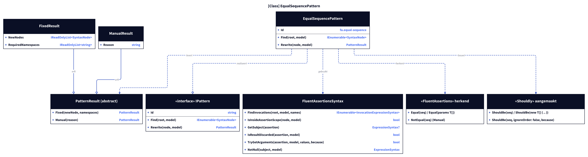
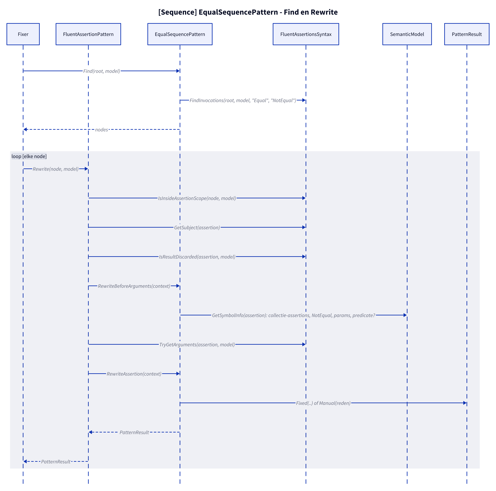
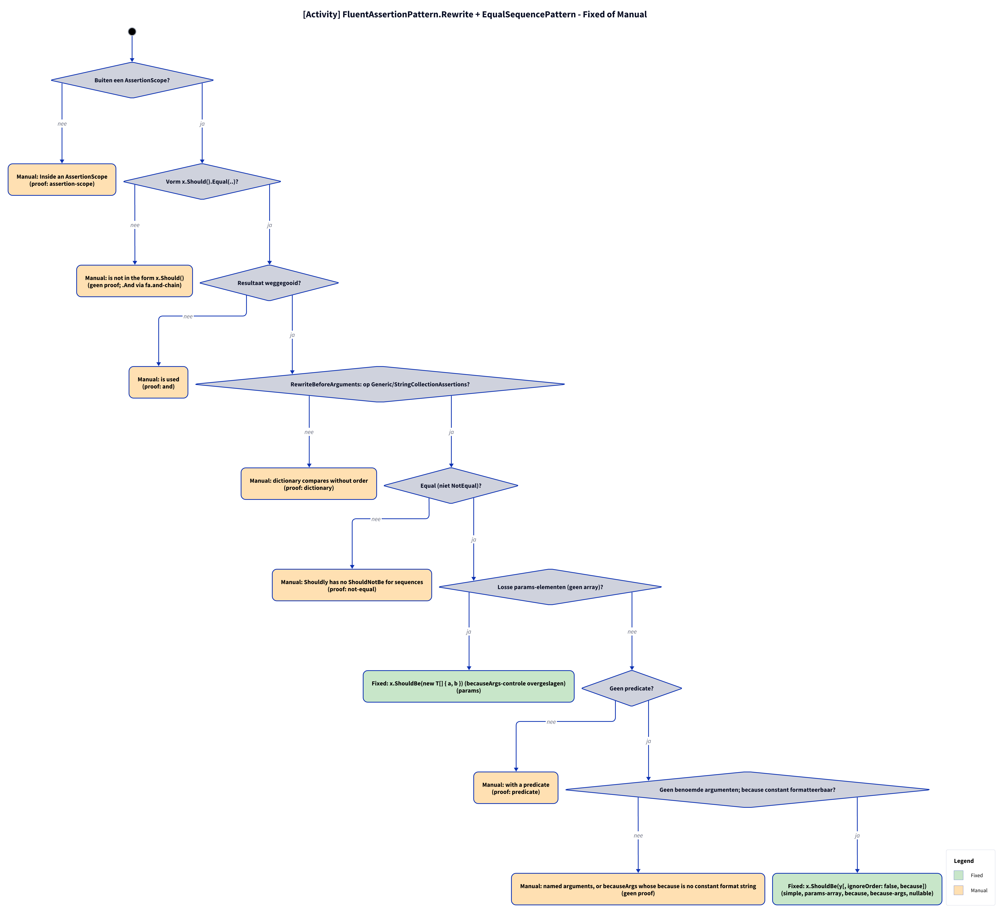

# Models: fa.equal-sequence

`x.Should().Equal(y)` becomes `x.ShouldBe(y)`; `Equal(1, 2)` becomes `x.ShouldBe(new T[] { 1, 2 })`; with `because` `x.ShouldBe(y, ignoreOrder: false, because)`. Facts from `src/Unshackle.Core/Fixes/FluentAssertions/Patterns/EqualSequencePattern.cs`.

**Figure 1.** Classes around `EqualSequencePattern`. Left out: `Fixer`, `IFix` and the usings (see [../modellen/klassen.md](../modellen/klassen.md)).

<!-- kingmadoc:diagram img/fa-equal-sequence-modellen-1.d2 -->

| Element | Path | Role |
| --- | --- | --- |
| `IPattern` | `src/Unshackle.Core/Abstractions/IPattern.cs` | Contract |
| `FluentAssertionPattern` | `src/Unshackle.Core/Fixes/FluentAssertions/FluentAssertionPattern.cs` | Template Method: `Rewrite` does scope, shape, result and because(-args), then `RewriteAssertion` |
| `EqualSequencePattern` | `src/Unshackle.Core/Fixes/FluentAssertions/Patterns/EqualSequencePattern.cs` | This pattern, Id `fa.equal-sequence` |
| `FluentAssertionsSyntax` | `src/Unshackle.Core/Fixes/FluentAssertions/FluentAssertionsSyntax.cs` | Shared checks |
| `PatternResult`, `FixedResult`, `ManualResult` | `src/Unshackle.Core/Models/` | Outcome |

**Figure 2.** Sequence of `Find` and `Rewrite`.

<!-- kingmadoc:diagram img/fa-equal-sequence-modellen-2.d2 -->

| Step | Place | What happens |
| --- | --- | --- |
| Find | `EqualSequencePattern.Find` | `FindInvocations` on the FA names |
| Checks | `FluentAssertionPattern.Rewrite` → `EqualSequencePattern.RewriteBeforeArguments` / `RewriteAssertion` | scope, shape, result; before the argument split type, NotEqual, separate params, predicate; then `TryGetArguments` |
| Outcome | `PatternResult.Fixed` / `Manual` | Shouldly call or reason |

**Figure 3.** Decision tree of `FluentAssertionPattern.Rewrite` + `EqualSequencePattern`; proofs in `src/Unshackle.Tests/Proofs/FluentAssertions/EqualSequence/`.

<!-- kingmadoc:diagram img/fa-equal-sequence-modellen-3.d2 -->

| Question | If no: Manual reason | Proof |
| --- | --- | --- |
| Outside an AssertionScope? | Inside an AssertionScope | `assertion-scope` |
| Shape x.Should().Equal(..)? | is not in the form x.Should() | `no proof; .And via fa.and-chain` |
| Result discarded? | is used | `and` |
| On Generic/StringCollectionAssertions? | dictionary compares without order | `dictionary` |
| Equal (not NotEqual)? | Shouldly has no ShouldNotBe for sequences | `not-equal` |
| No predicate? | with a predicate | `predicate` |
| No named arguments; because constant and formattable? | named arguments, or becauseArgs whose because is no constant format string | `no proof` |
| Fixed (before the predicate check) | `x.ShouldBe(new T[] { a, b })` (separate params) | params |
| Fixed | `x.ShouldBe(y[, ignoreOrder: false, because])`; becauseArgs via `string.Format(CultureInfo.InvariantCulture, ...)` | simple, params-array, because, because-args, nullable |

## See also

- [fa-equal-sequence-plan.md](fa-equal-sequence-plan.md) - plan
- [fa-equal-sequence-verify.md](fa-equal-sequence-verify.md) - verification
- `src/Unshackle.Core/Fixes/FluentAssertions/Patterns/EqualSequencePattern.cs` - the pattern
- `src/Unshackle.Tests/Proofs/FluentAssertions/EqualSequence/` - the proofs
- [../README.md](../README.md)
