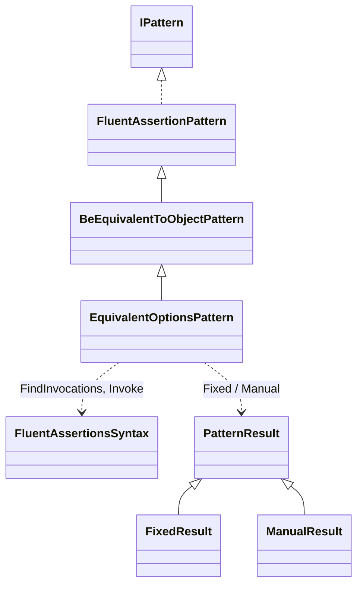
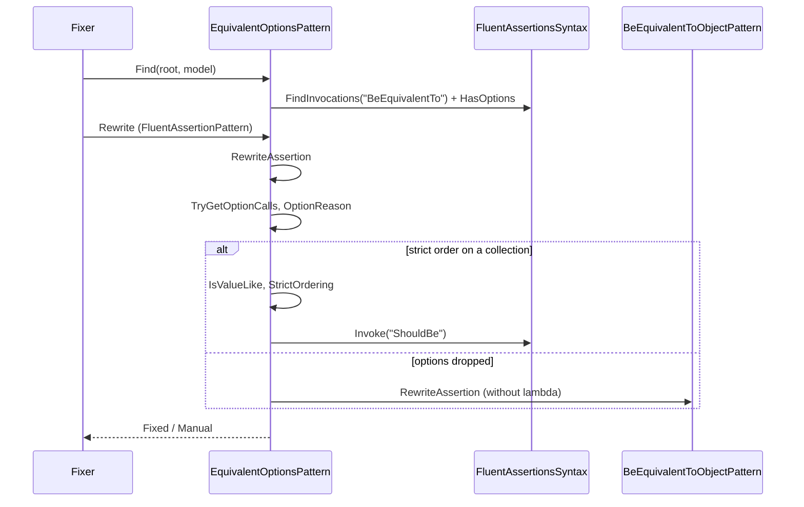
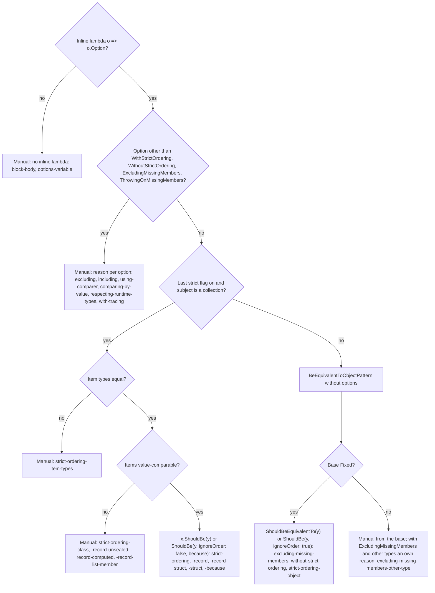

# Models: fa.equivalent-options

`BeEquivalentTo(y, o => ...)`: options are dropped, become `ShouldBe`, or Manual. Facts from `src/Unshackle.Core/Fixes/FluentAssertions/Patterns/EquivalentOptionsPattern.cs`. Diagrams by hand in Mermaid (kingmadoc/d2 missing).

**Figure 1.** Classes around `EquivalentOptionsPattern`.

| Element | Path | Role |
| --- | --- | --- |
| `BeEquivalentToObjectPattern` | `.../Patterns/BeEquivalentToObjectPattern.cs` | Base: object and leaf-collection form; `HasOptions`, `ElementType`, `IsLeaf` are protected; its `Find` skips `BeEquivalentTo` with options |
| `EquivalentOptionsPattern` | `.../Patterns/EquivalentOptionsPattern.cs` | This pattern, Id `fa.equivalent-options` |
| `FluentAssertionsSyntax` | `.../FluentAssertionsSyntax.cs` | `FindInvocations`, `Invoke` |
| `PatternResult` etc. | `src/Unshackle.Core/Models/` | Outcome |

**Figure 2.** Sequence.

| Step | Place | What happens |
| --- | --- | --- |
| Find | `Find` | Only `BeEquivalentTo` with an `EquivalencyAssertionOptions` parameter |
| Read the lambda | `TryGetOptionCalls` | The chain calls of `o => o.A().B()` in order |
| Options | `RewriteAssertion` | Strict flag, no-ops, otherwise a reason per option |
| Value items | `IsValueLike` | Leaf, sealed record, record struct or struct with only leaf fields |

**Figure 3.** Decision tree.

| Question | Outcome | Proof |
| --- | --- | --- |
| Inline lambda? | Otherwise Manual | `block-body`, `options-variable` |
| Unknown or changing option? | Manual per option | `excluding`, `excluding-two`, `including`, `using-comparer`, ... |
| Strict on a collection, value items? | `ShouldBe(y)` | `strict-ordering`, `strict-ordering-record` |
| Otherwise | Base pattern without the lambda | `without-strict-ordering`, `strict-ordering-object` |

## See also

- [fa-equivalent-options-plan.md](fa-equivalent-options-plan.md)
- [fa-equivalent-options-verify.md](fa-equivalent-options-verify.md)
- `src/Unshackle.Core/Fixes/FluentAssertions/Patterns/EquivalentOptionsPattern.cs`
- `src/Unshackle.Tests/Proofs/FluentAssertions/EquivalentOptions/`
