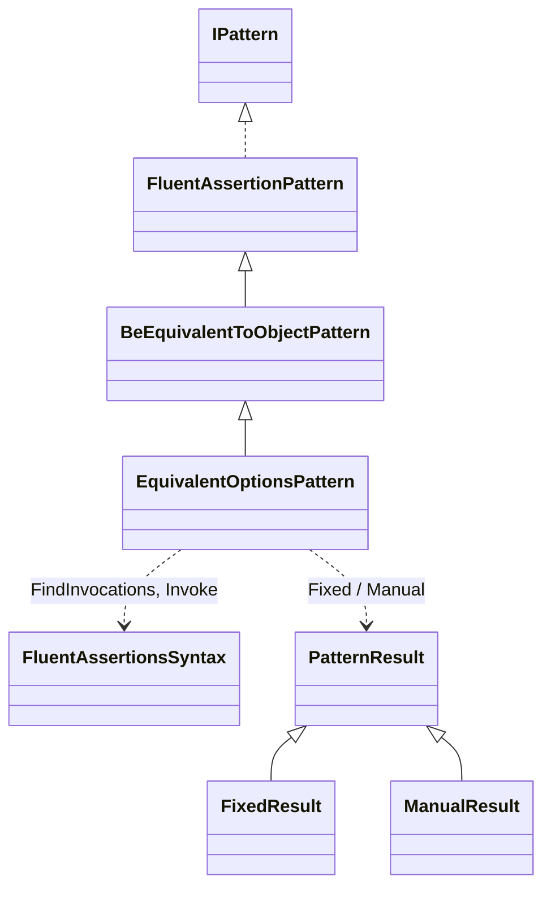
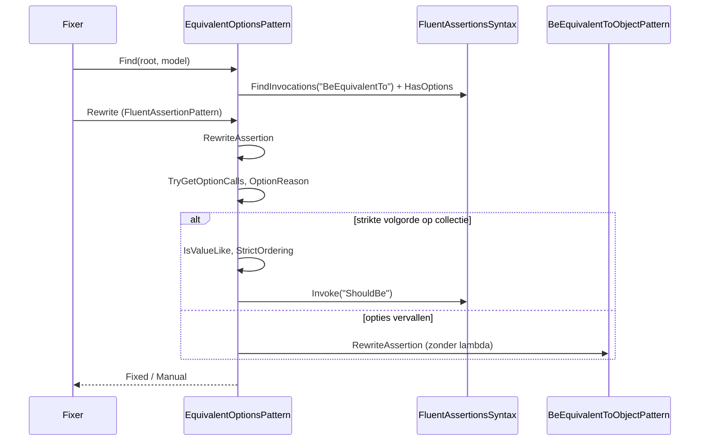
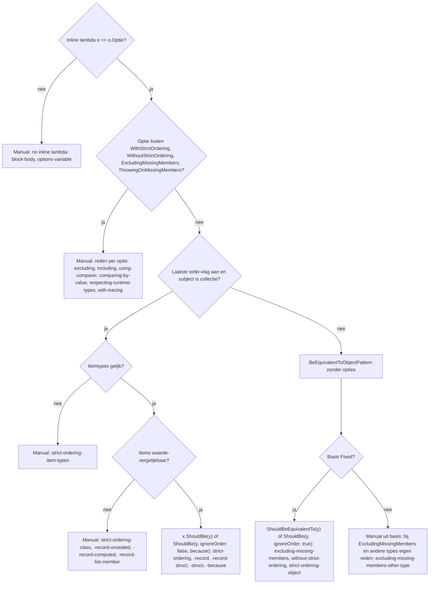

# Modellen: fa.equivalent-options

`BeEquivalentTo(y, o => ...)`: opties vervallen, worden `ShouldBe` of Manual. Feiten uit `src/Unshackle.Core/Fixes/FluentAssertions/Patterns/EquivalentOptionsPattern.cs`. Diagrammen met de hand in Mermaid (kingmadoc/d2 ontbreken).

**Figure 1.** Klassen rond `EquivalentOptionsPattern`.

| Element | Pad | Rol |
| --- | --- | --- |
| `BeEquivalentToObjectPattern` | `.../Patterns/BeEquivalentToObjectPattern.cs` | Basis: object- en leaf-collectievorm; `HasOptions`, `ElementType`, `IsLeaf` zijn protected; zijn `Find` slaat `BeEquivalentTo` met options over |
| `EquivalentOptionsPattern` | `.../Patterns/EquivalentOptionsPattern.cs` | Dit patroon, Id `fa.equivalent-options` |
| `FluentAssertionsSyntax` | `.../FluentAssertionsSyntax.cs` | `FindInvocations`, `Invoke` |
| `PatternResult` e.a. | `src/Unshackle.Core/Models/` | Uitkomst |

**Figure 2.** Volgorde.

| Stap | Plek | Wat gebeurt er |
| --- | --- | --- |
| Find | `Find` | Alleen `BeEquivalentTo` met een `EquivalencyAssertionOptions`-parameter |
| Lambda lezen | `TryGetOptionCalls` | De ketenaanroepen van `o => o.A().B()` in volgorde |
| Opties | `RewriteAssertion` | Strikt-vlag, no-ops, anders een reden per optie |
| Waarde-items | `IsValueLike` | Leaf, sealed record, record struct of struct met alleen leaf-velden |

**Figure 3.** Beslisboom.

| Vraag | Uitkomst | Proof |
| --- | --- | --- |
| Inline lambda? | Anders Manual | `block-body`, `options-variable` |
| Onbekende of veranderende optie? | Manual per optie | `excluding`, `excluding-two`, `including`, `using-comparer`, ... |
| Strikt op collectie, waarde-items? | `ShouldBe(y)` | `strict-ordering`, `strict-ordering-record` |
| Anders | Basispatroon zonder lambda | `without-strict-ordering`, `strict-ordering-object` |

## Zie ook

- [fa-equivalent-options-plan.md](fa-equivalent-options-plan.md)
- [fa-equivalent-options-verify.md](fa-equivalent-options-verify.md)
- `src/Unshackle.Core/Fixes/FluentAssertions/Patterns/EquivalentOptionsPattern.cs`
- `src/Unshackle.Tests/Proofs/FluentAssertions/EquivalentOptions/`
