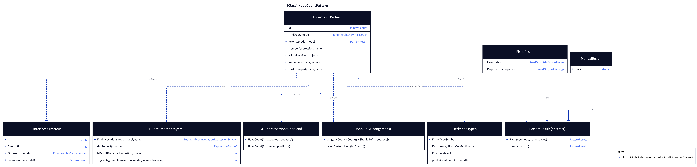
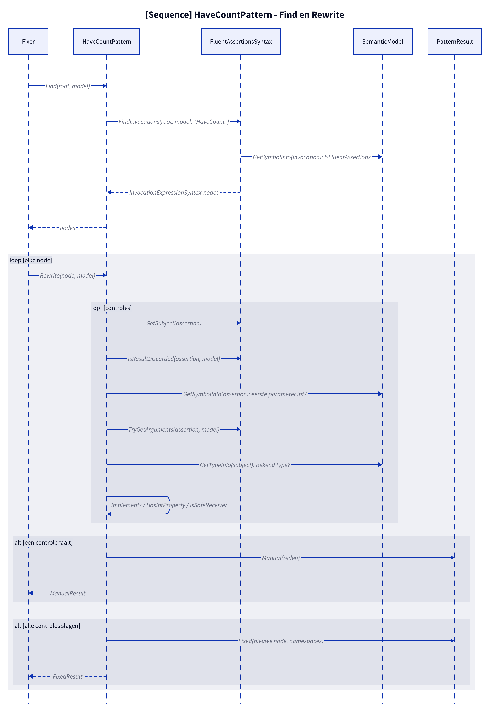
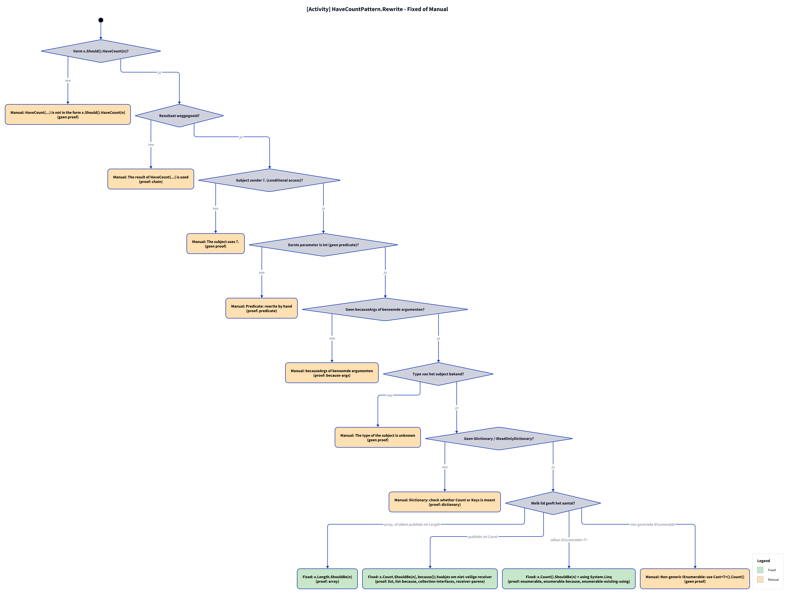

# Models: fa.have-count

x.Should().HaveCount(n) to x.Count.ShouldBe(n). Facts from `src/Unshackle.Core/Fixes/FluentAssertions/Patterns/HaveCountPattern.cs`.

**Figure 1.** Classes around `HaveCountPattern`: what it inherits, uses and creates. Left out: `Fixer`, `IFix` and the usings handling (see [../modellen/klassen.md](../modellen/klassen.md)).

<!-- kingmadoc:diagram img/fa-have-count-modellen-1.d2 -->

| Element | Path | Role |
| --- | --- | --- |
| `IPattern` | `src/Unshackle.Core/Abstractions/IPattern.cs` | Contract: `Find` and `Rewrite` |
| `FluentAssertionPattern` | `src/Unshackle.Core/Fixes/FluentAssertions/FluentAssertionPattern.cs` | Template Method: `Rewrite` does scope, shape, result and because(-args), then `RewriteAssertion` |
| `HaveCountPattern` | `src/Unshackle.Core/Fixes/FluentAssertions/Patterns/HaveCountPattern.cs` | This pattern, Id `fa.have-count`; `RewriteAssertion`; private: `Member(expression, name)`, `Implements(type, names)`, `HasIntProperty(type, name)` |
| `FluentAssertionsSyntax` | `src/Unshackle.Core/Fixes/FluentAssertions/FluentAssertionsSyntax.cs` | Shared building blocks: `FindInvocations`, `GetSubject`, `IsResultDiscarded`, `TryGetArguments`, `NotNullReceiver` |
| `PatternResult`, `FixedResult`, `ManualResult` | `src/Unshackle.Core/Models/` | Outcome: `Fixed` with new node(s) and namespaces, or `Manual` with a reason |
| «FluentAssertions» recognised | - | `HaveCount(int expected[, because])`; `HaveCountGreaterThan`/`…OrEqualTo`/`HaveCountLessThan`/`…OrEqualTo` (also `…GreaterOrEqualTo`/`…LessOrEqualTo`); `HaveCount(Expression predicate)` |
| «Shouldly» created | - | `Length / Count / Count()` + `ShouldBe` / `ShouldBeGreaterThan(OrEqualTo)` / `ShouldBeLessThan(OrEqualTo)` `(n[, because])`; `using System.Linq` (with `Count()`) |
| Recognised types | - | `IArrayTypeSymbol`; `IDictionary / IReadOnlyDictionary`; `IEnumerable<T>`; `public int Count or Length` |

**Figure 2.** `Fixer` calls `Find` and per node `FluentAssertionPattern.Rewrite`; that does the shared checks and calls `HaveCountPattern.RewriteAssertion`, which returns `Fixed` or `Manual`. Left out: replacing the node and the usings by the `Fixer`.

<!-- kingmadoc:diagram img/fa-have-count-modellen-2.d2 -->

| Step | Place | What happens |
| --- | --- | --- |
| Find | `HaveCountPattern.Find` | `FluentAssertionsSyntax.FindInvocations` looks for `HaveCount` and the six `HaveCount…Than…` names whose symbol lies in a FluentAssertions namespace |
| Shared checks | `FluentAssertionPattern.Rewrite` | `IsInsideAssertionScope`; `GetSubject(assertion)`; `IsResultDiscarded(assertion, model)`; `TryGetArguments(assertion, model)` (becauseArgs with a constant because become `string.Format(CultureInfo.InvariantCulture, ...)`) |
| Own checks | `HaveCountPattern.RewriteAssertion` | `?.`; `GetSymbolInfo(assertion)` (first parameter int); `GetTypeInfo(subject)`; `Implements / HasIntProperty`; `NotNullReceiver` |
| Manual | `PatternResult.Manual` | The first failing check gives a `ManualResult` with a reason (see figure 3) |
| Fixed | `PatternResult.Fixed` | New node plus namespace `System.Linq` with `Count()`; the `Fixer` handles trivia and usings |

**Figure 3.** Decision tree of `FluentAssertionPattern.Rewrite` + `HaveCountPattern.RewriteAssertion`: 8 questions in the order of the code, every leaf names the proof in `src/Unshackle.Tests/Proofs/FluentAssertions/HaveCount/` that proves it (`<name>.before.cs` with `.after.cs` or `.manual.txt`). `<Should>` is `ShouldBe` or the comparison for `HaveCount…Than…`.

<!-- kingmadoc:diagram img/fa-have-count-modellen-3.d2 -->

| Question or selector | If no: Manual reason | Proof |
| --- | --- | --- |
| Outside an AssertionScope? | Inside an AssertionScope | no proof, guarded in code |
| Shape x.Should().HaveCount(n)? | HaveCount(...) is not in the form x.Should().HaveCount(...) | no proof, guarded in code |
| Result discarded? | The result of HaveCount(...) is used | `chain` |
| No named arguments; because constant and formattable? | named arguments, or becauseArgs whose because is no constant format string | no proof (becauseArgs with a constant because is Fixed: `because-args`, `count-comparison-because-args`) |
| Subject without ?. (conditional access)? | The subject uses ?. | no proof, guarded in code |
| First parameter is int (no predicate)? | Predicate: rewrite by hand | `predicate` |
| Type of the subject known? | The type of the subject is unknown | no proof, guarded in code |
| No IDictionary / IReadOnlyDictionary? | Dictionary: check whether Count or Keys is meant | `dictionary` |
| Selector: non-generic IEnumerable | Non-generic IEnumerable: use Cast<T>().Count() | no proof, guarded in code |

| Condition | Fixed form | Proofs |
| --- | --- | --- |
| array, or only a public int Length | `x.Length.<Should>(n)` | `array` |
| public int Count | `x.Count.<Should>(n[, because])`; parentheses and `ShouldNotBeNull()` via `NotNullReceiver` | `list`, `list-because`, `collection-interfaces`, `receiver-parens`, `nullable`, `count-comparisons` |
| only IEnumerable<T> | `x.Count().<Should>(n)` + `using System.Linq` | `enumerable`, `enumerable-because`, `enumerable-existing-using` |

## See also

- [fa-have-count-plan.md](fa-have-count-plan.md) - plan
- [fa-have-count-verify.md](fa-have-count-verify.md) - verification
- `src/Unshackle.Core/Fixes/FluentAssertions/Patterns/HaveCountPattern.cs` - the pattern
- `src/Unshackle.Tests/Proofs/FluentAssertions/HaveCount/` - the proofs
- [../modellen/pattern-beslissing.md](../modellen/pattern-beslissing.md) - generic decision of a pattern
- [../README.md](../README.md)
