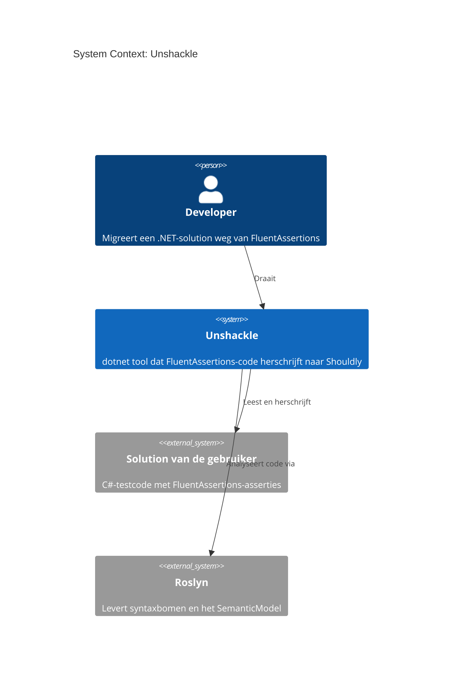
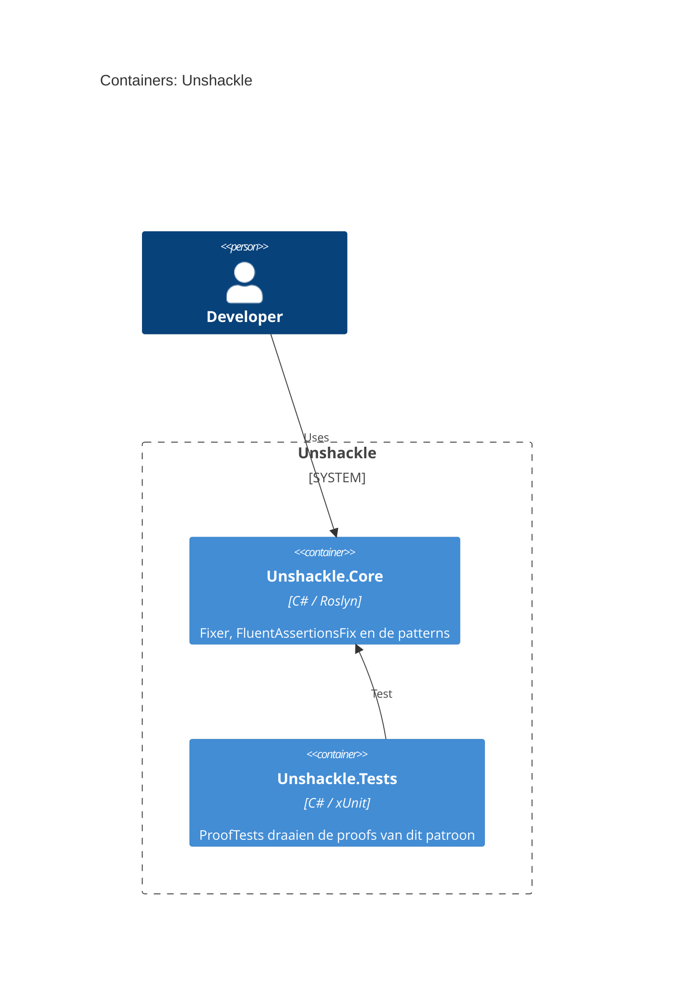

# Feature: fa.have-count: x.Should().HaveCount(n) wordt type-afhankelijk x.Count.ShouldBe(n), x.Length.ShouldBe(n) of x.Count().ShouldBe(n).

| | |
|---|---|
| **Project** | Unshackle |
| **Status** | Approved |
| **Generated** | 2026-10-10T23:33+02:00 by KingmaDoc 0.3.0.dev9 |

> Achteraf opgesteld uit TAAK-002 na de bouw. Dit plan beschrijft wat is gebouwd en waarom; het is geen ontwerp vooraf.
> Alles gemarkeerd als _(inferred)_ komt uit de codebase-analyse.

## One-sentence summary

fa.have-count: x.Should().HaveCount(n) wordt type-afhankelijk x.Count.ShouldBe(n), x.Length.ShouldBe(n) of x.Count().ShouldBe(n).

**Full description:** fa.have-count: x.Should().HaveCount(n) wordt type-afhankelijk x.Count.ShouldBe(n), x.Length.ShouldBe(n) of x.Count().ShouldBe(n).

## Scope (in / out)

**In scope**

- `x.Should().HaveCount(n[, because])` als losse assertion, herschreven op basis van het type van `x`: `Count`-property, `Length` (arrays) of LINQ `Count()` met `using System.Linq`.
- `because` zonder `becauseArgs` wordt `customMessage` van `ShouldBe`.
- Haakjes om een ontvanger met lagere precedence (`(a ?? b).Count`).
- `Manual(reden)` voor dictionaries, predicates, `becauseArgs`, ketens, `?.`, non-generic `IEnumerable` en onbekende types.

**Out of scope**

- `NotHaveCount`, `HaveCountGreaterThan(OrEqualTo)`, `HaveCountLessThan(OrEqualTo)` (andere patronen).
- Predicate-herschrijving (`c => c > 1`) naar `ShouldBeGreaterThan` e.d.
- Ketens met `.And`/`.Which` splitsen.
- De `using`-afhandeling zelf: de `Fixer` voegt `System.Linq` toe als het ontbreekt.

## Requirements

- **REQ-1**: WHEN `x.Should().HaveCount(n)` op een type met publieke `int Count` staat (bijv. `List<T>`) THE SYSTEM SHALL het herschrijven naar `x.Count.ShouldBe(n)` (proof `src/Unshackle.Tests/Proofs/FluentAssertions/HaveCount/list.*.cs`).
- **REQ-2**: WHEN `HaveCount` een `because` zonder `becauseArgs` heeft THE SYSTEM SHALL die als tweede argument van `ShouldBe` overnemen (proof `src/Unshackle.Tests/Proofs/FluentAssertions/HaveCount/list-because.*.cs`).
- **REQ-3**: WHEN het subject `ICollection<T>`, `IReadOnlyCollection<T>`, `IReadOnlyList<T>`, `IList<T>` of `HashSet<T>` is THE SYSTEM SHALL `.Count` gebruiken, ook als `Count` van een basis-interface komt (proof `src/Unshackle.Tests/Proofs/FluentAssertions/HaveCount/collection-interfaces.*.cs`).
- **REQ-4**: WHEN het subject een array is, of een type met `Length` maar zonder `Count` (bijv. `ImmutableArray<T>`), THE SYSTEM SHALL `.Length.ShouldBe(n)` gebruiken (proof `src/Unshackle.Tests/Proofs/FluentAssertions/HaveCount/array.*.cs`; `ImmutableArray<T>` heeft geen proof).
- **REQ-5**: WHEN het subject een generieke `IEnumerable<T>` zonder `Count`/`Length` is THE SYSTEM SHALL `x.Count().ShouldBe(n)` bouwen en `System.Linq` laten toevoegen (proof `src/Unshackle.Tests/Proofs/FluentAssertions/HaveCount/enumerable.*.cs`).
- **REQ-6**: WHEN het document `using System.Linq;` al heeft THE SYSTEM SHALL die niet nog eens toevoegen (proof `src/Unshackle.Tests/Proofs/FluentAssertions/HaveCount/enumerable-existing-using.*.cs`).
- **REQ-7**: WHEN een generieke `IEnumerable<T>` een `because` heeft THE SYSTEM SHALL die als tweede argument van `ShouldBe` overnemen (proof `src/Unshackle.Tests/Proofs/FluentAssertions/HaveCount/enumerable-because.*.cs`).
- **REQ-8**: WHEN het subject een expressie met lagere precedence is (bijv. `a ?? b`) THE SYSTEM SHALL haakjes om de ontvanger zetten (proof `src/Unshackle.Tests/Proofs/FluentAssertions/HaveCount/receiver-parens.*.cs`).
- **REQ-9**: IF het subject een dictionary is (`IDictionary<,>`, `IReadOnlyDictionary<,>` of een implementatie) THEN THE SYSTEM SHALL Manual geven omdat Count of Keys bedoeld kan zijn (proof `src/Unshackle.Tests/Proofs/FluentAssertions/HaveCount/dictionary.*`).
- **REQ-10**: IF `HaveCount` een predicate krijgt (`c => c > 1`) THEN THE SYSTEM SHALL Manual geven (proof `src/Unshackle.Tests/Proofs/FluentAssertions/HaveCount/predicate.*`).
- **REQ-11**: IF `HaveCount` `becauseArgs` of benoemde argumenten heeft THEN THE SYSTEM SHALL Manual geven (proof `src/Unshackle.Tests/Proofs/FluentAssertions/HaveCount/because-args.*`).
- **REQ-12**: IF het resultaat van `HaveCount` wordt gebruikt (`.And`, `.Which`, waarde) THEN THE SYSTEM SHALL Manual geven (proof `src/Unshackle.Tests/Proofs/FluentAssertions/HaveCount/chain.*`).
- **REQ-13**: IF het subject een non-generic `IEnumerable` is THEN THE SYSTEM SHALL Manual geven met het advies `Cast<T>().Count()`. _Geen proof: FA 7.2.2 heeft geen `HaveCount` op non-generic `IEnumerable`, dus before compileert niet._
- **REQ-14**: IF het subject een conditional access is (`a?.b`) THEN THE SYSTEM SHALL Manual geven. _Geen proof: alleen via code bewaakt._
- **REQ-15**: IF het type van het subject onbekend is (error type) THEN THE SYSTEM SHALL Manual geven. _Geen proof: alleen via code bewaakt._

## Assumptions

- _(inferred)_ Gebouwd op de bestaande stack: C#, Roslyn, Shouldly 4.3.0 als doel, FluentAssertions 7.2.2 als bron.
- Shouldly heeft geen `ShouldHaveCount`; de teller zelf asserten (`x.Count.ShouldBe(n)`) is het equivalent.
- `customMessage` van Shouldly is een kale string zonder `{0}`-formatting, dus `becauseArgs` kan niet mee.
- De `Fixer` kan via `PatternResult.Fixed(node, "System.Linq")` een using laten toevoegen als die ontbreekt.
- `Count()` en FA enumereren beide één keer: gedrag bij lazy sequences is gelijk.

## Risks

- `Count`-property dat geen `int` is op een eigen type: alleen een publieke `int`-property wordt geaccepteerd, anders volgt een andere tak of Manual.
- Foutmelding wordt korter (Shouldly toont "x.Count should be 2 but was 3" in plaats van de hele collectie): gedocumenteerd verschil, geen Manual.
- Dictionary-intentie (aantal keys of entries) is niet af te leiden: bewust Manual.
- Multidimensionale arrays vallen onder `IArrayTypeSymbol` en krijgen `Length` (totaal aantal elementen), net als FA telt. Geen proof.
## C4 Context (Mermaid)

Wie het patroon gebruikt en waarvan het afhangt.



## C4 Container (Mermaid)

De betrokken projecten _(inferred)_; de CLI is nog niet aangesloten.



## Open questions

- **Moet een pattern een using kunnen toevoegen?** Opgelost via `PatternResult.Fixed(node, "System.Linq")` (TAAK-002, aanpassingen bij realisatie).
- **Moet `HaveCount` met predicate later automatisch?** Nog open: eventueel aparte patronen voor `HaveCountGreaterThan` e.d.

**Answered while planning**

- [x] Wat lost dit op en voor wie? Developers die van FluentAssertions af willen; samples: `OrderTests.cs:33,42`, `OrderHandlerTests.cs:68`, `RepositoryTests.cs:16` (dictionary, Manual).
- [x] Wie of wat triggert het? De `Fixer` draait het patroon per document.
- [x] Externe systemen? Roslyn (SemanticModel); geen datastore.
- [x] Welke modules veranderen? `Unshackle.Core` (patroon en registratie in `FluentAssertionsFix`) en `Unshackle.Tests` (proofs).
- [x] Hoe weten we dat het werkt? `ProofTests` draait alle 12 proofs (before met FA, after met Shouldly, manual.txt met reden).

## Appendix: codebase context _(inferred)_

- **Tech stack:** C#
- **Entry points:** `src/Unshackle.Interface/Program.cs`
- **Config files:** _none found_
- **Test directories:** _none found_

| Language | Files |
|---|---|
| csharp | 76 |
| markdown | 25 |
| json | 2 |
| yaml | 2 |
| shell | 1 |

<details>
<summary>File tree (143 files)</summary>

```text
unshackle/
├── .claude/
│   ├── hooks/
│   │   └── check-pattern-docs.sh
│   ├── skills/
│   │   ├── taak-oppakken/
│   │   │   └── …
│   │   ├── taak-specifiek/
│   │   │   └── …
│   │   └── taak-start/
│   │       └── …
│   └── settings.json
├── .github/
│   └── workflows/
│       └── ci.yml
├── .vibe-wise/
│   ├── profile.md
│   ├── progress.md
│   └── project-map.md
├── claude/
│   ├── docs/
│   │   ├── agent-werkwijze.md
│   │   ├── code-standaarden.md
│   │   ├── design-patterns.md
│   │   ├── INDEX.md
│   │   └── patroon-loop.md
│   └── tasks/
│       ├── archief/
│       │   └── …
│       ├── patroon-queue.md
│       └── TAAK-003-fa-be-true-false.md
├── docs/
│   └── projectinfo/
│       ├── architectuur/
│       │   └── …
│       ├── patterns/
│       │   └── …
│       ├── beslissingen.md
│       ├── project.md
│       └── README.md
├── samples/
│   ├── SampleShop/
│   │   ├── SampleShop.Tests/
│   │   │   └── …
│   │   ├── SampleShop/
│   │   │   └── …
│   │   └── SampleShop.slnx
│   ├── .editorconfig
│   ├── Directory.Build.props
│   └── Directory.Packages.props
├── src/
│   ├── Unshackle.Core/
│   │   ├── Abstractions/
│   │   │   └── …
│   │   ├── Fixes/
│   │   │   └── …
│   │   ├── Models/
│   │   │   └── …
│   │   ├── Fixer.cs
│   │   ├── Unshackle.Core.csproj
│   │   └── UsingDirectives.cs
│   ├── Unshackle.DataAccess/
│   │   ├── Reports/
│   │   │   └── …
│   │   ├── Solutions/
│   │   │   └── …
│   │   └── Unshackle.DataAccess.csproj
│   ├── Unshackle.Interface/
│   │   ├── Commands/
│   │   │   └── …
│   │   ├── Output/
│   │   │   └── …
│   │   ├── Program.cs
│   │   └── Unshackle.Interface.csproj
│   └── Unshackle.Tests/
│       ├── Core/
│       │   └── …
│       ├── DataAccess/
│       │   └── …
│       ├── Helpers/
│       │   └── …
│       ├── Integration/
│       │   └── …
│       ├── Interface/
│       │   └── …
│       ├── Proofs/
│       │   └── …
│       ├── ProofFix.cs
│       ├── ProofTests.cs
│       └── Unshackle.Tests.csproj
├── .editorconfig
├── .featuredoc.yml
├── .gitignore
├── CLAUDE.md
├── Directory.Build.props
├── Directory.Packages.props
├── global.json
├── LICENSE
├── README.md
└── Unshackle.slnx
```

</details>
