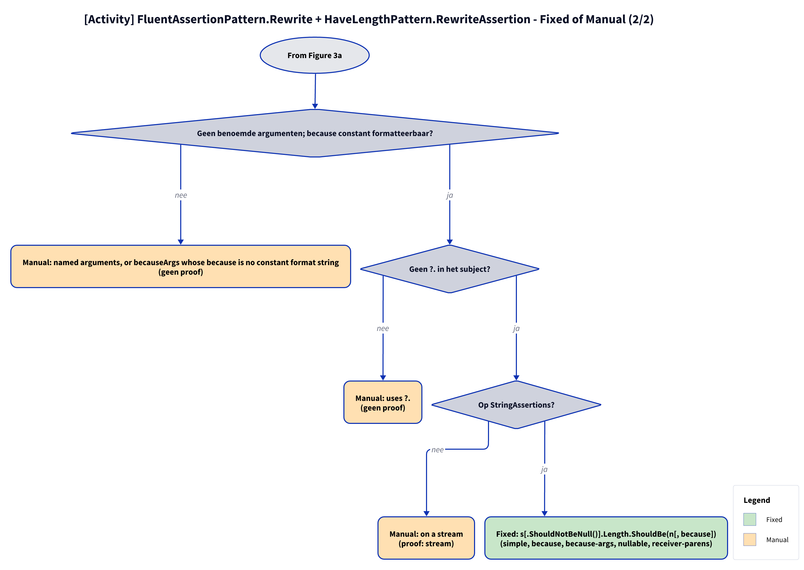

# Models: fa.have-length

`s.Should().HaveLength(n)` becomes `s.Length.ShouldBe(n)`; nullable subject `s.ShouldNotBeNull().Length.ShouldBe(n)`. Facts from `src/Unshackle.Core/Fixes/FluentAssertions/Patterns/HaveLengthPattern.cs`.

**Figure 1.** Classes around `HaveLengthPattern`. Omitted: `Fixer`, `IFix` and the usings (see [../modellen/klassen.md](../modellen/klassen.md)).

<!-- kingmadoc:diagram img/fa-have-length-modellen-1.d2 -->

| Element | Path | Role |
| --- | --- | --- |
| `IPattern` | `src/Unshackle.Core/Abstractions/IPattern.cs` | Contract |
| `FluentAssertionPattern` | `src/Unshackle.Core/Fixes/FluentAssertions/FluentAssertionPattern.cs` | Template Method: `Rewrite` handles scope, form, result and because(-args), then `RewriteAssertion` |
| `HaveLengthPattern` | `src/Unshackle.Core/Fixes/FluentAssertions/Patterns/HaveLengthPattern.cs` | This pattern, Id `fa.have-length` |
| `FluentAssertionsSyntax` | `src/Unshackle.Core/Fixes/FluentAssertions/FluentAssertionsSyntax.cs` | Shared checks |
| `PatternResult`, `FixedResult`, `ManualResult` | `src/Unshackle.Core/Models/` | Outcome |

**Figure 2.** Order of `Find` and `Rewrite`.

<!-- kingmadoc:diagram img/fa-have-length-modellen-2.d2 -->

| Step | Location | What happens |
| --- | --- | --- |
| Find | `HaveLengthPattern.Find` | `FindInvocations` on the FA names |
| Checks | `FluentAssertionPattern.Rewrite` → `HaveLengthPattern.RewriteAssertion` | scope, form, use of the result, arguments (`TryGetArguments`); then `?.`, type, `NotNullReceiver` |
| Outcome | `PatternResult.Fixed` / `Manual` | Shouldly call or reason |

**Figure 3a.** Decision tree of `FluentAssertionPattern.Rewrite` + `RewriteAssertion`; proofs in `src/Unshackle.Tests/Proofs/FluentAssertions/HaveLength/`. Split into Figures 3a–3b (at most 12 arrows each).

<!-- kingmadoc:diagram img/fa-have-length-modellen-3.d2 -->

**Figure 3b.** Continuation of Figure 3a from its "Continued in Figure 3b" node.

<!-- kingmadoc:diagram img/fa-have-length-modellen-4.d2 -->

| Question | If no: Manual reason | Proof |
| --- | --- | --- |
| Outside an AssertionScope? | Inside an AssertionScope | `assertion-scope` |
| Form s.Should().HaveLength(..)? | is not in the form s.Should() | `no proof; .And via fa.and-chain` |
| Result discarded? | is used | `no proof` |
| No named arguments; because constant and formattable? | named arguments, or becauseArgs whose because is no constant format string | `no proof` |
| No ?. in the subject? | uses ?. | `no proof` |
| On StringAssertions? | on a stream | `stream` |
| Fixed | `s[.ShouldNotBeNull()].Length.ShouldBe(n[, because])` | simple, because, because-args, nullable, receiver-parens |

## See also

- [fa-have-length-plan.md](fa-have-length-plan.md) - plan
- [fa-have-length-verify.md](fa-have-length-verify.md) - verification
- `src/Unshackle.Core/Fixes/FluentAssertions/Patterns/HaveLengthPattern.cs` - the pattern
- `src/Unshackle.Tests/Proofs/FluentAssertions/HaveLength/` - the proofs
- [../README.md](../README.md)
