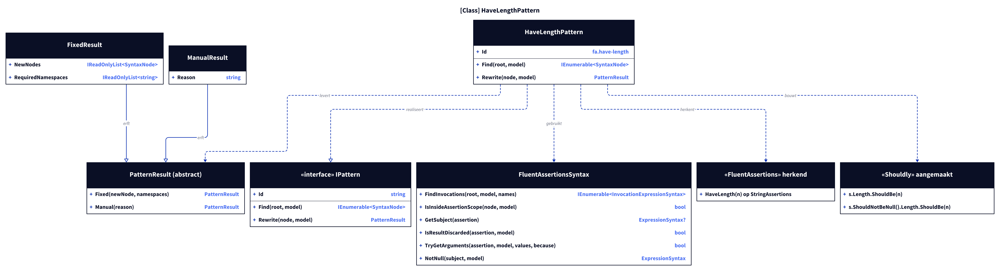
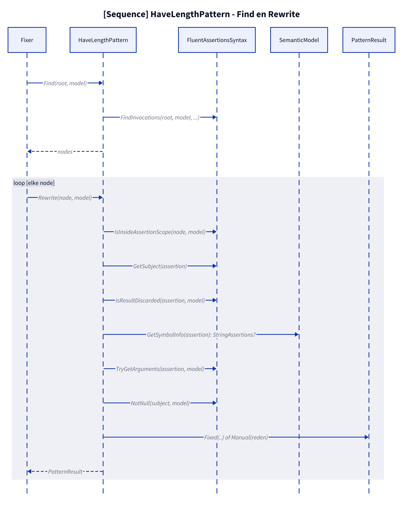
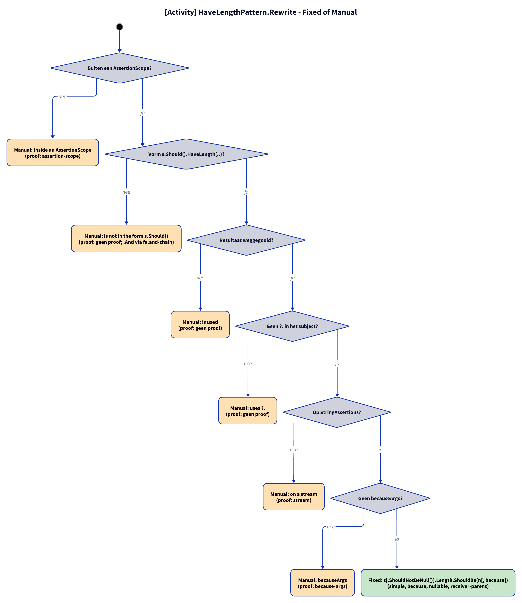

# Modellen: fa.have-length

`s.Should().HaveLength(n)` wordt `s.Length.ShouldBe(n)`; nullable subject `s.ShouldNotBeNull().Length.ShouldBe(n)`. Feiten uit `src/Unshackle.Core/Fixes/FluentAssertions/Patterns/HaveLengthPattern.cs`.

**Figure 1.** Klassen rond `HaveLengthPattern`. Weggelaten: `Fixer`, `IFix` en de usings (zie [../modellen/klassen.md](../modellen/klassen.md)).

<!-- kingmadoc:diagram img/fa-have-length-modellen-1.d2 -->

| Element | Pad | Rol |
| --- | --- | --- |
| `IPattern` | `src/Unshackle.Core/Abstractions/IPattern.cs` | Contract |
| `HaveLengthPattern` | `src/Unshackle.Core/Fixes/FluentAssertions/Patterns/HaveLengthPattern.cs` | Dit patroon, Id `fa.have-length` |
| `FluentAssertionsSyntax` | `src/Unshackle.Core/Fixes/FluentAssertions/FluentAssertionsSyntax.cs` | Gedeelde controles |
| `PatternResult`, `FixedResult`, `ManualResult` | `src/Unshackle.Core/Models/` | Uitkomst |

**Figure 2.** Volgorde van `Find` en `Rewrite`.

<!-- kingmadoc:diagram img/fa-have-length-modellen-2.d2 -->

| Stap | Plek | Wat gebeurt er |
| --- | --- | --- |
| Find | `HaveLengthPattern.Find` | `FindInvocations` op de FA-namen |
| Controles | `HaveLengthPattern.Rewrite` | scope, vorm, gebruik van het resultaat, type, argumenten |
| Uitkomst | `PatternResult.Fixed` / `Manual` | Shouldly-aanroep of reden |

**Figure 3.** Beslisboom van `Rewrite`; proofs in `src/Unshackle.Tests/Proofs/FluentAssertions/HaveLength/`.

<!-- kingmadoc:diagram img/fa-have-length-modellen-3.d2 -->

| Vraag | Bij nee: Manual-reden | Proof |
| --- | --- | --- |
| Buiten een AssertionScope? | Inside an AssertionScope | `assertion-scope` |
| Vorm s.Should().HaveLength(..)? | is not in the form s.Should() | `geen proof; .And via fa.and-chain` |
| Resultaat weggegooid? | is used | `geen proof` |
| Geen ?. in het subject? | uses ?. | `geen proof` |
| Op StringAssertions? | on a stream | `stream` |
| Geen becauseArgs? | becauseArgs | `because-args` |
| Fixed | `s[.ShouldNotBeNull()].Length.ShouldBe(n[, because])` | simple, because, nullable, receiver-parens |

## Zie ook

- [fa-have-length-plan.md](fa-have-length-plan.md) - plan
- [fa-have-length-verify.md](fa-have-length-verify.md) - verificatie
- `src/Unshackle.Core/Fixes/FluentAssertions/Patterns/HaveLengthPattern.cs` - het patroon
- `src/Unshackle.Tests/Proofs/FluentAssertions/HaveLength/` - de proofs
- [../README.md](../README.md)
