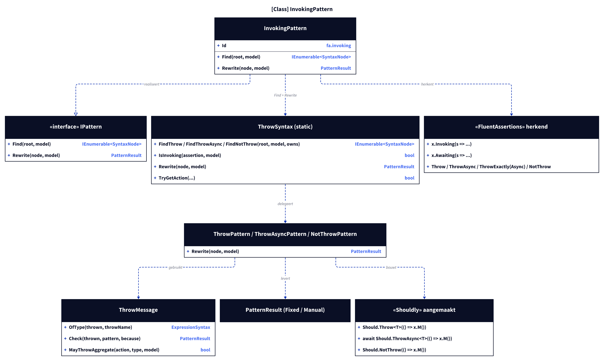
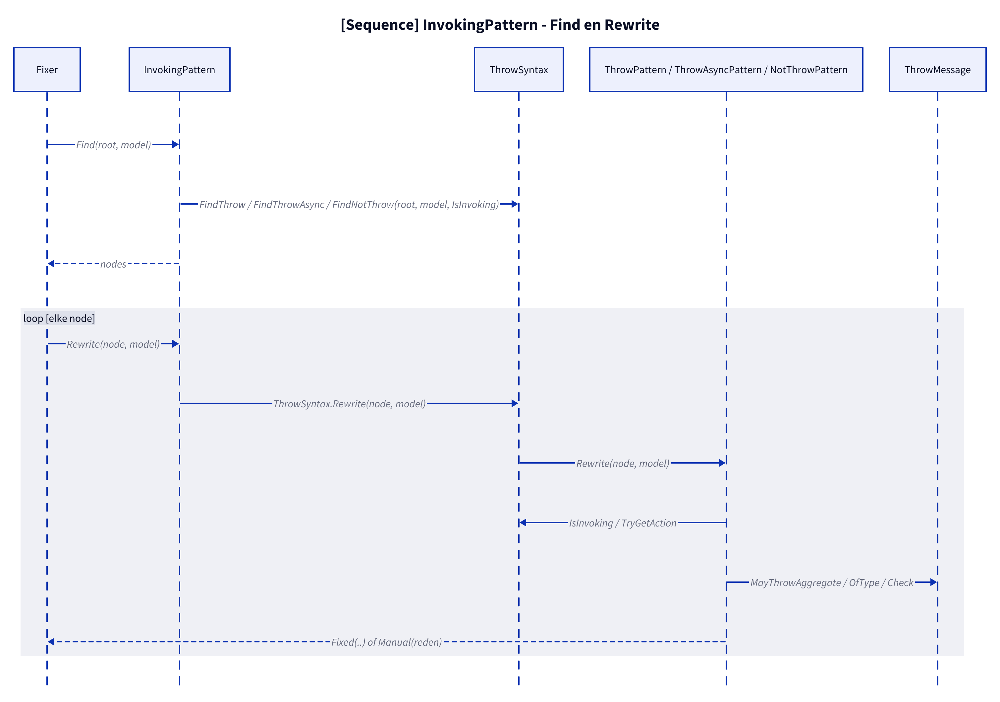
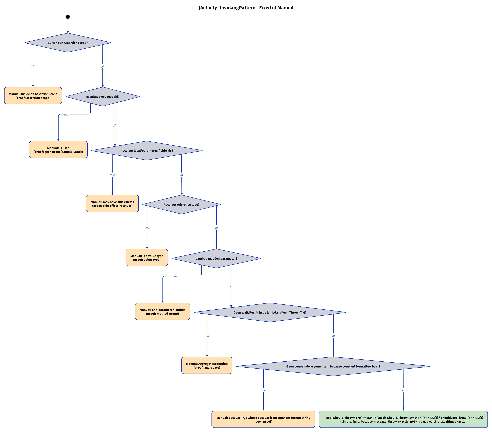

# Models: fa.invoking

`x.Invoking(s => s.M()).Should().Throw<T>()` becomes `Should.Throw<T>(() => x.M())`; also `Awaiting`/`ThrowAsync`, `ThrowExactly(Async)` and `NotThrow`. Facts from `src/Unshackle.Core/Fixes/FluentAssertions/Patterns/InvokingPattern.cs`, `InvokingPattern.cs`, `ThrowPattern.cs`, `ThrowAsyncPattern.cs`, `NotThrowPattern.cs` and `ThrowMessage.cs`.

**Figure 1.** Classes around `InvokingPattern`. Omitted: `Fixer`, `IFix` and the usings (see [../modellen/klassen.md](../modellen/klassen.md)).

<!-- kingmadoc:diagram img/fa-invoking-modellen-1.d2 -->

| Element | Path | Role |
| --- | --- | --- |
| `InvokingPattern` | `src/Unshackle.Core/Fixes/FluentAssertions/Patterns/InvokingPattern.cs` | This pattern, Id `fa.invoking`: claims the nodes |
| `ThrowSyntax` | `src/Unshackle.Core/Fixes/FluentAssertions/Patterns/ThrowSyntax.cs` | `FindThrow`/`FindThrowAsync`/`FindNotThrow` with filter `IsInvoking`; `Rewrite` picks the rewriting pattern; `TryGetAction` builds `() => ...` |
| `ThrowPattern`, `ThrowAsyncPattern`, `NotThrowPattern` | `src/Unshackle.Core/Fixes/FluentAssertions/Patterns/` | Rewrite (also ThrowExactly and Invoking) |
| `ThrowMessage` | `src/Unshackle.Core/Fixes/FluentAssertions/Patterns/ThrowMessage.cs` | `OfType`, message check, AggregateException heuristic |

**Figure 2.** Order of `Find` and `Rewrite`.

<!-- kingmadoc:diagram img/fa-invoking-modellen-2.d2 -->

| Step | Location | What happens |
| --- | --- | --- |
| Find | `InvokingPattern.Find` | `ThrowSyntax.FindThrow`/`FindThrowAsync`/`FindNotThrow` with filter `ThrowSyntax.IsInvoking` |
| Rewrite | `InvokingPattern.Rewrite` → `ThrowSyntax.Rewrite` | Picks Throw/ThrowAsync/NotThrow by the name of the assertion |
| Outcome | `PatternResult.Fixed` / `Manual` | Shouldly call or reason |

**Figure 3.** Decision tree; proofs in `src/Unshackle.Tests/Proofs/FluentAssertions/Invoking/`.

<!-- kingmadoc:diagram img/fa-invoking-modellen-3.d2 -->

| Question | If no: Manual reason | Proof |
| --- | --- | --- |
| Outside an AssertionScope? | Inside an AssertionScope | `assertion-scope` |
| Result discarded? | is used | `no proof (sample: .And)` |
| Receiver local/parameter/field/this? | may have side effects | `side-effect-receiver` |
| Receiver reference type? | is a value type | `value-type` |
| Lambda with one parameter? | one-parameter lambda | `method-group` |
| No Wait/Result in the lambda (only Throw<T>)? | AggregateException | `aggregate` |
| No named arguments; because constant and formattable? | becauseArgs whose because is no constant format string | no proof (becauseArgs with constant because is Fixed: `because-args`) |

## See also

- [fa-invoking-plan.md](fa-invoking-plan.md) - plan
- [fa-invoking-verify.md](fa-invoking-verify.md) - verification
- `src/Unshackle.Core/Fixes/FluentAssertions/Patterns/InvokingPattern.cs` - the pattern
- `src/Unshackle.Tests/Proofs/FluentAssertions/Invoking/` - the proofs
- [../README.md](../README.md)
