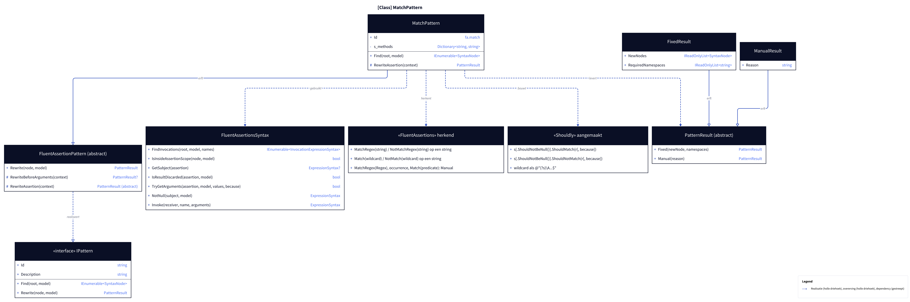
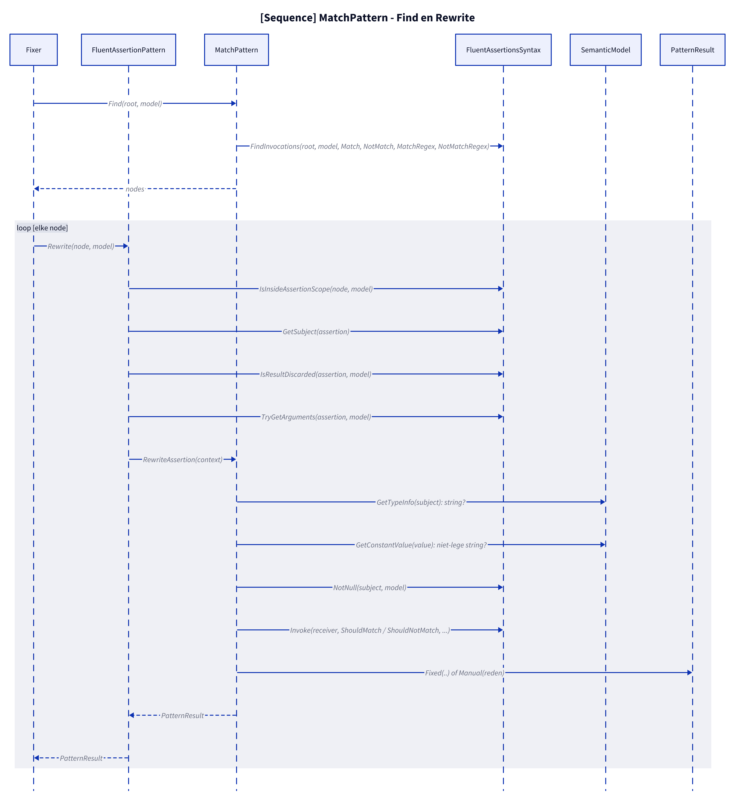
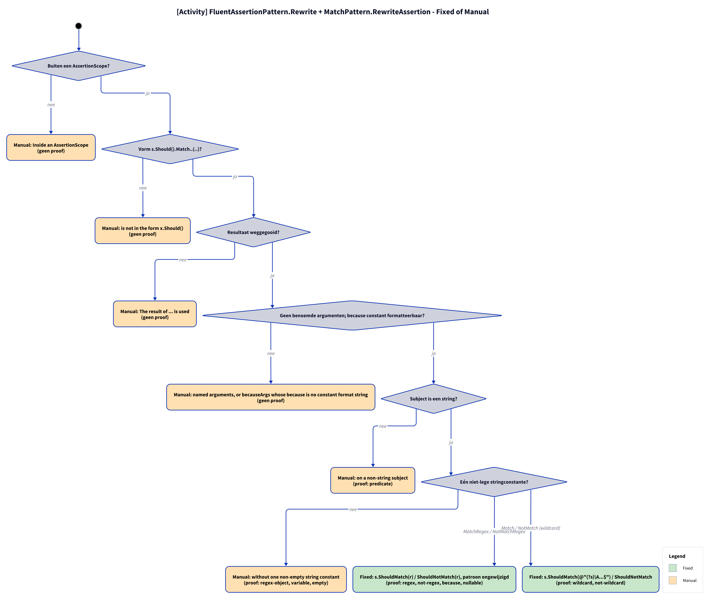

# Models: fa.match

`s.Should().MatchRegex(r)` becomes `s.ShouldMatch(r)`, `NotMatchRegex` → `ShouldNotMatch`; wildcard `Match`/`NotMatch` with a constant becomes the regex `(?s)\A…$`. Facts from `src/Unshackle.Core/Fixes/FluentAssertions/Patterns/MatchPattern.cs`.

**Figure 1.** Classes: what the pattern inherits, uses and creates. Omitted: `Fixer`, `IFix` and the usings (see [../modellen/klassen.md](../modellen/klassen.md)).

<!-- kingmadoc:diagram img/fa-match-modellen-1.d2 -->

| Element | Path | Role |
| --- | --- | --- |
| `IPattern` | `src/Unshackle.Core/Abstractions/IPattern.cs` | Contract: `Find` and `Rewrite` |
| `FluentAssertionPattern` | `src/Unshackle.Core/Fixes/FluentAssertions/FluentAssertionPattern.cs` | Template Method: `Rewrite` handles scope, form, result and because(-args), then `RewriteAssertion` |
| `MatchPattern` | `src/Unshackle.Core/Fixes/FluentAssertions/Patterns/MatchPattern.cs` | This pattern, Id `fa.match`; `RewriteAssertion`; `s_methods` (FA name → Shouldly name) |
| `FluentAssertionsSyntax` | `src/Unshackle.Core/Fixes/FluentAssertions/FluentAssertionsSyntax.cs` | `FindInvocations`, `IsInsideAssertionScope`, `GetSubject`, `IsResultDiscarded`, `TryGetArguments`, `NotNull`, `Invoke` |
| `PatternResult`, `FixedResult`, `ManualResult` | `src/Unshackle.Core/Models/` | Outcome |
| «FluentAssertions» recognized | - | `MatchRegex`/`NotMatchRegex(string)`, `Match`/`NotMatch(wildcard)` on a string; `Regex` overloads, occurrence and predicate → Manual |
| «Shouldly» created | - | `s[.ShouldNotBeNull()].ShouldMatch(r[, because])` / `ShouldNotMatch`; wildcard as `@"(?s)\A…$"` |

**Figure 2.** `Fixer` calls `Find` and, per node, `FluentAssertionPattern.Rewrite`; that performs the shared checks and calls the pattern's own steps. Omitted: the replacement of the node by the `Fixer`.

<!-- kingmadoc:diagram img/fa-match-modellen-2.d2 -->

| Step | Location | What happens |
| --- | --- | --- |
| Find | `MatchPattern.Find` | `FindInvocations` on `Match`, `NotMatch`, `MatchRegex`, `NotMatchRegex` |
| Shared checks | `FluentAssertionPattern.Rewrite` | `IsInsideAssertionScope`, `GetSubject`, `IsResultDiscarded`, `TryGetArguments` (becauseArgs with constant because → `string.Format(CultureInfo.InvariantCulture, ...)`) |
| Own checks | `MatchPattern.RewriteAssertion` | subject is string; one non-empty string constant; wildcard → regex; `NotNull` |
| Outcome | `PatternResult.Fixed` / `Manual` | Shouldly call or reason |

**Figure 3.** Decision tree in code order; proofs in `src/Unshackle.Tests/Proofs/FluentAssertions/Match/`.

<!-- kingmadoc:diagram img/fa-match-modellen-3.d2 -->

| Question | If no: Manual reason | Proof |
| --- | --- | --- |
| Outside an AssertionScope? | Inside an AssertionScope | no proof |
| Form s.Should().Match..(..)? | is not in the form x.Should() | no proof |
| Result discarded? | The result of ... is used | no proof |
| No named arguments; because constant and formattable? | named arguments, or becauseArgs whose because is no constant format string | no proof |
| Subject is a string? | on a non-string subject | predicate |
| One non-empty string constant? | without one non-empty string constant | regex-object, variable, empty |

| Condition | Fixed form | Proofs |
| --- | --- | --- |
| `MatchRegex` / `NotMatchRegex` | `s.ShouldMatch(r[, because])` / `ShouldNotMatch`, pattern unchanged | `regex`, `not-regex`, `because`, `nullable` |
| `Match` / `NotMatch` (wildcard) | `s.ShouldMatch(@"(?s)\A…$")` / `ShouldNotMatch` | `wildcard`, `not-wildcard` |

## See also

- [fa-match-plan.md](fa-match-plan.md) - plan
- [fa-match-verify.md](fa-match-verify.md) - verification
- `src/Unshackle.Tests/Proofs/FluentAssertions/Match/` - the proofs
