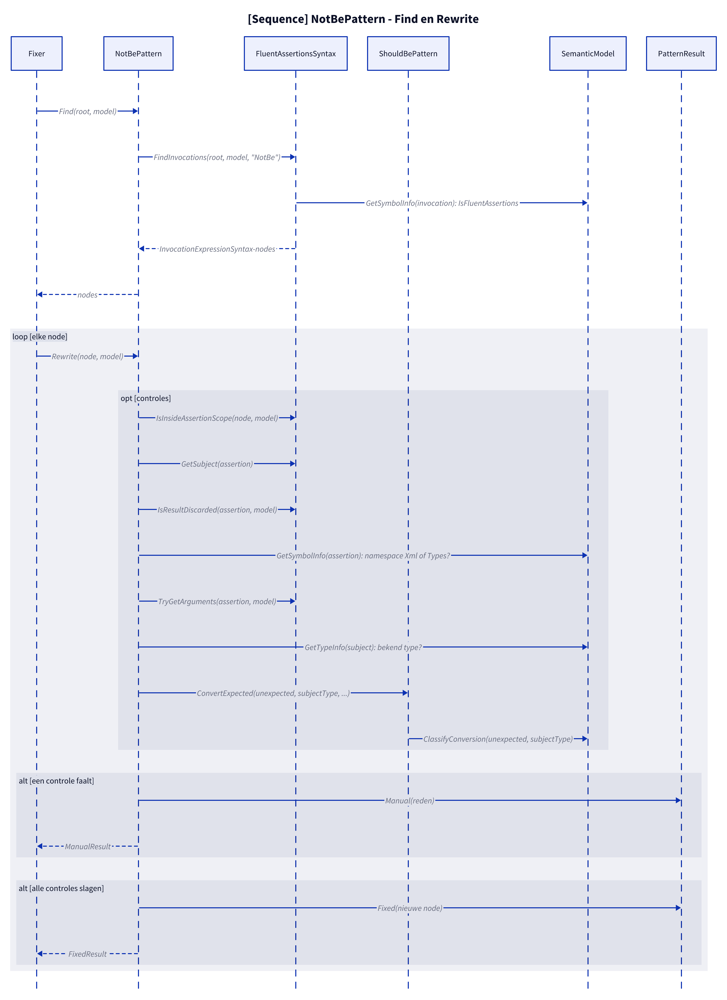
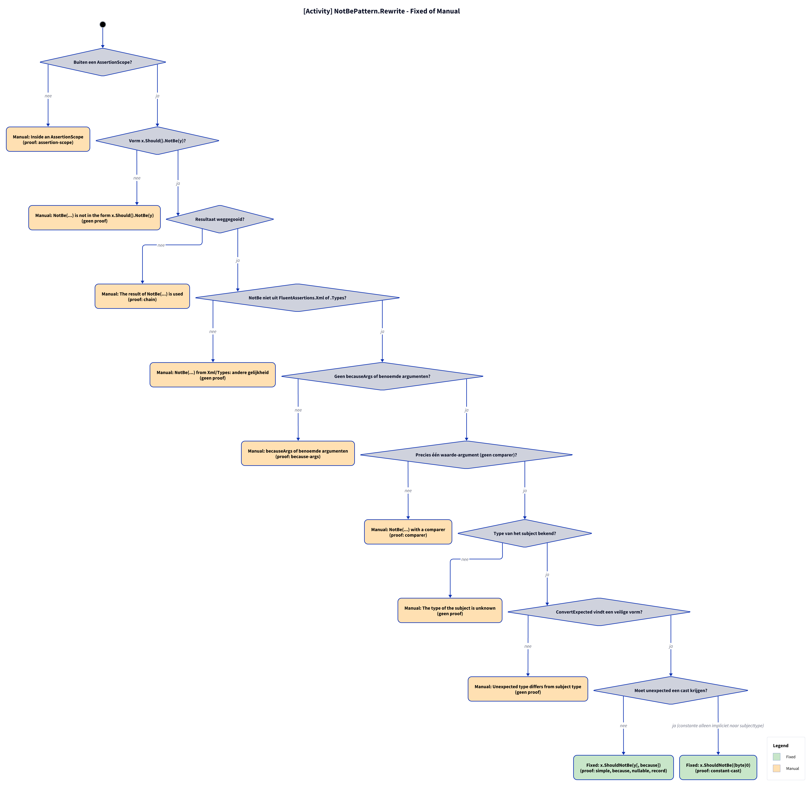

# Modellen: fa.not-be

`x.Should().NotBe(y)` naar `x.ShouldNotBe(y)`. Feiten uit `src/Unshackle.Core/Fixes/FluentAssertions/Patterns/NotBePattern.cs`.

**Figure 1.** Klassen rond `NotBePattern`. Het hergebruikt `ShouldBePattern.ConvertExpected` (internal) voor de typeconversie. Weggelaten: `Fixer`, `IFix` en de usings-afhandeling (zie [../modellen/klassen.md](../modellen/klassen.md)).

<!-- kingmadoc:diagram img/fa-not-be-modellen-1.d2 -->

| Element                                        | Pad                                                                     | Rol                                                                                               |
| ---------------------------------------------- | ----------------------------------------------------------------------- | ------------------------------------------------------------------------------------------------- |
| `IPattern`                                     | `src/Unshackle.Core/Abstractions/IPattern.cs`                           | Contract: `Find` en `Rewrite`                                                                     |
| `NotBePattern`                                 | `src/Unshackle.Core/Fixes/FluentAssertions/Patterns/NotBePattern.cs`    | Dit patroon, Id `fa.not-be`                                                                       |
| `ShouldBePattern.ConvertExpected`              | `src/Unshackle.Core/Fixes/FluentAssertions/Patterns/ShouldBePattern.cs` | Cast van de verwachte waarde naar het subjecttype, of `null`                                      |
| `FluentAssertionsSyntax`                       | `src/Unshackle.Core/Fixes/FluentAssertions/FluentAssertionsSyntax.cs`   | `FindInvocations`, `IsInsideAssertionScope`, `GetSubject`, `IsResultDiscarded`, `TryGetArguments` |
| `PatternResult`, `FixedResult`, `ManualResult` | `src/Unshackle.Core/Models/`                                            | Uitkomst                                                                                          |
| «FluentAssertions» herkend                     | -                                                                       | `NotBe(unexpected[, because])`                                                                    |
| «Shouldly» aangemaakt                          | -                                                                       | `ShouldNotBe(unexpected[, because])`                                                              |

**Figure 2.** `Fixer` roept `Find` en per node `Rewrite` aan. Weggelaten: het vervangen van de node en de usings door de `Fixer`.

<!-- kingmadoc:diagram img/fa-not-be-modellen-2.d2 -->

| Stap      | Plek                   | Wat gebeurt er                                                        |
| --------- | ---------------------- | --------------------------------------------------------------------- |
| Find      | `NotBePattern.Find`    | `FindInvocations(root, model, "NotBe")`                               |
| Controles | `NotBePattern.Rewrite` | scope, vorm, resultaat, namespace, argumenten, subjecttype, conversie |
| Manual    | `PatternResult.Manual` | Eerste mislukte controle (figuur 3)                                   |
| Fixed     | `PatternResult.Fixed`  | `subject.ShouldNotBe(argumenten)`                                     |

**Figure 3.** Beslisboom van `Rewrite` in de volgorde van de code; proofs in `src/Unshackle.Tests/Proofs/FluentAssertions/NotBe/`.

<!-- kingmadoc:diagram img/fa-not-be-modellen-3.d2 -->

| Vraag                      | Bij nee: Manual-reden                             | Proof                                                             |
| -------------------------- | ------------------------------------------------- | ----------------------------------------------------------------- |
| Buiten een AssertionScope? | Inside an AssertionScope                          | `assertion-scope`                                                 |
| Vorm x.Should().NotBe(y)?  | NotBe(...) is not in the form x.Should().NotBe(y) | geen proof, bewaakt in code                                       |
| Resultaat weggegooid?      | The result of NotBe(...) is used                  | `chain`                                                           |
| Niet uit Xml/Types?        | andere gelijkheid                                 | geen proof, zelfde regel als `fa.should-be` (`xml`)               |
| Geen becauseArgs?          | becauseArgs of benoemde argumenten                | `because-args`                                                    |
| Eén waarde-argument?       | with a comparer                                   | `comparer`                                                        |
| Subjecttype bekend?        | The type of the subject is unknown                | geen proof                                                        |
| Veilige conversie?         | Unexpected type differs from subject type         | geen proof, zelfde regel als `fa.should-be` (`nullable-expected`) |

| Voorwaarde | Fixed-vorm                    | Proofs                                    |
| ---------- | ----------------------------- | ----------------------------------------- |
| geen cast  | `x.ShouldNotBe(y[, because])` | `simple`, `because`, `nullable`, `record` |
| cast       | `x.ShouldNotBe((byte)0)`      | `constant-cast`                           |

## Zie ook

- [fa-not-be-plan.md](fa-not-be-plan.md) - plan
- [fa-not-be-verify.md](fa-not-be-verify.md) - verificatie
- `src/Unshackle.Core/Fixes/FluentAssertions/Patterns/NotBePattern.cs` - het patroon
- `src/Unshackle.Tests/Proofs/FluentAssertions/NotBe/` - de proofs
- [../README.md](../README.md)
