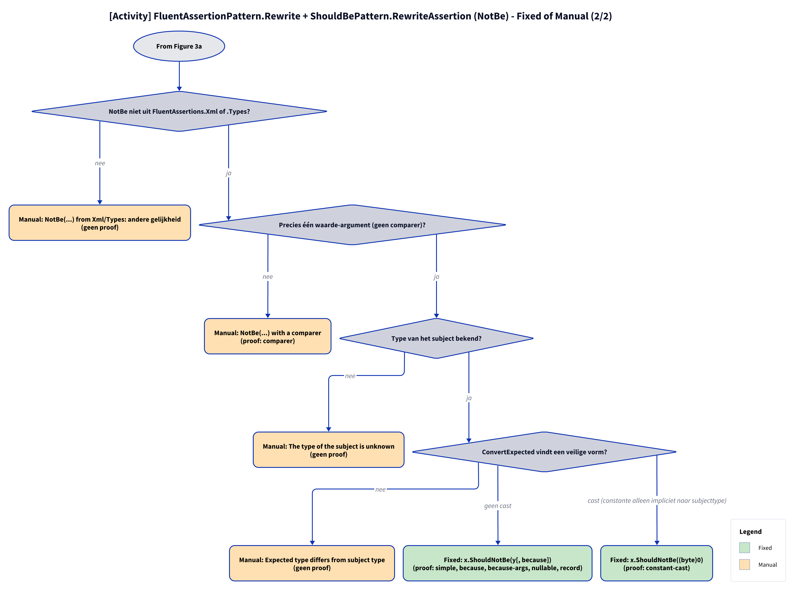

# Models: fa.not-be

`x.Should().NotBe(y)` to `x.ShouldNotBe(y)`. Facts from `src/Unshackle.Core/Fixes/FluentAssertions/Patterns/NotBePattern.cs`.

**Figure 1.** Classes around `NotBePattern`. It reuses `FluentAssertionsSyntax.ConvertExpected` for the type conversion (since REVIEW-A a subclass of `ShouldBePattern`, which inherits from `FluentAssertionPattern`; `NotBePattern` only overrides `Find` and `ShouldName`). Omitted: `Fixer`, `IFix` and the usings handling (see [../modellen/klassen.md](../modellen/klassen.md)).

<!-- kingmadoc:diagram img/fa-not-be-modellen-1.d2 -->

| Element                                        | Path                                                                    | Role                                                                                              |
| ---------------------------------------------- | ----------------------------------------------------------------------- | ------------------------------------------------------------------------------------------------- |
| `IPattern`                                     | `src/Unshackle.Core/Abstractions/IPattern.cs`                           | Contract: `Find` and `Rewrite`                                                                    |
| `FluentAssertionPattern` | `src/Unshackle.Core/Fixes/FluentAssertions/FluentAssertionPattern.cs` | Template Method: `Rewrite` handles scope, form, result and because(-args), then `RewriteAssertion` |
| `ShouldBePattern` | `src/Unshackle.Core/Fixes/FluentAssertions/Patterns/ShouldBePattern.cs` | Base: `RewriteAssertion` with the own checks, `ShouldName` virtual |
| `NotBePattern`                                 | `src/Unshackle.Core/Fixes/FluentAssertions/Patterns/NotBePattern.cs`    | This pattern, Id `fa.not-be`                                                                      |
| `FluentAssertionsSyntax.ConvertExpected`              | `src/Unshackle.Core/Fixes/FluentAssertions/FluentAssertionsSyntax.cs` | Cast of the expected value to the subject type, or `null`                                         |
| `FluentAssertionsSyntax`                       | `src/Unshackle.Core/Fixes/FluentAssertions/FluentAssertionsSyntax.cs`   | `FindInvocations`, `IsInsideAssertionScope`, `GetSubject`, `IsResultDiscarded`, `TryGetArguments` |
| `PatternResult`, `FixedResult`, `ManualResult` | `src/Unshackle.Core/Models/`                                            | Outcome                                                                                           |
| «FluentAssertions» recognized                  | -                                                                       | `NotBe(unexpected[, because])`                                                                    |
| «Shouldly» created                             | -                                                                       | `ShouldNotBe(unexpected[, because])`                                                              |

**Figure 2.** `Fixer` calls `Find` and, per node, `Rewrite`. Omitted: the replacement of the node and the usings by the `Fixer`.

<!-- kingmadoc:diagram img/fa-not-be-modellen-2.d2 -->

| Step      | Location               | What happens                                                          |
| --------- | ---------------------- | --------------------------------------------------------------------- |
| Find      | `NotBePattern.Find`    | `FindInvocations(root, model, "NotBe")`                               |
| Checks    | `FluentAssertionPattern.Rewrite` → `ShouldBePattern.RewriteAssertion` | scope, form, result, arguments; then namespace, comparer, subject type, conversion |
| Manual    | `PatternResult.Manual` | First failed check (figure 3)                                         |
| Fixed     | `PatternResult.Fixed`  | `subject.ShouldNotBe(arguments)`                                      |

**Figure 3a.** Decision tree of `FluentAssertionPattern.Rewrite` + `ShouldBePattern.RewriteAssertion` in code order; proofs in `src/Unshackle.Tests/Proofs/FluentAssertions/NotBe/`. Split into Figures 3a–3b (at most 12 arrows each).

<!-- kingmadoc:diagram img/fa-not-be-modellen-3.d2 -->

**Figure 3b.** Continuation of Figure 3a from its "Continued in Figure 3b" node.

<!-- kingmadoc:diagram img/fa-not-be-modellen-4.d2 -->

| Question                   | If no: Manual reason                              | Proof                                                             |
| -------------------------- | ------------------------------------------------- | ----------------------------------------------------------------- |
| Outside an AssertionScope? | Inside an AssertionScope                          | `assertion-scope`                                                 |
| Form x.Should().NotBe(y)?  | NotBe(...) is not in the form x.Should().NotBe(y) | no proof, guarded in code                                         |
| Result discarded?          | The result of NotBe(...) is used                  | `chain`                                                           |
| No named arguments; because constant and formattable? | named arguments, or becauseArgs whose because is no constant format string | no proof (becauseArgs with constant because is Fixed: `because-args`) |
| Not from Xml/Types?        | different equality                                | no proof, same rule as `fa.should-be` (`xml`)                     |
| One value argument?        | with a comparer                                   | `comparer`                                                        |
| Subject type known?        | The type of the subject is unknown                | no proof                                                          |
| Safe conversion?           | Expected type differs from subject type           | no proof, same rule as `fa.should-be` (`nullable-expected`)       |

| Condition  | Fixed form                    | Proofs                                    |
| ---------- | ----------------------------- | ----------------------------------------- |
| no cast    | `x.ShouldNotBe(y[, because])` | `simple`, `because`, `because-args`, `nullable`, `record` |
| cast       | `x.ShouldNotBe((byte)0)`      | `constant-cast`                           |

## See also

- [fa-not-be-plan.md](fa-not-be-plan.md) - plan
- [fa-not-be-verify.md](fa-not-be-verify.md) - verification
- `src/Unshackle.Core/Fixes/FluentAssertions/Patterns/NotBePattern.cs` - the pattern
- `src/Unshackle.Tests/Proofs/FluentAssertions/NotBe/` - the proofs
- [../README.md](../README.md)
