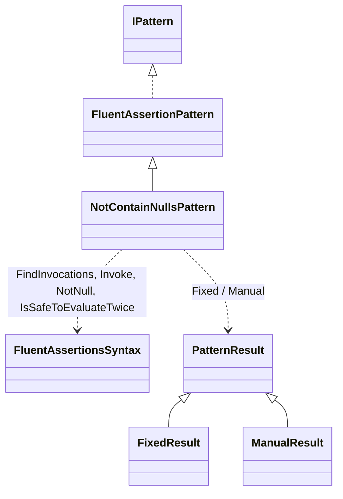
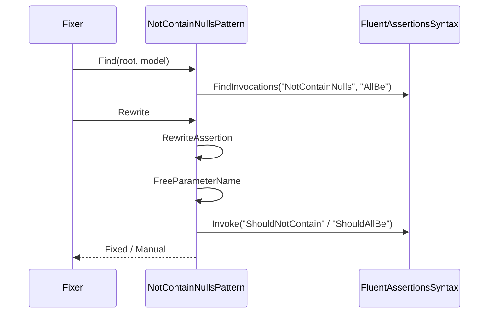

# Modellen: fa.not-contain-nulls

`NotContainNulls()` en `AllBe("v")` worden een predicaat-aanroep. Feiten uit `src/Unshackle.Core/Fixes/FluentAssertions/Patterns/NotContainNullsPattern.cs`. Diagrammen met de hand in Mermaid (kingmadoc/d2 ontbreken).

**Figure 1.** Klassen rond `NotContainNullsPattern`.

| Element | Pad | Rol |
| --- | --- | --- |
| `FluentAssertionPattern` | `src/Unshackle.Core/Fixes/FluentAssertions/FluentAssertionPattern.cs` | Template Method: scope, vorm, resultaat, because(-args) |
| `NotContainNullsPattern` | `src/Unshackle.Core/Fixes/FluentAssertions/Patterns/NotContainNullsPattern.cs` | Dit patroon, Id `fa.not-contain-nulls` |
| `FluentAssertionsSyntax` | `src/Unshackle.Core/Fixes/FluentAssertions/FluentAssertionsSyntax.cs` | Hulpmethodes |
| `PatternResult` e.a. | `src/Unshackle.Core/Models/` | Uitkomst |

**Figure 2.** Volgorde.

| Stap | Plek | Wat gebeurt er |
| --- | --- | --- |
| Find | `Find` | Alle `NotContainNulls`- en `AllBe`-aanroepen op FA |
| Naam | `FreeParameterName` | Eerste naam uit `i`, `item`, `x`, ... die niet in scope is |
| Herschrijven | `RewriteNotContainNulls` / `RewriteAllBe` | Predicaat als argument, because erachter |

**Figure 3.** Beslisboom.

| Vraag | Uitkomst | Proof |
| --- | --- | --- |
| AssertionScope? | Manual | `assertion-scope`, `all-be-assertion-scope` |
| Resultaat gebruikt? | Manual | `result-used`, `all-be-result-used` |
| Selector? | Manual | `selector` |
| Waardetype? | Manual | `value-type` |
| Berekende waarde? | Manual | `all-be-computed` |
| Gewoon geval | Fixed | `simple`, `all-be-string` |

## Zie ook

- [fa-not-contain-nulls-plan.md](fa-not-contain-nulls-plan.md)
- [fa-not-contain-nulls-verify.md](fa-not-contain-nulls-verify.md)
- `src/Unshackle.Core/Fixes/FluentAssertions/Patterns/NotContainNullsPattern.cs`
- `src/Unshackle.Tests/Proofs/FluentAssertions/NotContainNulls/`
