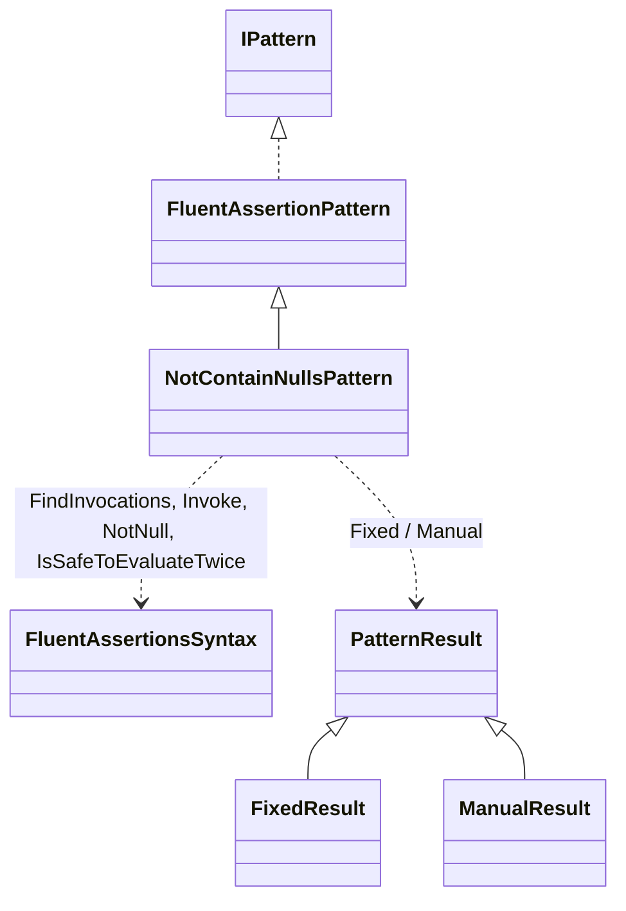
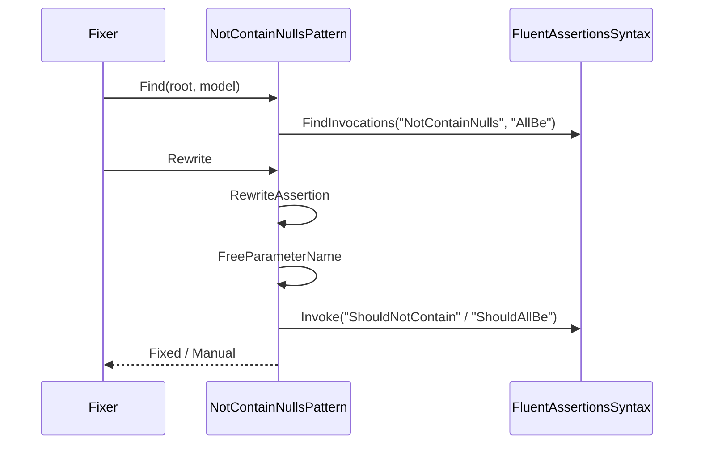
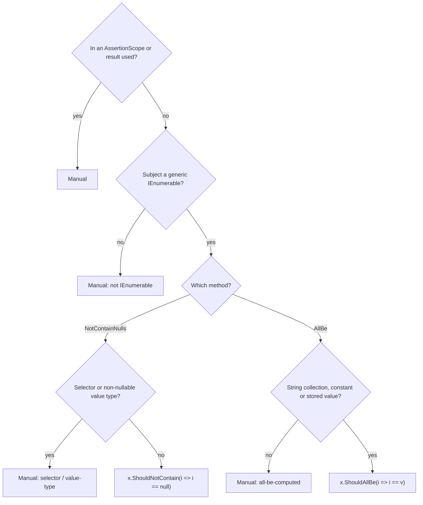

# Models: fa.not-contain-nulls

`NotContainNulls()` and `AllBe("v")` become a predicate call. Facts from `src/Unshackle.Core/Fixes/FluentAssertions/Patterns/NotContainNullsPattern.cs`. Diagrams by hand in Mermaid (kingmadoc/d2 missing).

**Figure 1.** Classes around `NotContainNullsPattern`.

| Element | Path | Role |
| --- | --- | --- |
| `FluentAssertionPattern` | `src/Unshackle.Core/Fixes/FluentAssertions/FluentAssertionPattern.cs` | Template Method: scope, shape, result, because(-args) |
| `NotContainNullsPattern` | `src/Unshackle.Core/Fixes/FluentAssertions/Patterns/NotContainNullsPattern.cs` | This pattern, Id `fa.not-contain-nulls` |
| `FluentAssertionsSyntax` | `src/Unshackle.Core/Fixes/FluentAssertions/FluentAssertionsSyntax.cs` | Helper methods |
| `PatternResult` etc. | `src/Unshackle.Core/Models/` | Outcome |

**Figure 2.** Sequence.

| Step | Place | What happens |
| --- | --- | --- |
| Find | `Find` | All `NotContainNulls` and `AllBe` calls on FA |
| Name | `FreeParameterName` | The first name from `i`, `item`, `x`, ... that is not in scope |
| Rewrite | `RewriteNotContainNulls` / `RewriteAllBe` | Predicate as the argument, because after it |

**Figure 3.** Decision tree.

| Question | Outcome | Proof |
| --- | --- | --- |
| AssertionScope? | Manual | `assertion-scope`, `all-be-assertion-scope` |
| Result used? | Manual | `result-used`, `all-be-result-used` |
| Selector? | Manual | `selector` |
| Value type? | Manual | `value-type` |
| Computed value? | Manual | `all-be-computed` |
| Plain case | Fixed | `simple`, `all-be-string` |

## See also

- [fa-not-contain-nulls-plan.md](fa-not-contain-nulls-plan.md)
- [fa-not-contain-nulls-verify.md](fa-not-contain-nulls-verify.md)
- `src/Unshackle.Core/Fixes/FluentAssertions/Patterns/NotContainNullsPattern.cs`
- `src/Unshackle.Tests/Proofs/FluentAssertions/NotContainNulls/`
