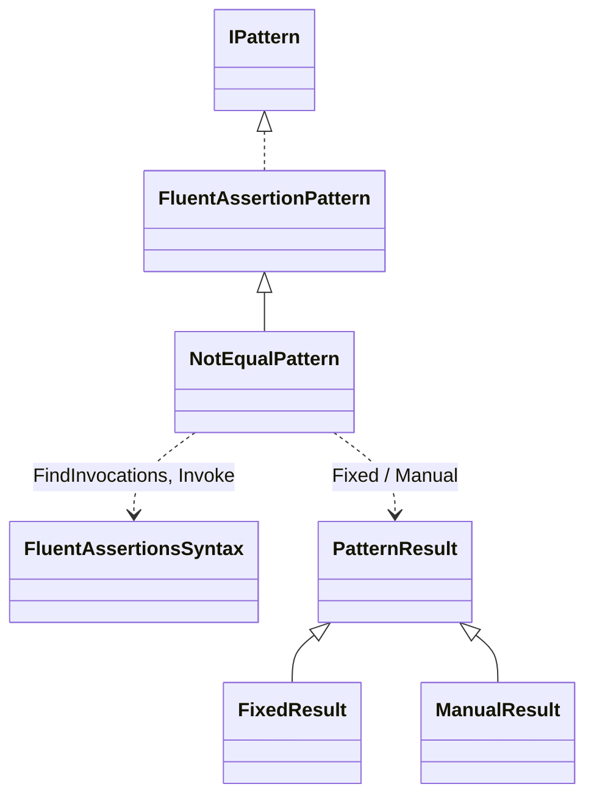
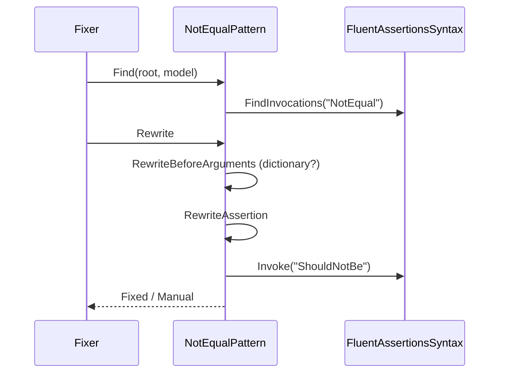
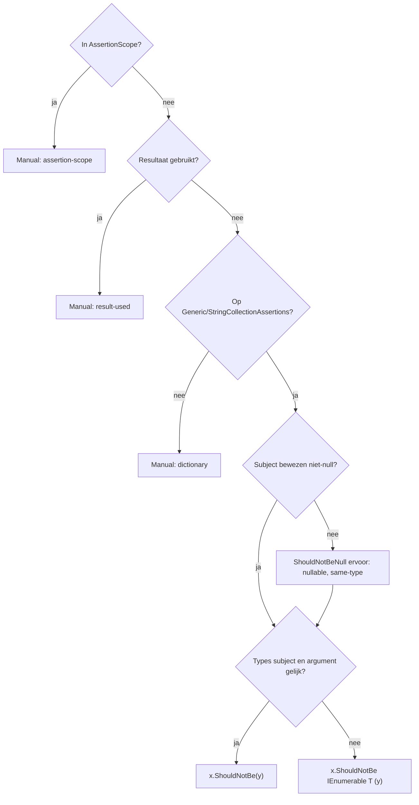

# Modellen: fa.not-equal

`x.Should().NotEqual(y)` wordt `x.ShouldNotBe(y)`. Feiten uit `src/Unshackle.Core/Fixes/FluentAssertions/Patterns/NotEqualPattern.cs`. Diagrammen met de hand in Mermaid (kingmadoc/d2 ontbreken).

**Figure 1.** Klassen rond `NotEqualPattern`.

| Element | Pad | Rol |
| --- | --- | --- |
| `FluentAssertionPattern` | `src/Unshackle.Core/Fixes/FluentAssertions/FluentAssertionPattern.cs` | Template Method: scope, vorm, resultaat, because(-args) |
| `NotEqualPattern` | `src/Unshackle.Core/Fixes/FluentAssertions/Patterns/NotEqualPattern.cs` | Dit patroon, Id `fa.not-equal` |
| `FluentAssertionsSyntax` | `src/Unshackle.Core/Fixes/FluentAssertions/FluentAssertionsSyntax.cs` | `FindInvocations`, `Invoke` |
| `PatternResult` e.a. | `src/Unshackle.Core/Models/` | Uitkomst |

**Figure 2.** Volgorde.

| Stap | Plek | Wat gebeurt er |
| --- | --- | --- |
| Find | `NotEqualPattern.Find` | Alle `NotEqual`-aanroepen op FA |
| Controle | `RewriteBeforeArguments` | Dictionary-overload → Manual |
| Herschrijven | `RewriteAssertion` | `ShouldNotBe`, evt. met `IEnumerable<T>` |

**Figure 3.** Beslisboom.

| Vraag | Uitkomst | Proof |
| --- | --- | --- |
| AssertionScope? | Manual | `assertion-scope` |
| Resultaat gebruikt? | Manual | `result-used` |
| Collection-assertions? | Anders Manual | `dictionary` |
| Types gelijk? | `ShouldNotBe(y)` of met `IEnumerable<T>` | `same-type`, `interface-type`, `string-collection`, `because`, `because-args`, `nullable` / `different-type`, `array-literal` |

## Zie ook

- [fa-not-equal-plan.md](fa-not-equal-plan.md)
- [fa-not-equal-verify.md](fa-not-equal-verify.md)
- `src/Unshackle.Core/Fixes/FluentAssertions/Patterns/NotEqualPattern.cs`
- `src/Unshackle.Tests/Proofs/FluentAssertions/NotEqual/`
