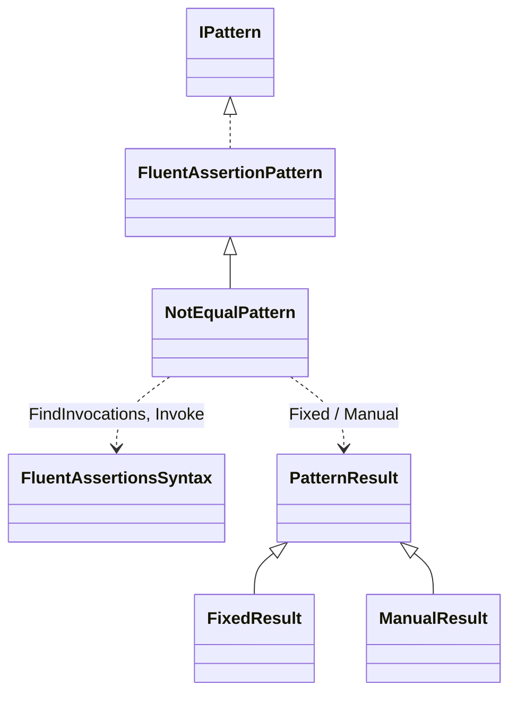
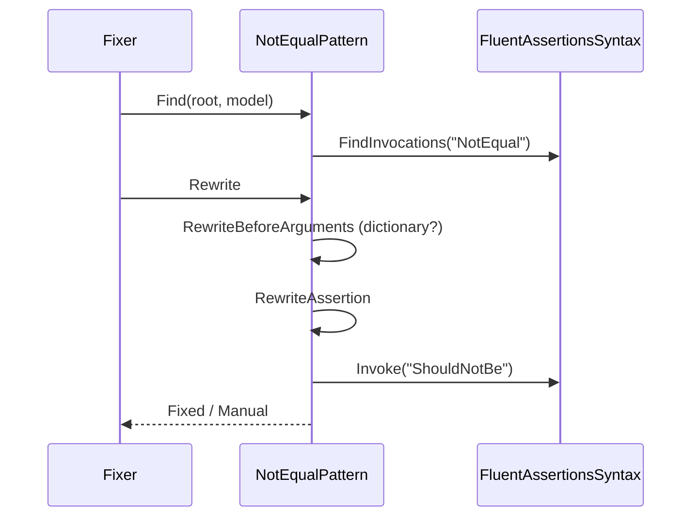
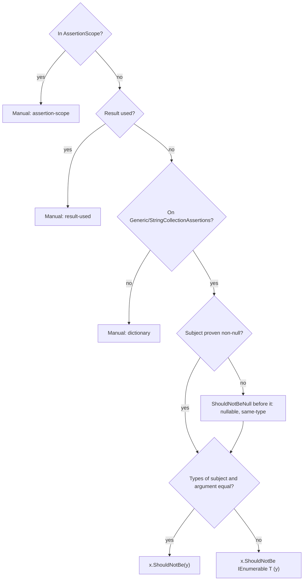

# Models: fa.not-equal

`x.Should().NotEqual(y)` becomes `x.ShouldNotBe(y)`. Facts from `src/Unshackle.Core/Fixes/FluentAssertions/Patterns/NotEqualPattern.cs`. Diagrams by hand in Mermaid (kingmadoc/d2 missing).

**Figure 1.** Classes around `NotEqualPattern`.

| Element | Path | Role |
| --- | --- | --- |
| `FluentAssertionPattern` | `src/Unshackle.Core/Fixes/FluentAssertions/FluentAssertionPattern.cs` | Template Method: scope, shape, result, because(-args) |
| `NotEqualPattern` | `src/Unshackle.Core/Fixes/FluentAssertions/Patterns/NotEqualPattern.cs` | This pattern, Id `fa.not-equal` |
| `FluentAssertionsSyntax` | `src/Unshackle.Core/Fixes/FluentAssertions/FluentAssertionsSyntax.cs` | `FindInvocations`, `Invoke` |
| `PatternResult` etc. | `src/Unshackle.Core/Models/` | Outcome |

**Figure 2.** Sequence.

| Step | Place | What happens |
| --- | --- | --- |
| Find | `NotEqualPattern.Find` | All `NotEqual` calls on FA |
| Check | `RewriteBeforeArguments` | Dictionary overload → Manual |
| Rewrite | `RewriteAssertion` | `ShouldNotBe`, possibly with `IEnumerable<T>` |

**Figure 3.** Decision tree.

| Question | Outcome | Proof |
| --- | --- | --- |
| AssertionScope? | Manual | `assertion-scope` |
| Result used? | Manual | `result-used` |
| Collection assertions? | Otherwise Manual | `dictionary` |
| Types equal? | `ShouldNotBe(y)` or with `IEnumerable<T>` | `same-type`, `interface-type`, `string-collection`, `because`, `because-args`, `nullable` / `different-type`, `array-literal` |

## See also

- [fa-not-equal-plan.md](fa-not-equal-plan.md)
- [fa-not-equal-verify.md](fa-not-equal-verify.md)
- `src/Unshackle.Core/Fixes/FluentAssertions/Patterns/NotEqualPattern.cs`
- `src/Unshackle.Tests/Proofs/FluentAssertions/NotEqual/`
