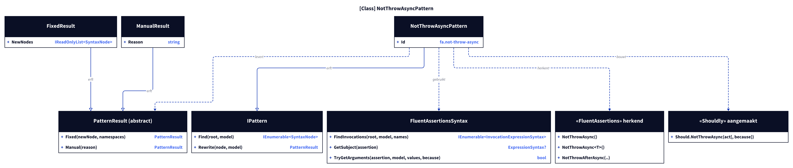
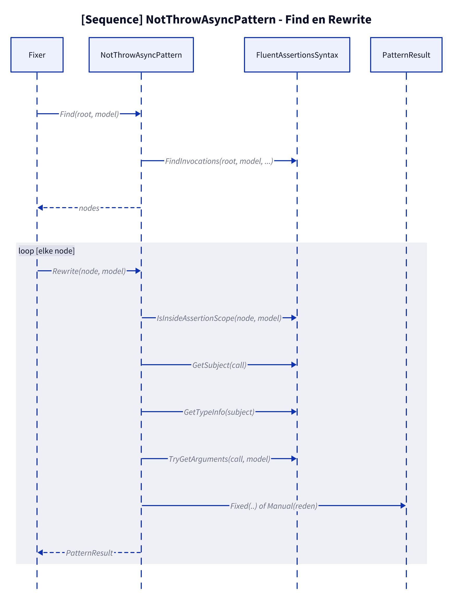
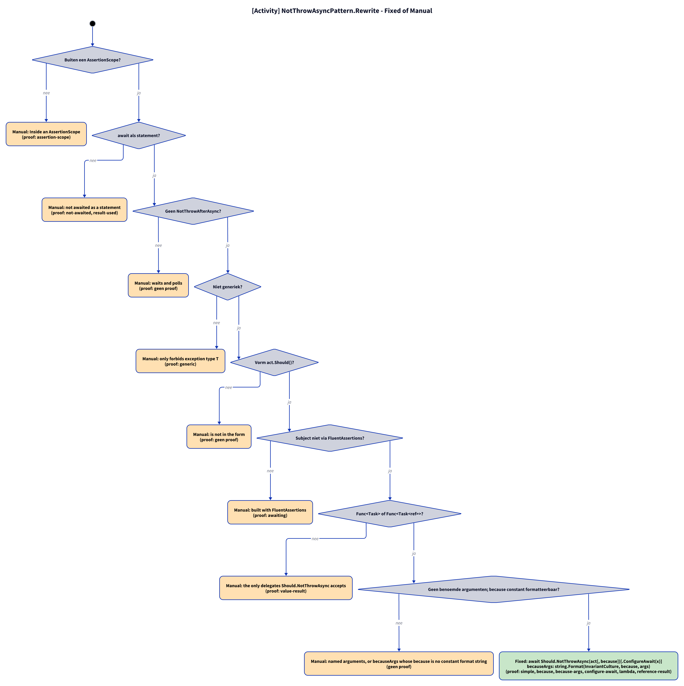

# Modellen: fa.not-throw-async

`await act.Should().NotThrowAsync()` wordt `await Should.NotThrowAsync(act)`, met `because` en `.ConfigureAwait(..)`. Feiten uit `src/Unshackle.Core/Fixes/FluentAssertions/Patterns/NotThrowAsyncPattern.cs`.

**Figure 1.** Klassen rond `NotThrowAsyncPattern`. Weggelaten: `Fixer`, `IFix` en de usings (zie [../modellen/klassen.md](../modellen/klassen.md)).

<!-- kingmadoc:diagram img/fa-not-throw-async-modellen-1.d2 -->

| Element | Pad | Rol |
| --- | --- | --- |
| `IPattern` | `src/Unshackle.Core/` | Basis/contract |
| `NotThrowAsyncPattern` | `src/Unshackle.Core/Fixes/FluentAssertions/Patterns/NotThrowAsyncPattern.cs` | Dit patroon, Id `fa.not-throw-async` |
| `FluentAssertionsSyntax` | `src/Unshackle.Core/Fixes/FluentAssertions/FluentAssertionsSyntax.cs` | Gedeelde controles |
| `PatternResult`, `FixedResult`, `ManualResult` | `src/Unshackle.Core/Models/` | Uitkomst |

**Figure 2.** Volgorde van `Find` en `Rewrite`.

<!-- kingmadoc:diagram img/fa-not-throw-async-modellen-2.d2 -->

| Stap | Plek | Wat gebeurt er |
| --- | --- | --- |
| Find | `NotThrowAsyncPattern.Find` | `FindInvocations` op de FA-namen |
| Controles | `NotThrowAsyncPattern.Rewrite` | `IsInsideAssertionScope`, `GetSubject`, `GetTypeInfo`, `TryGetArguments` |
| Uitkomst | `PatternResult.Fixed` / `Manual` | Shouldly-aanroep of reden |

**Figure 3.** Beslisboom van `Rewrite`; proofs in `src/Unshackle.Tests/Proofs/FluentAssertions/NotThrowAsync/`.

<!-- kingmadoc:diagram img/fa-not-throw-async-modellen-3.d2 -->

| Vraag | Bij nee: Manual-reden | Proof |
| --- | --- | --- |
| Buiten een AssertionScope? | Inside an AssertionScope | `assertion-scope` |
| await als statement? | not awaited as a statement | `not-awaited, result-used` |
| Geen NotThrowAfterAsync? | waits and polls | `geen proof` |
| Niet generiek? | only forbids exception type T | `generic` |
| Vorm act.Should()? | is not in the form | `geen proof` |
| Subject niet via FluentAssertions? | built with FluentAssertions | `awaiting` |
| Func<Task> of Func<Task<ref>>? | the only delegates Should.NotThrowAsync accepts | `value-result` |
| Geen benoemde argumenten; because constant formatteerbaar? | named arguments, or becauseArgs whose because is no constant format string | `geen proof` |
| Fixed | `await Should.NotThrowAsync(act[, because])[.ConfigureAwait(x)]`; becauseArgs via `string.Format(CultureInfo.InvariantCulture, because, args)` (TAAK-097) | simple, because, because-args, configure-await, lambda, reference-result |

## Zie ook

- [fa-not-throw-async-plan.md](fa-not-throw-async-plan.md) - plan
- [fa-not-throw-async-verify.md](fa-not-throw-async-verify.md) - verificatie
- `src/Unshackle.Core/Fixes/FluentAssertions/Patterns/NotThrowAsyncPattern.cs` - het patroon
- `src/Unshackle.Tests/Proofs/FluentAssertions/NotThrowAsync/` - de proofs
- [../README.md](../README.md)
