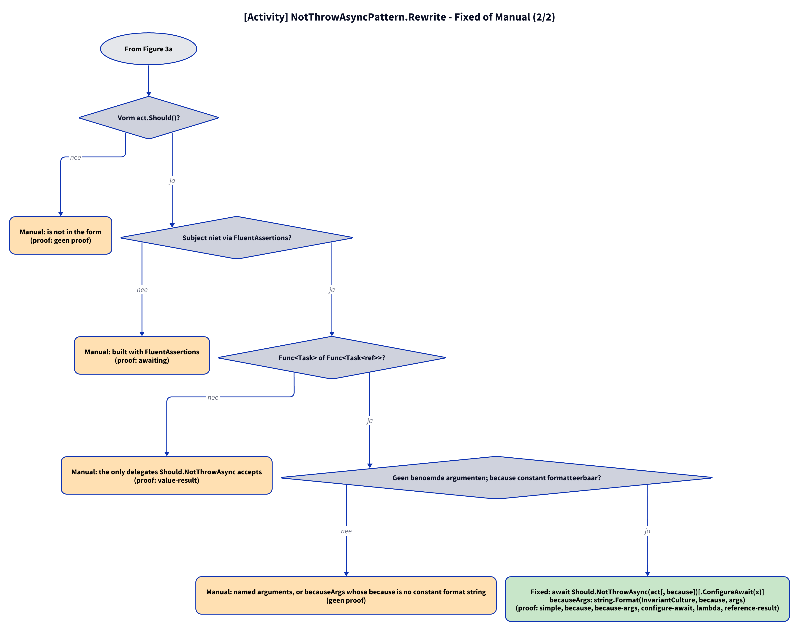

# Models: fa.not-throw-async

`await act.Should().NotThrowAsync()` becomes `await Should.NotThrowAsync(act)`, with `because` and `.ConfigureAwait(..)`. Facts from `src/Unshackle.Core/Fixes/FluentAssertions/Patterns/NotThrowAsyncPattern.cs`.

**Figure 1.** Classes around `NotThrowAsyncPattern`. Left out: `Fixer`, `IFix` and the usings (see [../modellen/klassen.md](../modellen/klassen.md)).

<!-- kingmadoc:diagram img/fa-not-throw-async-modellen-1.d2 -->

| Element | Path | Role |
| --- | --- | --- |
| `IPattern` | `src/Unshackle.Core/` | Base/contract |
| `NotThrowAsyncPattern` | `src/Unshackle.Core/Fixes/FluentAssertions/Patterns/NotThrowAsyncPattern.cs` | This pattern, Id `fa.not-throw-async` |
| `FluentAssertionsSyntax` | `src/Unshackle.Core/Fixes/FluentAssertions/FluentAssertionsSyntax.cs` | Shared checks |
| `PatternResult`, `FixedResult`, `ManualResult` | `src/Unshackle.Core/Models/` | Outcome |

**Figure 2.** Sequence of `Find` and `Rewrite`.

<!-- kingmadoc:diagram img/fa-not-throw-async-modellen-2.d2 -->

| Step | Place | What happens |
| --- | --- | --- |
| Find | `NotThrowAsyncPattern.Find` | `FindInvocations` on the FA names |
| Checks | `NotThrowAsyncPattern.Rewrite` | `IsInsideAssertionScope`, `GetSubject`, `GetTypeInfo`, `TryGetArguments` |
| Outcome | `PatternResult.Fixed` / `Manual` | Shouldly call or reason |

**Figure 3a.** Decision tree of `Rewrite`; proofs in `src/Unshackle.Tests/Proofs/FluentAssertions/NotThrowAsync/`. Split into Figures 3a–3b (at most 12 arrows each).

<!-- kingmadoc:diagram img/fa-not-throw-async-modellen-3.d2 -->

**Figure 3b.** Continuation of Figure 3a from its "Continued in Figure 3b" node.

<!-- kingmadoc:diagram img/fa-not-throw-async-modellen-4.d2 -->

| Question | If no: Manual reason | Proof |
| --- | --- | --- |
| Outside an AssertionScope? | Inside an AssertionScope | `assertion-scope` |
| await as a statement? | not awaited as a statement | `not-awaited, result-used` |
| No NotThrowAfterAsync? | waits and polls | `no proof` |
| Not generic? | only forbids exception type T | `generic` |
| Shape act.Should()? | is not in the form | `no proof` |
| Subject not via FluentAssertions? | built with FluentAssertions | `awaiting` |
| Func<Task> or Func<Task<ref>>? | the only delegates Should.NotThrowAsync accepts | `value-result` |
| No named arguments; because constant and formattable? | named arguments, or becauseArgs whose because is no constant format string | `no proof` |
| Fixed | `await Should.NotThrowAsync(act[, because])[.ConfigureAwait(x)]`; becauseArgs via `string.Format(CultureInfo.InvariantCulture, because, args)` (TAAK-097) | simple, because, because-args, configure-await, lambda, reference-result |

## See also

- [fa-not-throw-async-plan.md](fa-not-throw-async-plan.md) - plan
- [fa-not-throw-async-verify.md](fa-not-throw-async-verify.md) - verification
- `src/Unshackle.Core/Fixes/FluentAssertions/Patterns/NotThrowAsyncPattern.cs` - the pattern
- `src/Unshackle.Tests/Proofs/FluentAssertions/NotThrowAsync/` - the proofs
- [../README.md](../README.md)
