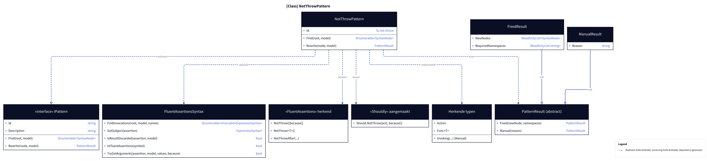
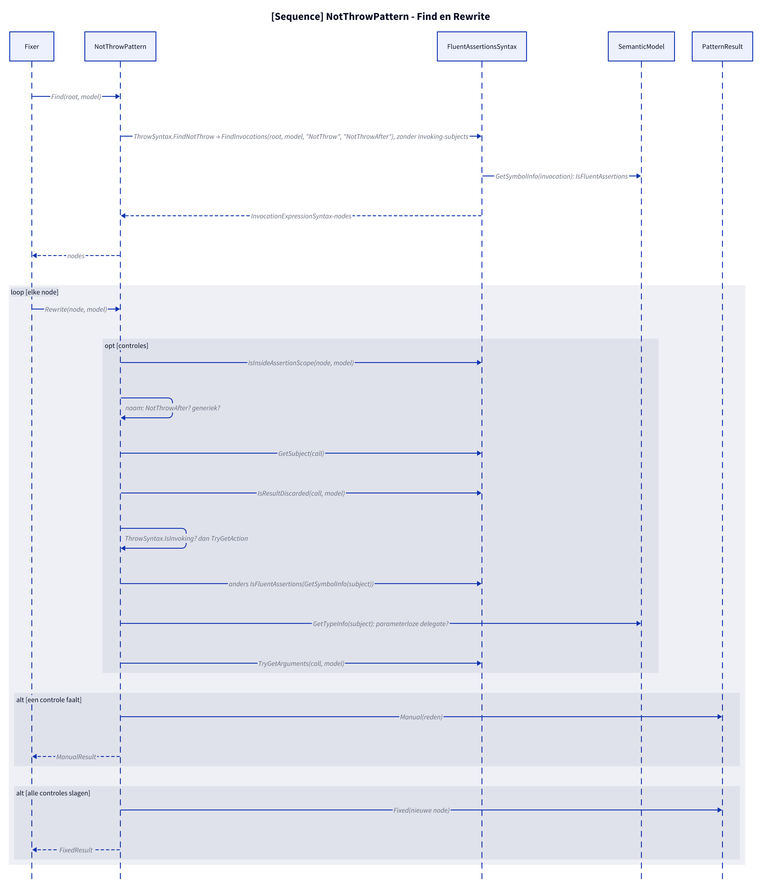
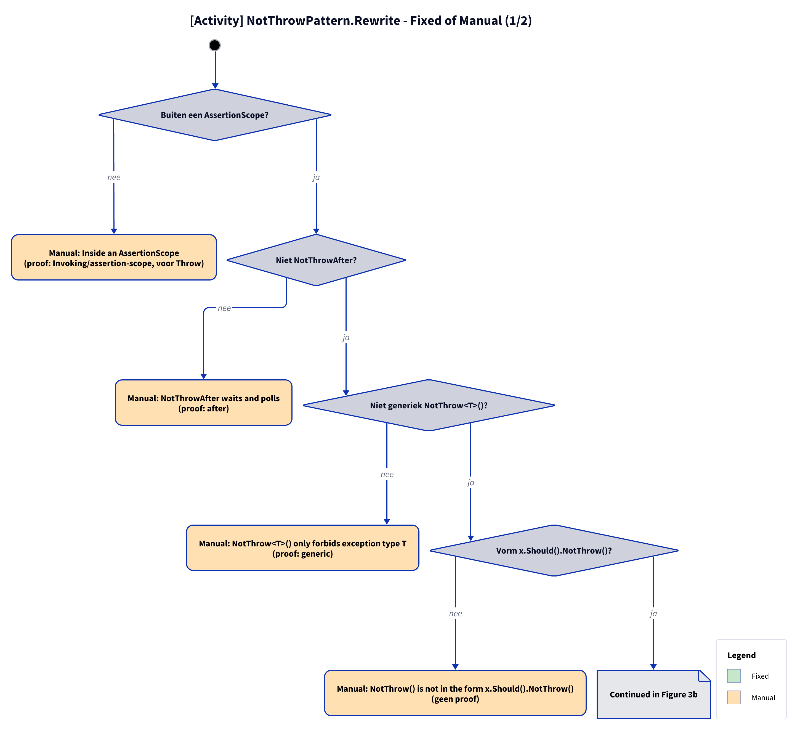
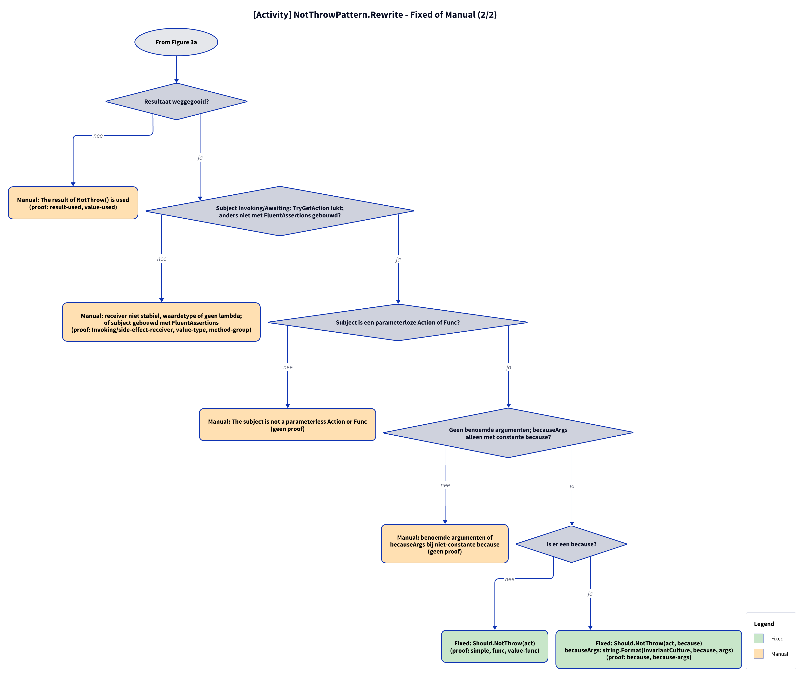

# Models: fa.not-throw

act.Should().NotThrow() to Should.NotThrow(act). Facts from `src/Unshackle.Core/Fixes/FluentAssertions/Patterns/NotThrowPattern.cs`.

**Figure 1.** Classes around `NotThrowPattern`: what it implements, uses and creates. Left out: `Fixer`, `IFix` and the usings handling (see [../modellen/klassen.md](../modellen/klassen.md)).

<!-- kingmadoc:diagram img/fa-not-throw-modellen-1.d2 -->

| Element | Path | Role |
| --- | --- | --- |
| `IPattern` | `src/Unshackle.Core/Abstractions/IPattern.cs` | Contract: `Find` and `Rewrite` |
| `NotThrowPattern` | `src/Unshackle.Core/Fixes/FluentAssertions/Patterns/NotThrowPattern.cs` | This pattern, Id `fa.not-throw` |
| `ThrowSyntax` | `src/Unshackle.Core/Fixes/FluentAssertions/Patterns/ThrowSyntax.cs` | `FindNotThrow`, `IsInvoking`, `TryGetAction` |
| `FluentAssertionsSyntax` | `src/Unshackle.Core/Fixes/FluentAssertions/FluentAssertionsSyntax.cs` | Shared building blocks: `IsInsideAssertionScope`, `GetSubject`, `IsResultDiscarded`, `IsFluentAssertions`, `TryGetArguments` |
| `PatternResult`, `FixedResult`, `ManualResult` | `src/Unshackle.Core/Models/` | Outcome: `Fixed` with new node(s) and namespaces, or `Manual` with a reason |
| «FluentAssertions» recognised | - | `NotThrow([because])`; `NotThrow<T>()`; `NotThrowAfter(...)` |
| «Shouldly» created | - | `Should.NotThrow(act[, because])` |
| Recognised types | - | `Action`; `Func<T>`; `Invoking(...)` (via `InvokingPattern`) |

**Figure 2.** `Fixer` calls `Find` and `Rewrite` per node; `Rewrite` does the checks via `FluentAssertionsSyntax` and `SemanticModel` and returns `Fixed` or `Manual`. Left out: replacing the node and the usings by the `Fixer`.

<!-- kingmadoc:diagram img/fa-not-throw-modellen-2.d2 -->

| Step | Place | What happens |
| --- | --- | --- |
| Find | `NotThrowPattern.Find` | `ThrowSyntax.FindNotThrow` looks for FA calls `NotThrow`, `NotThrowAfter`; subjects with `Invoking(...)` belong to `InvokingPattern`, which calls `NotThrowPattern.Rewrite` |
| Checks | `NotThrowPattern.Rewrite` | `IsInsideAssertionScope`; `naam`; `GetSubject(call)`; `IsResultDiscarded(call, model)`; `ThrowSyntax.IsInvoking`/`TryGetAction`; `IsFluentAssertions(GetSymbolInfo(subject))`; `GetTypeInfo(subject)`; `TryGetArguments(call, model)` |
| Manual | `PatternResult.Manual` | The first failing check gives a `ManualResult` with a reason (see figure 3) |
| Fixed | `PatternResult.Fixed` | New node; the `Fixer` handles trivia and usings |

**Figure 3a.** Decision tree of `Rewrite`: 8 questions in the order of the code, every leaf names the proof in `src/Unshackle.Tests/Proofs/FluentAssertions/NotThrow/` that proves it (`<name>.before.cs` with `.after.cs` or `.manual.txt`). Split into Figures 3a–3b (at most 12 arrows each).

<!-- kingmadoc:diagram img/fa-not-throw-modellen-3.d2 -->

**Figure 3b.** Continuation of Figure 3a from its "Continued in Figure 3b" node.

<!-- kingmadoc:diagram img/fa-not-throw-modellen-4.d2 -->

| Question or selector | If no: Manual reason | Proof |
| --- | --- | --- |
| Outside an AssertionScope? | Inside an AssertionScope | `Invoking/assertion-scope` (shows it for Throw) |
| Not NotThrowAfter? | NotThrowAfter waits and polls | `after` |
| Not generic NotThrow<T>()? | NotThrow<T>() only forbids exception type T | `generic` |
| Shape x.Should().NotThrow()? | NotThrow() is not in the form x.Should().NotThrow() | no proof, guarded in code |
| Result discarded? | The result of NotThrow() is used | `result-used`, `value-used` |
| Subject `Invoking`/`Awaiting`: `ThrowSyntax.TryGetAction` succeeds; otherwise subject not built with FluentAssertions? | receiver not stable, value type, no lambda; or The subject is built with FluentAssertions | `Invoking/side-effect-receiver`, `value-type`, `method-group` |
| Subject is a parameterless Action or Func? | The subject is not a parameterless Action or Func | no proof, guarded in code |
| No named arguments, becauseArgs only with a constant `because`? | named arguments, or becauseArgs whose because is no constant format string | no proof, guarded in code |

| Condition | Fixed form | Proofs |
| --- | --- | --- |
| nee | `Should.NotThrow(act)` | `simple`, `func`, `value-func` |
| yes | `Should.NotThrow(act, because)`; with `becauseArgs`: `string.Format(CultureInfo.InvariantCulture, because, args)` | `because`, `because-args` |

## See also

- [fa-not-throw-plan.md](fa-not-throw-plan.md) - plan
- [fa-not-throw-verify.md](fa-not-throw-verify.md) - verification
- `src/Unshackle.Core/Fixes/FluentAssertions/Patterns/NotThrowPattern.cs` - the pattern
- `src/Unshackle.Tests/Proofs/FluentAssertions/NotThrow/` - the proofs
- [../modellen/pattern-beslissing.md](../modellen/pattern-beslissing.md) - generic decision of a pattern
- [../README.md](../README.md)
