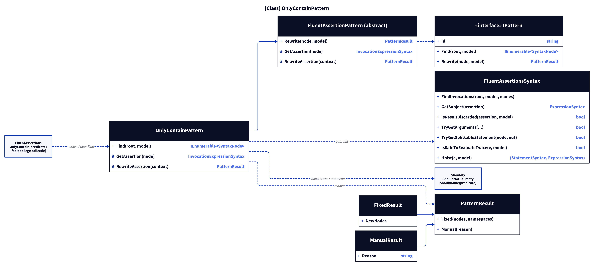
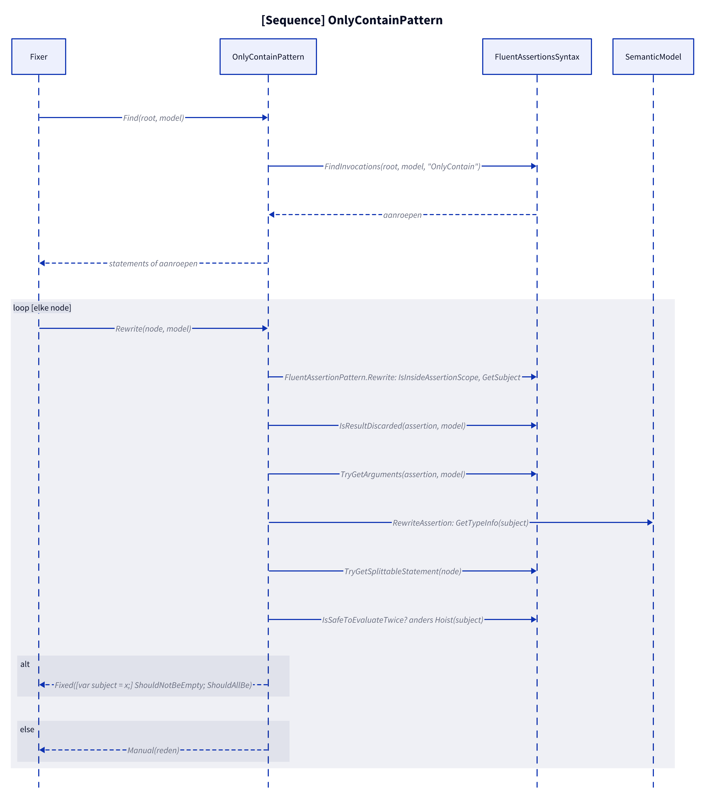
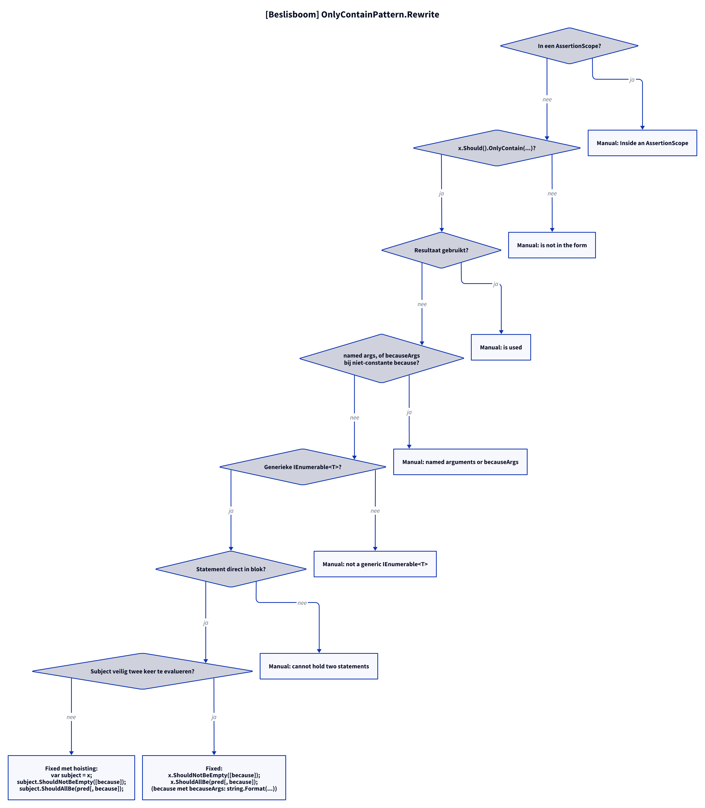

# Modellen: fa.only-contain

Feiten uit `src/Unshackle.Core/Fixes/FluentAssertions/Patterns/OnlyContainPattern.cs`.

## Figuur 1: klassen

**Figure 1.** `OnlyContainPattern`, zijn contract en de helpers; rechts de FluentAssertions-methode die hij herkent en de twee Shouldly-methoden die hij maakt.

<!-- kingmadoc:diagram img/fa-only-contain-modellen-1.d2 -->

| Element | Rol |
| ------- | --- |
| `FluentAssertionPattern` | Basisklasse (Template Method): `Rewrite` doet scope-, subject-, resultaat- en argumentcontroles en roept dan `RewriteAssertion` aan |
| `OnlyContainPattern` | Vindt `OnlyContain` (`Find`, de hele statement als die in een blok staat) en bouwt twee statements (`RewriteAssertion`) |
| `FluentAssertionsSyntax` | Gedeelde stappen: onderwerp, weggegooid resultaat, `because`-argumenten, splitsbaar statement, `IsSafeToEvaluateTwice`/`Hoist` |
| `PatternResult` | `Fixed` met twee statements, of `Manual(reden)` |
| FA- en Shouldly-methoden | `OnlyContain` faalt op een lege collectie, `ShouldAllBe` niet: `ShouldNotBeEmpty` vult dat aan |

## Figuur 2: sequence

**Figure 2.** Eén document: `Find` verzamelt statements of aanroepen, `Rewrite` beslist per node tussen `Fixed` (twee statements) en `Manual`.

<!-- kingmadoc:diagram img/fa-only-contain-modellen-2.d2 -->

| Stap | Methode in de code | Wat gebeurt er |
| ---- | ------------------ | -------------- |
| Vinden | `Find` | `FindInvocations` met `OnlyContain`; staat de aanroep als statement in een blok, dan is de statement de node |
| Scope en subject | `FluentAssertionPattern.Rewrite`: `IsInsideAssertionScope`, `GetSubject` | Niet in een (niet omgezette) `AssertionScope`; moet `x.Should()` zijn, anders Manual |
| Resultaat | `IsResultDiscarded` | Gebruikt resultaat geeft Manual |
| Argumenten | `TryGetArguments` | Predicaat en `because`; `becauseArgs` bij constante `because` worden `string.Format(CultureInfo.InvariantCulture, because, args)`; named args of niet-constante `because` geven Manual |
| Type | `OnlyContainPattern.RewriteAssertion`: `GetTypeInfo` | Moet generieke `IEnumerable<T>` zijn |
| Splitsen | `TryGetSplittableStatement` | Statement direct in een blok, anders Manual |
| Hoisting | `IsSafeToEvaluateTwice`, `Hoist` | Subject met mogelijke bijwerkingen wordt eerst `var subject = x;` |

## Figuur 3: beslisboom

**Figure 3.** Elke vraag in `Rewrite`; de bladeren zijn de Shouldly-vorm of de Manual-reden.

<!-- kingmadoc:diagram img/fa-only-contain-modellen-3.d2 -->

| Blad | Voorwaarde | Proof (`Proofs/FluentAssertions/OnlyContain/`) |
| ---- | ---------- | ---------------------------------------------- |
| Fixed | statement in blok, eenvoudig subject | `simple`, `enumerable`, `array`, `dictionary`, `member-subject` |
| Fixed | met `because` (op beide statements) | `because` |
| Fixed | `becauseArgs` bij constante `because` (`string.Format`) | `because-args` |
| Fixed met hoisting | subject is een aanroep: `var subject = x;` ervoor | `subject-call` |
| Manual "is not in the form" | na `.And` | `and-chain` |
| Manual "is used" | `.And`, variabele | `chain`, `used` |
| Manual "cannot hold two statements" | lambda-body, `if` zonder accolades | `lambda`, `no-block` |

## Zie ook

- [fa-only-contain-plan.md](fa-only-contain-plan.md)
- [fa-only-contain-verify.md](fa-only-contain-verify.md)
- `src/Unshackle.Core/Fixes/FluentAssertions/Patterns/OnlyContainPattern.cs`
- `src/Unshackle.Tests/Proofs/FluentAssertions/OnlyContain/`
