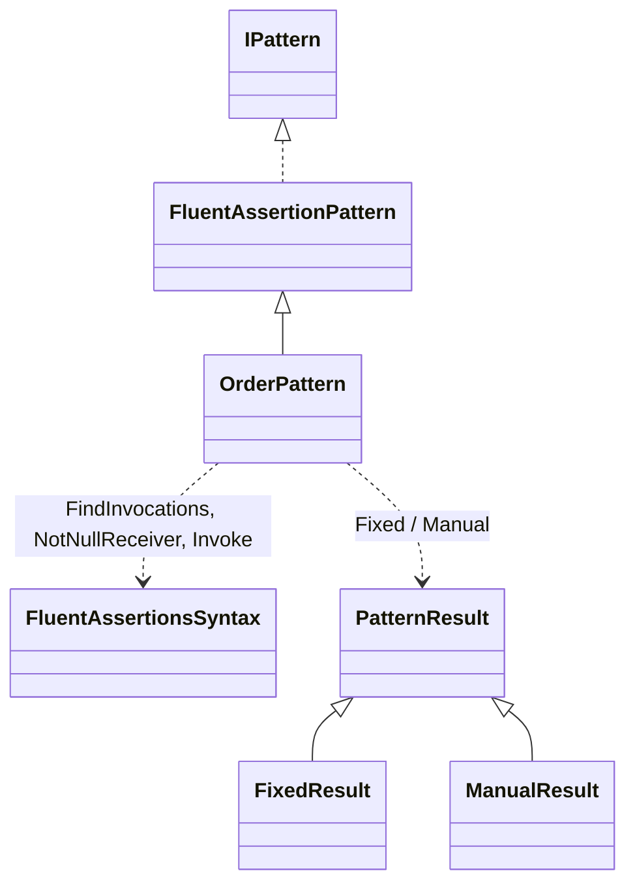
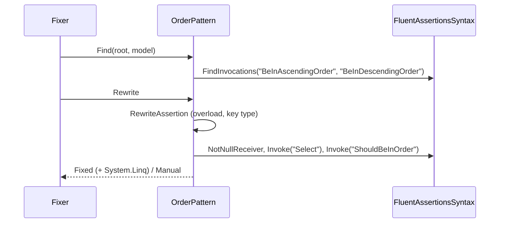
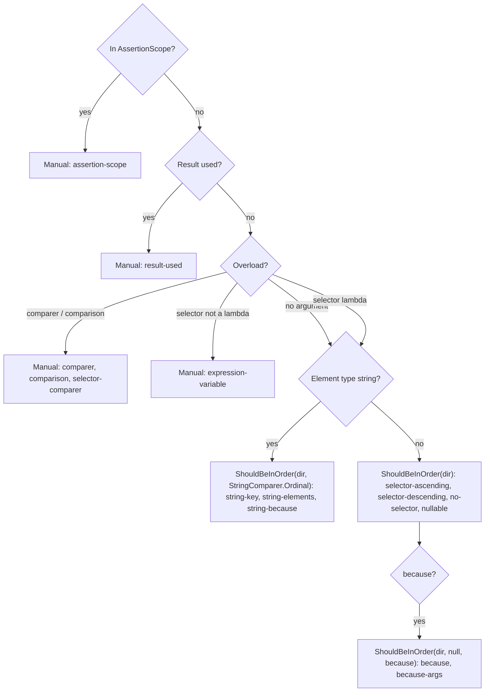

# Models: fa.order

`x.Should().BeInAscendingOrder(p => p.K)` becomes `x.Select(p => p.K).ShouldBeInOrder(SortDirection.Ascending)`. Facts from `src/Unshackle.Core/Fixes/FluentAssertions/Patterns/OrderPattern.cs`. Diagrams by hand in Mermaid (kingmadoc/d2 missing).

**Figure 1.** Classes around `OrderPattern`.

| Element | Path | Role |
| --- | --- | --- |
| `FluentAssertionPattern` | `src/Unshackle.Core/Fixes/FluentAssertions/FluentAssertionPattern.cs` | Template Method: scope, shape, result, because(-args) |
| `OrderPattern` | `src/Unshackle.Core/Fixes/FluentAssertions/Patterns/OrderPattern.cs` | This pattern, Id `fa.order` |
| `FluentAssertionsSyntax` | `src/Unshackle.Core/Fixes/FluentAssertions/FluentAssertionsSyntax.cs` | `FindInvocations`, `NotNullReceiver`, `Invoke` |
| `PatternResult` etc. | `src/Unshackle.Core/Models/` | Outcome |

**Figure 2.** Sequence.

| Step | Place | What happens |
| --- | --- | --- |
| Find | `OrderPattern.Find` | All Be-In-Ascending/Descending-Order calls on FA |
| Overload | `RewriteAssertion` | No argument or a selector lambda; otherwise Manual |
| Rewrite | `RewriteAssertion` | `Select` (with a selector) and `ShouldBeInOrder` with direction, comparer and because |

**Figure 3.** Decision tree.

| Question | Outcome | Proof |
| --- | --- | --- |
| AssertionScope? | Manual | `assertion-scope` |
| Result used? | Manual | `result-used` |
| Comparer or comparison? | Manual | `comparer`, `comparison`, `selector-comparer` |
| Selector not a lambda? | Manual | `expression-variable` |
| String key? | `StringComparer.Ordinal` | `string-key`, `string-elements`, `string-because` |
| Other | `ShouldBeInOrder(dir)` | `selector-ascending`, `selector-descending`, `no-selector`, `nullable`, `because`, `because-args` |

## See also

- [fa-order-plan.md](fa-order-plan.md)
- [fa-order-verify.md](fa-order-verify.md)
- `src/Unshackle.Core/Fixes/FluentAssertions/Patterns/OrderPattern.cs`
- `src/Unshackle.Tests/Proofs/FluentAssertions/Order/`
