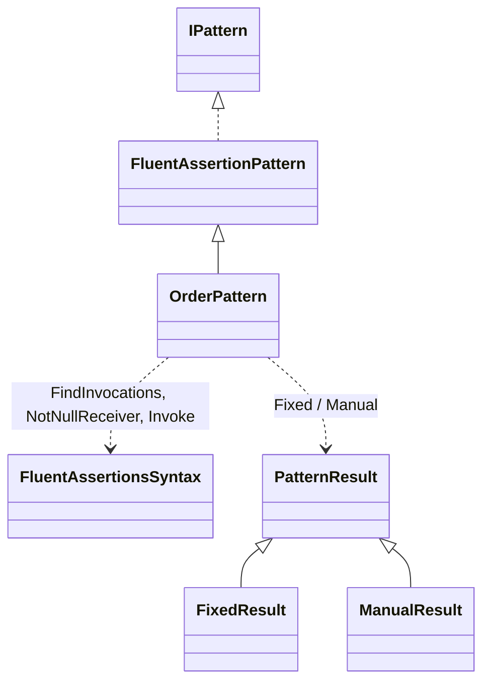
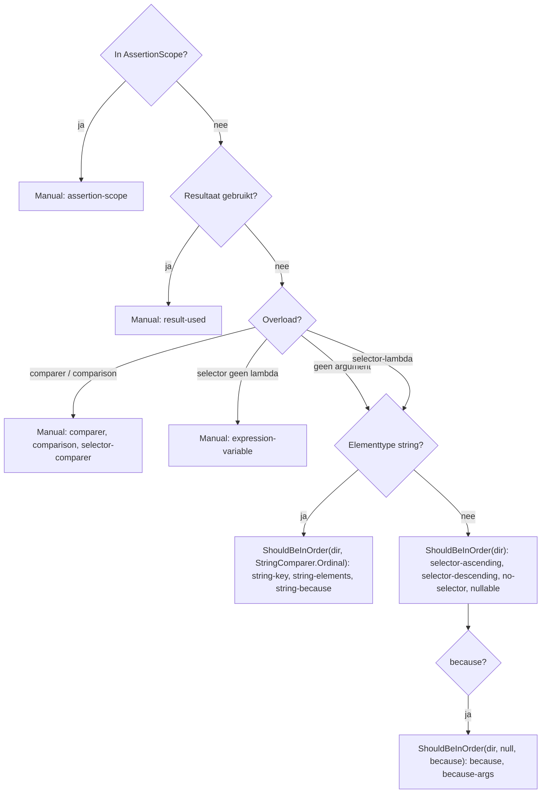

# Modellen: fa.order

`x.Should().BeInAscendingOrder(p => p.K)` wordt `x.Select(p => p.K).ShouldBeInOrder(SortDirection.Ascending)`. Feiten uit `src/Unshackle.Core/Fixes/FluentAssertions/Patterns/OrderPattern.cs`. Diagrammen met de hand in Mermaid (kingmadoc/d2 ontbreken).

**Figure 1.** Klassen rond `OrderPattern`.

| Element | Pad | Rol |
| --- | --- | --- |
| `FluentAssertionPattern` | `src/Unshackle.Core/Fixes/FluentAssertions/FluentAssertionPattern.cs` | Template Method: scope, vorm, resultaat, because(-args) |
| `OrderPattern` | `src/Unshackle.Core/Fixes/FluentAssertions/Patterns/OrderPattern.cs` | Dit patroon, Id `fa.order` |
| `FluentAssertionsSyntax` | `src/Unshackle.Core/Fixes/FluentAssertions/FluentAssertionsSyntax.cs` | `FindInvocations`, `NotNullReceiver`, `Invoke` |
| `PatternResult` e.a. | `src/Unshackle.Core/Models/` | Uitkomst |

**Figure 2.** Volgorde.

| Stap | Plek | Wat gebeurt er |
| --- | --- | --- |
| Find | `OrderPattern.Find` | Alle Be-In-Ascending/Descending-Order-aanroepen op FA |
| Overload | `RewriteAssertion` | Geen argument of selector-lambda; anders Manual |
| Herschrijven | `RewriteAssertion` | `Select` (bij selector) en `ShouldBeInOrder` met richting, comparer en because |

**Figure 3.** Beslisboom.

| Vraag | Uitkomst | Proof |
| --- | --- | --- |
| AssertionScope? | Manual | `assertion-scope` |
| Resultaat gebruikt? | Manual | `result-used` |
| Comparer of comparison? | Manual | `comparer`, `comparison`, `selector-comparer` |
| Selector geen lambda? | Manual | `expression-variable` |
| String-sleutel? | `StringComparer.Ordinal` | `string-key`, `string-elements`, `string-because` |
| Overig | `ShouldBeInOrder(dir)` | `selector-ascending`, `selector-descending`, `no-selector`, `nullable`, `because`, `because-args` |

## Zie ook

- [fa-order-plan.md](fa-order-plan.md)
- [fa-order-verify.md](fa-order-verify.md)
- `src/Unshackle.Core/Fixes/FluentAssertions/Patterns/OrderPattern.cs`
- `src/Unshackle.Tests/Proofs/FluentAssertions/Order/`
