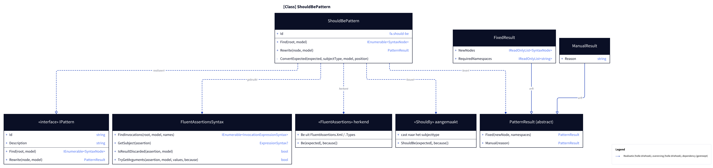
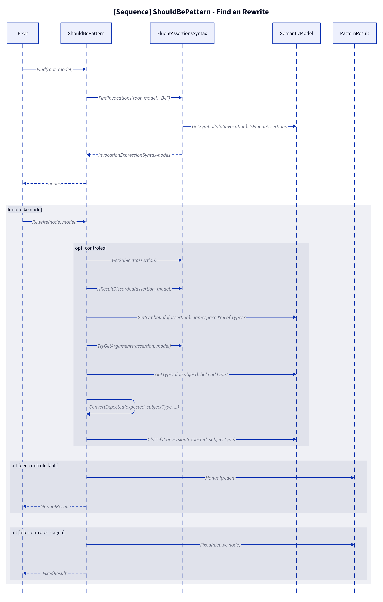
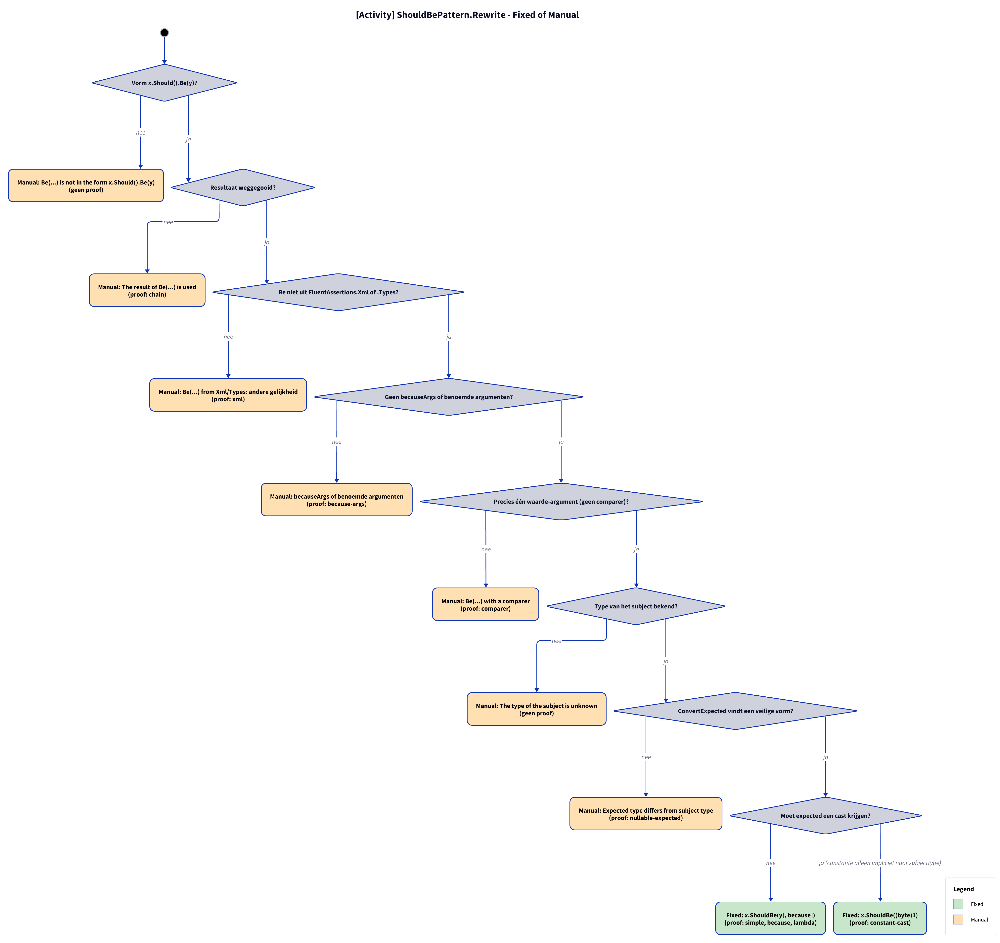

# Modellen: fa.should-be

x.Should().Be(y) naar x.ShouldBe(y). Feiten uit `src/Unshackle.Core/Fixes/FluentAssertions/Patterns/ShouldBePattern.cs`.

**Figure 1.** Klassen rond `ShouldBePattern`: wat hij implementeert, gebruikt en aanmaakt. Weggelaten: `Fixer`, `IFix` en de usings-afhandeling (zie [../modellen/klassen.md](../modellen/klassen.md)).

<!-- kingmadoc:diagram img/fa-should-be-modellen-1.d2 -->

| Element | Pad | Rol |
| --- | --- | --- |
| `IPattern` | `src/Unshackle.Core/Abstractions/IPattern.cs` | Contract: `Find` en `Rewrite` |
| `ShouldBePattern` | `src/Unshackle.Core/Fixes/FluentAssertions/Patterns/ShouldBePattern.cs` | Dit patroon, Id `fa.should-be`; gedeeld via `FluentAssertionsSyntax`: `ConvertExpected(expected, subjectType, model, position)` |
| `FluentAssertionsSyntax` | `src/Unshackle.Core/Fixes/FluentAssertions/FluentAssertionsSyntax.cs` | Gedeelde bouwstenen: `FindInvocations`, `GetSubject`, `IsResultDiscarded`, `TryGetArguments` |
| `PatternResult`, `FixedResult`, `ManualResult` | `src/Unshackle.Core/Models/` | Uitkomst: `Fixed` met nieuwe node(s) en namespaces, of `Manual` met reden |
| «FluentAssertions» herkend | - | `Be(expected[, because])`; `Be uit FluentAssertions.Xml / .Types` |
| «Shouldly» aangemaakt | - | `ShouldBe(expected[, because])`; `cast naar het subjecttype` |

**Figure 2.** `Fixer` roept `Find` en per node `Rewrite` aan; `Rewrite` doet de controles via `FluentAssertionsSyntax` en `SemanticModel` en levert `Fixed` of `Manual`. Weggelaten: het vervangen van de node en de usings door de `Fixer`.

<!-- kingmadoc:diagram img/fa-should-be-modellen-2.d2 -->

| Stap | Plek | Wat gebeurt er |
| --- | --- | --- |
| Find | `ShouldBePattern.Find` | `FluentAssertionsSyntax.FindInvocations` zoekt aanroepen `Be` waarvan het symbool in een FluentAssertions-namespace ligt |
| Controles | `ShouldBePattern.Rewrite` | `GetSubject(assertion)`; `IsResultDiscarded(assertion, model)`; `GetSymbolInfo(assertion)`; `TryGetArguments(assertion, model)`; `GetTypeInfo(subject)`; `ConvertExpected(expected, subjectType, ...)`; `ClassifyConversion(expected, subjectType)` |
| Manual | `PatternResult.Manual` | Eerste mislukte controle geeft `ManualResult` met reden (zie figuur 3) |
| Fixed | `PatternResult.Fixed` | Nieuwe node; trivia en usings regelt de `Fixer` |

**Figure 3.** Beslisboom van `Rewrite`: 7 vragen in de volgorde van de code, elk blad noemt de proof in `src/Unshackle.Tests/Proofs/FluentAssertions/ShouldBe/` die het bewijst (`<naam>.before.cs` met `.after.cs` of `.manual.txt`).

<!-- kingmadoc:diagram img/fa-should-be-modellen-3.d2 -->

| Vraag of selector | Bij nee: Manual-reden | Proof |
| --- | --- | --- |
| Vorm x.Should().Be(y)? | Be(...) is not in the form x.Should().Be(y) | geen proof, bewaakt in code |
| Resultaat weggegooid? | The result of Be(...) is used | `chain` |
| Be niet uit FluentAssertions.Xml of .Types? | Be(...) from Xml/Types: andere gelijkheid | `xml` |
| Geen becauseArgs of benoemde argumenten? | becauseArgs of benoemde argumenten | `because-args` |
| Precies één waarde-argument (geen comparer)? | Be(...) with a comparer | `comparer` |
| Type van het subject bekend? | The type of the subject is unknown | geen proof, bewaakt in code |
| ConvertExpected vindt een veilige vorm? | Expected type differs from subject type | `nullable-expected` |

| Voorwaarde | Fixed-vorm | Proofs |
| --- | --- | --- |
| nee | `x.ShouldBe(y[, because])` | `simple`, `because`, `lambda` |
| ja (constante alleen impliciet naar subjecttype) | `x.ShouldBe((byte)1)` | `constant-cast` |

## Zie ook

- [fa-should-be-plan.md](fa-should-be-plan.md) - plan
- [fa-should-be-verify.md](fa-should-be-verify.md) - verificatie
- `src/Unshackle.Core/Fixes/FluentAssertions/Patterns/ShouldBePattern.cs` - het patroon
- `src/Unshackle.Tests/Proofs/FluentAssertions/ShouldBe/` - de proofs
- [../modellen/pattern-beslissing.md](../modellen/pattern-beslissing.md) - generieke beslissing van een pattern
- [../README.md](../README.md)
