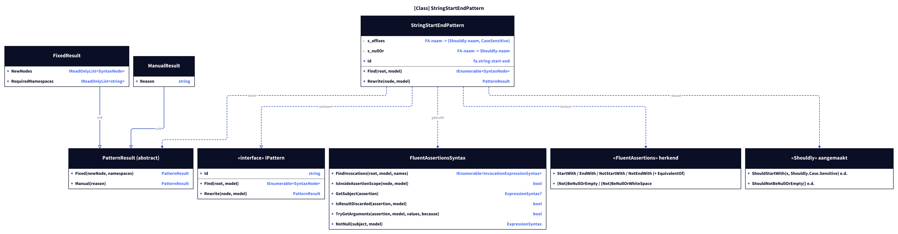
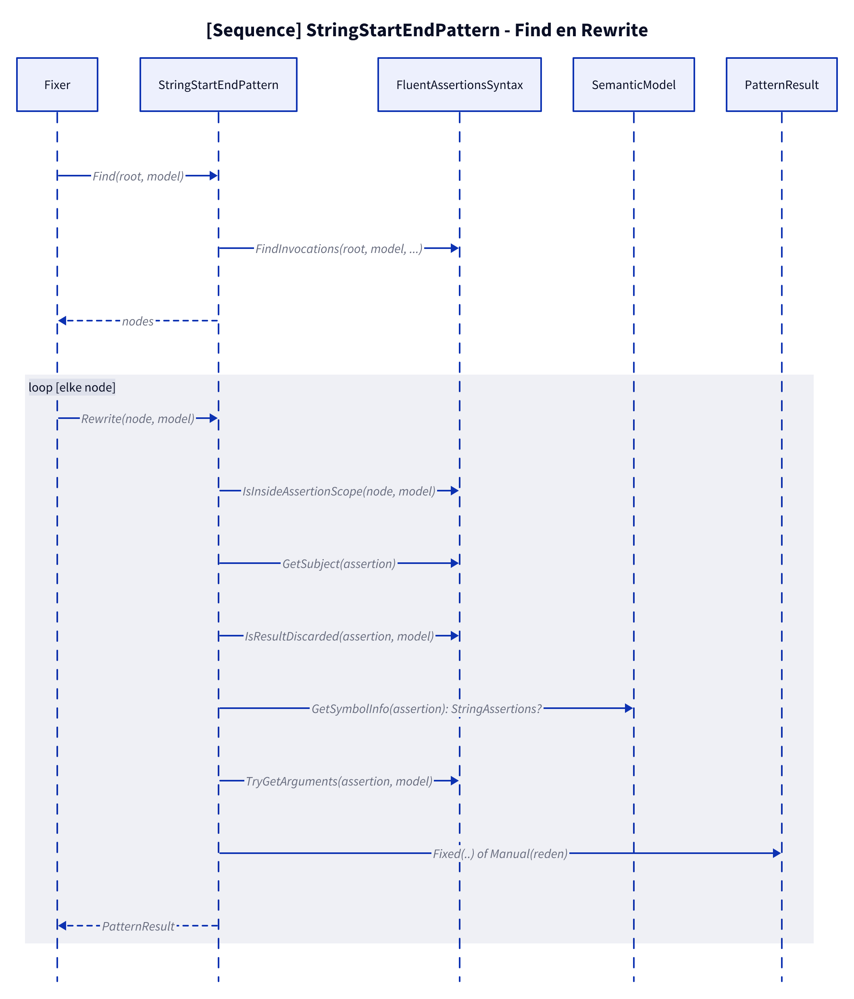
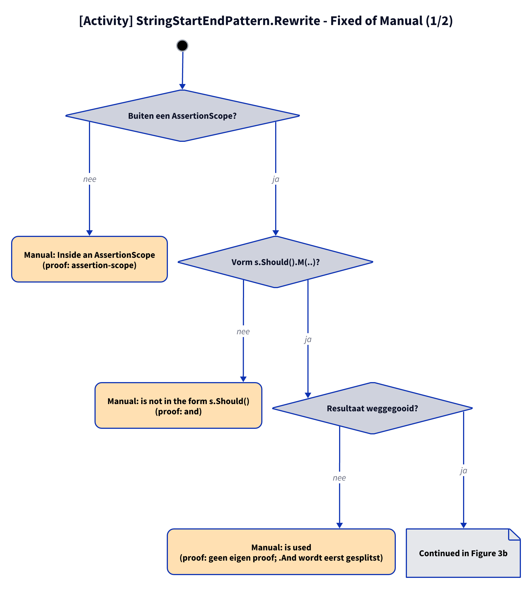
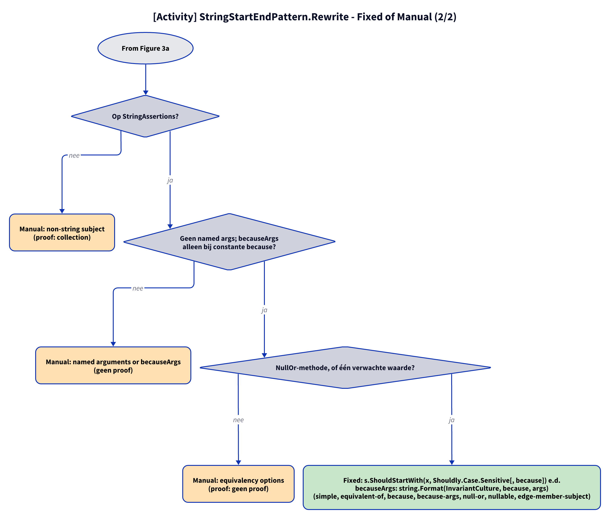

# Models: fa.string-start-end

`s.Should().StartWith(x)` and family become `s.ShouldStartWith(x, Shouldly.Case.Sensitive)`; `NotBeNullOrEmpty()` etc. become `ShouldNotBeNullOrEmpty()` etc. Facts from `src/Unshackle.Core/Fixes/FluentAssertions/Patterns/StringStartEndPattern.cs`.

**Figure 1.** Classes around `StringStartEndPattern`. Left out: `Fixer`, `IFix` and the usings (see [../modellen/klassen.md](../modellen/klassen.md)).

<!-- kingmadoc:diagram img/fa-string-start-end-modellen-1.d2 -->

| Element | Path | Role |
| --- | --- | --- |
| `IPattern` | `src/Unshackle.Core/Abstractions/IPattern.cs` | Contract |
| `FluentAssertionPattern` | `src/Unshackle.Core/Fixes/FluentAssertions/FluentAssertionPattern.cs` | Base class (Template Method): scope, shape, result, `RewriteBeforeArguments`, arguments, then `RewriteAssertion` |
| `StringStartEndPattern` | `src/Unshackle.Core/Fixes/FluentAssertions/Patterns/StringStartEndPattern.cs` | This pattern, Id `fa.string-start-end` |
| `FluentAssertionsSyntax` | `src/Unshackle.Core/Fixes/FluentAssertions/FluentAssertionsSyntax.cs` | Shared checks |
| `PatternResult`, `FixedResult`, `ManualResult` | `src/Unshackle.Core/Models/` | Outcome |

**Figure 2.** Sequence of `Find` and `Rewrite`.

<!-- kingmadoc:diagram img/fa-string-start-end-modellen-2.d2 -->

| Step | Place | What happens |
| --- | --- | --- |
| Find | `StringStartEndPattern.Find` | `FindInvocations` on the FA names |
| Checks | `FluentAssertionPattern.Rewrite` → `StringStartEndPattern.RewriteBeforeArguments` (type) → `RewriteAssertion` | scope, shape, use of the result, type, arguments, Shouldly name and `Case` |
| Outcome | `PatternResult.Fixed` / `Manual` | Shouldly call or reason |

**Figure 3a.** Decision tree of `Rewrite`; proofs in `src/Unshackle.Tests/Proofs/FluentAssertions/StringStartEnd/`. Split into Figures 3a–3b (at most 12 arrows each).

<!-- kingmadoc:diagram img/fa-string-start-end-modellen-3.d2 -->

**Figure 3b.** Continuation of Figure 3a from its "Continued in Figure 3b" node.

<!-- kingmadoc:diagram img/fa-string-start-end-modellen-4.d2 -->

| Question | If no: Manual reason | Proof |
| --- | --- | --- |
| Outside an AssertionScope? | Inside an AssertionScope | `assertion-scope` |
| Shape s.Should().M(..)? | is not in the form s.Should() | `and` |
| Result discarded? | is used | `no own proof; .And is split first` |
| On StringAssertions? | non-string subject | `collection` |
| No named args; becauseArgs only with a constant `because`? | named arguments, or becauseArgs whose because is no constant format string | no proof |
| A NullOr method, or one expected value? | equivalency options | `no proof` |
| Fixed | `s.ShouldStartWith(x, Shouldly.Case.Sensitive[, because]) etc.` | simple, equivalent-of, because, because-args (`string.Format(CultureInfo.InvariantCulture, because, args)`), null-or, nullable, edge-member-subject |

## See also

- [fa-string-start-end-plan.md](fa-string-start-end-plan.md) - plan
- [fa-string-start-end-verify.md](fa-string-start-end-verify.md) - verification
- `src/Unshackle.Core/Fixes/FluentAssertions/Patterns/StringStartEndPattern.cs` - the pattern
- `src/Unshackle.Tests/Proofs/FluentAssertions/StringStartEnd/` - the proofs
- [../README.md](../README.md)
