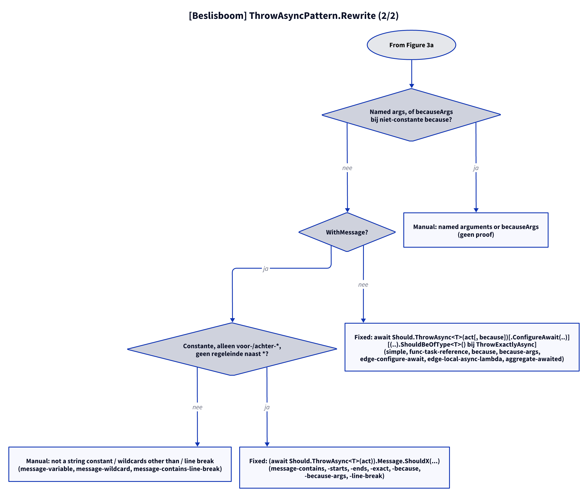

# Models: fa.throw-async

Facts from `src/Unshackle.Core/Fixes/FluentAssertions/Patterns/ThrowAsyncPattern.cs` and `ThrowMessage.cs`.

## Figure 1: classes

**Figure 1.** `ThrowAsyncPattern`, its contract and helpers; the helper `ThrowMessage` is shared with `ThrowPattern`.

<!-- kingmadoc:diagram img/fa-throw-async-modellen-1.d2 -->

| Element | Role |
| ------- | --- |
| `ThrowAsyncPattern` | Finds `ThrowAsync` (+ `.WithMessage`, + `.ConfigureAwait`, + the surrounding `await`) and builds `await Should.ThrowAsync<T>(subject)`; `ThrowExactlyAsync` and `Awaiting` subjects are found by `ThrowExactlyPattern`/`InvokingPattern`, which call this `Rewrite` |
| `ThrowSyntax` | `FindThrowAsync`, `IsExactly`, `IsInvoking`, `TryGetAction` |
| `FluentAssertionsSyntax` | Shared steps: `IsInsideAssertionScope`, subject, `because` arguments (ignores the receiver of extension methods) |
| `ThrowMessage` | `Check` translates the `WithMessage` wildcard to `Message.ShouldContain/StartWith/EndWith/Be` (Manual for other wildcards or a line break next to `*`); `MayThrowAggregate`; `OfType` |
| `PatternResult` | `Fixed` with the new expression, or `Manual(reason)` |
| FA and Shouldly methods | `ThrowAsync<T>`, `WithMessage` become `Should.ThrowAsync<T>` and a `Message` check |

## Figure 2: sequence

**Figure 2.** `Find` returns the `await` expression per call; `Rewrite` decides between `Fixed` and `Manual`.

<!-- kingmadoc:diagram img/fa-throw-async-modellen-2.d2 -->

| Step | Method in the code | What happens |
| ---- | ------------------ | -------------- |
| Find | `Find` | `ThrowSyntax.FindThrowAsync` with filter `!IsExactly && !IsInvoking`, then on to `.WithMessage`, `.ConfigureAwait` and the surrounding `await` |
| Scope | `IsInsideAssertionScope` | In a non-converted `AssertionScope`: Manual |
| Subject | `GetSubject` | Must be `x.Should()` |
| Subject type | `IsInvoking`/`TryGetAction`, `SemanticModel.GetTypeInfo` | `Func<Task>` or `Func<Task<T>>` with T a reference type |
| AggregateException | `ThrowMessage.MayThrowAggregate` | Blocking `.Result`/`Wait` in the action: Manual (not for ThrowExactlyAsync) |
| Arguments | `TryGetArguments` | `because`; `becauseArgs` with a constant `because` become `string.Format(CultureInfo.InvariantCulture, because, args)` |
| Message | `ThrowMessage.Check` | Wildcard to `ShouldContain`/`StartWith`/`EndWith`/`Be` |

## Figure 3: decision tree

**Figure 3a.** Every question in `Rewrite`; the leaves are the Shouldly form or the Manual reason. Split into Figures 3a–3b (at most 12 arrows each).

<!-- kingmadoc:diagram img/fa-throw-async-modellen-3.d2 -->

**Figure 3b.** Continuation of Figure 3a from its "Continued in Figure 3b" node.

<!-- kingmadoc:diagram img/fa-throw-async-modellen-4.d2 -->

| Leaf | Condition | Proof (`Proofs/FluentAssertions/ThrowAsync/`) |
| ---- | ---------- | --------------------------------------------- |
| Fixed | `Func<Task>`, `Func<Task<string>>`, with/without `because`, `becauseArgs`, `ConfigureAwait`, a local async lambda, `await` in the action | `simple`, `func-task-reference`, `because`, `because-args`, `edge-configure-await`, `edge-local-async-lambda`, `aggregate-awaited` |
| Fixed | `.WithMessage` with `*x*`, `x*`, `*x`, `x` | `message-contains`, `message-starts`, `message-ends`, `message-exact`, `message-because`, `message-exact-because`, `message-because-args`, `message-line-break` |
| Manual "not directly awaited" | no `await`, or `.Where` after it | `no-await`, `where` |
| Manual "is used" | `var x = await ...` | `value-used` |
| Manual (Awaiting) | `Awaiting(...)` with an unstable receiver, a value type or no lambda | `Invoking/side-effect-receiver`, `value-type`, `method-group` |
| Manual "unwraps AggregateException" | `.Result` in the action | `aggregate-result` |
| Manual "reference type" | `Func<Task<int>>` | `value-func` |
| Manual "named arguments, or becauseArgs" | named args or a non-constant `because` | `named-because`, `because-variable` |
| Manual "not a string constant" / "wildcards other than" / "contains a line break" | an untranslatable pattern | `message-variable`, `message-wildcard`, `message-contains-line-break` |

## See also

- [fa-throw-async-plan.md](fa-throw-async-plan.md)
- [fa-throw-async-verify.md](fa-throw-async-verify.md)
- `src/Unshackle.Core/Fixes/FluentAssertions/Patterns/ThrowAsyncPattern.cs`
- `src/Unshackle.Tests/Proofs/FluentAssertions/ThrowAsync/`
