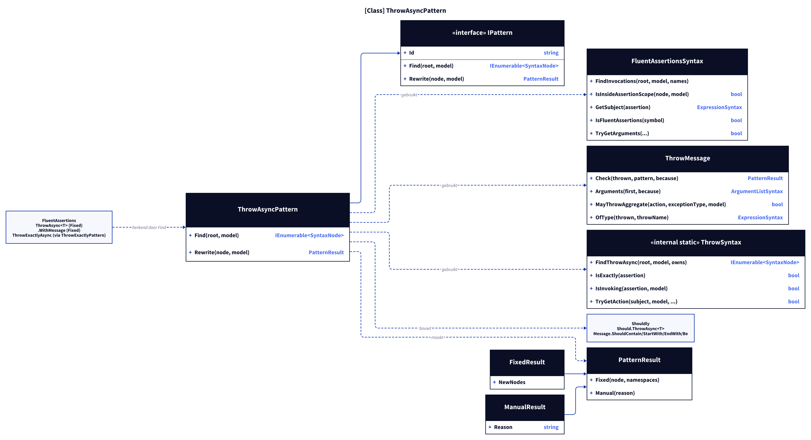
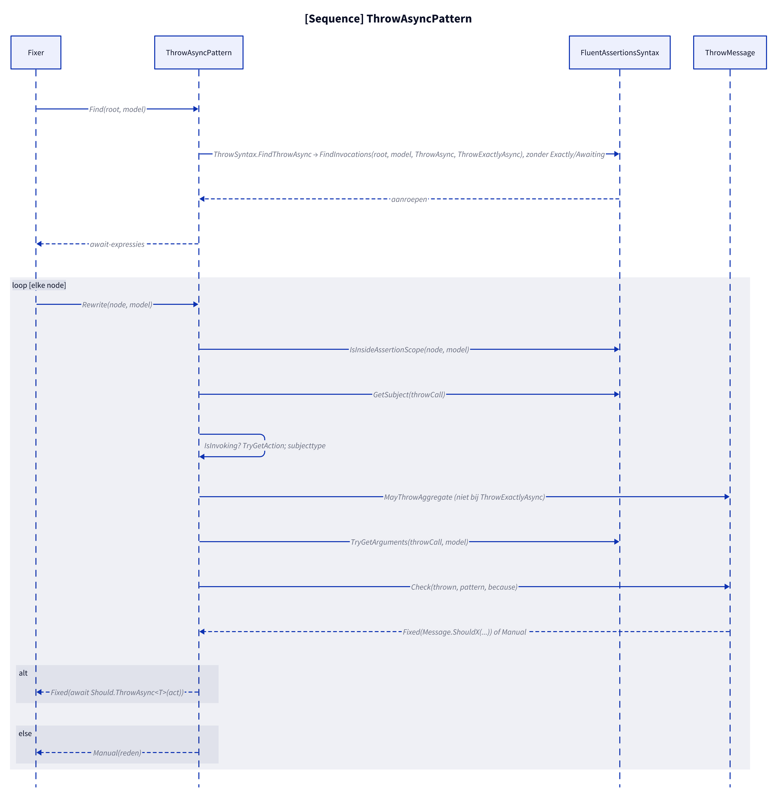
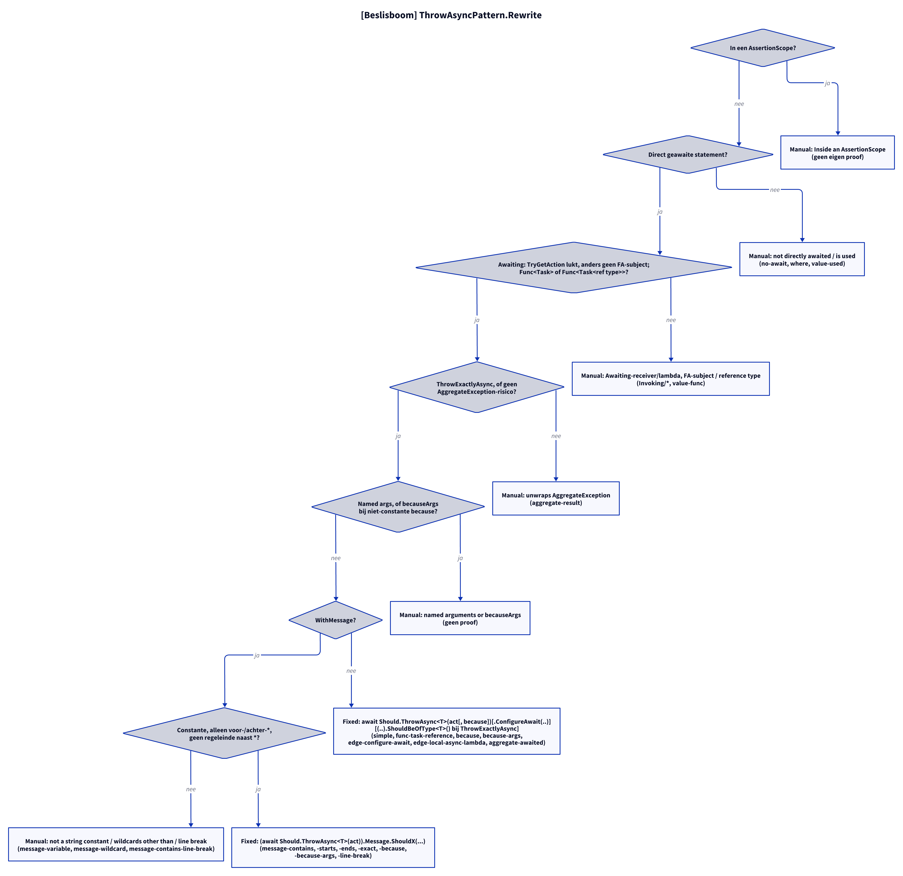

# Modellen: fa.throw-async

Feiten uit `src/Unshackle.Core/Fixes/FluentAssertions/Patterns/ThrowAsyncPattern.cs` en `ThrowMessage.cs`.

## Figuur 1: klassen

**Figure 1.** `ThrowAsyncPattern`, zijn contract en helpers; de helper `ThrowMessage` wordt gedeeld met `ThrowPattern`.

<!-- kingmadoc:diagram img/fa-throw-async-modellen-1.d2 -->

| Element | Rol |
| ------- | --- |
| `ThrowAsyncPattern` | Vindt `ThrowAsync` (+ `.WithMessage`, + `.ConfigureAwait`, + omringende `await`) en bouwt `await Should.ThrowAsync<T>(subject)`; `ThrowExactlyAsync`- en `Awaiting`-subjects vinden `ThrowExactlyPattern`/`InvokingPattern`, die deze `Rewrite` aanroepen |
| `ThrowSyntax` | `FindThrowAsync`, `IsExactly`, `IsInvoking`, `TryGetAction` |
| `FluentAssertionsSyntax` | Gedeelde stappen: `IsInsideAssertionScope`, onderwerp, `because`-argumenten (negeert de receiver van extensiemethoden) |
| `ThrowMessage` | `Check` vertaalt het `WithMessage`-wildcard naar `Message.ShouldContain/StartWith/EndWith/Be` (Manual bij andere wildcards of een regeleinde naast `*`); `MayThrowAggregate`; `OfType` |
| `PatternResult` | `Fixed` met de nieuwe expressie, of `Manual(reden)` |
| FA- en Shouldly-methoden | `ThrowAsync<T>`, `WithMessage` worden `Should.ThrowAsync<T>` en een `Message`-check |

## Figuur 2: sequence

**Figure 2.** `Find` geeft per aanroep de `await`-expressie; `Rewrite` beslist tussen `Fixed` en `Manual`.

<!-- kingmadoc:diagram img/fa-throw-async-modellen-2.d2 -->

| Stap | Methode in de code | Wat gebeurt er |
| ---- | ------------------ | -------------- |
| Vinden | `Find` | `ThrowSyntax.FindThrowAsync` met filter `!IsExactly && !IsInvoking`, daarna naar `.WithMessage`, `.ConfigureAwait` en de omringende `await` |
| Scope | `IsInsideAssertionScope` | In een niet omgezette `AssertionScope`: Manual |
| Subject | `GetSubject` | Moet `x.Should()` zijn |
| Subjecttype | `IsInvoking`/`TryGetAction`, `SemanticModel.GetTypeInfo` | `Func<Task>` of `Func<Task<T>>` met T referentietype |
| AggregateException | `ThrowMessage.MayThrowAggregate` | Blokkerende `.Result`/`Wait` in de actie: Manual (niet bij ThrowExactlyAsync) |
| Argumenten | `TryGetArguments` | `because`; `becauseArgs` bij constante `because` worden `string.Format(CultureInfo.InvariantCulture, because, args)` |
| Bericht | `ThrowMessage.Check` | Wildcard naar `ShouldContain`/`StartWith`/`EndWith`/`Be` |

## Figuur 3: beslisboom

**Figure 3.** Elke vraag in `Rewrite`; de bladeren zijn de Shouldly-vorm of de Manual-reden.

<!-- kingmadoc:diagram img/fa-throw-async-modellen-3.d2 -->

| Blad | Voorwaarde | Proof (`Proofs/FluentAssertions/ThrowAsync/`) |
| ---- | ---------- | --------------------------------------------- |
| Fixed | `Func<Task>`, `Func<Task<string>>`, met/zonder `because`, `becauseArgs`, `ConfigureAwait`, lokale async lambda, `await` in de actie | `simple`, `func-task-reference`, `because`, `because-args`, `edge-configure-await`, `edge-local-async-lambda`, `aggregate-awaited` |
| Fixed | `.WithMessage` met `*x*`, `x*`, `*x`, `x` | `message-contains`, `message-starts`, `message-ends`, `message-exact`, `message-because`, `message-exact-because`, `message-because-args`, `message-line-break` |
| Manual "not directly awaited" | geen `await`, of `.Where` erachter | `no-await`, `where` |
| Manual "is used" | `var x = await ...` | `value-used` |
| Manual (Awaiting) | `Awaiting(...)` met onstabiele receiver, waardetype of geen lambda | `Invoking/side-effect-receiver`, `value-type`, `method-group` |
| Manual "unwraps AggregateException" | `.Result` in de actie | `aggregate-result` |
| Manual "reference type" | `Func<Task<int>>` | `value-func` |
| Manual "named arguments, or becauseArgs" | named args of niet-constante `because` | geen proof |
| Manual "not a string constant" / "wildcards other than" / "contains a line break" | niet-vertaalbaar patroon | `message-variable`, `message-wildcard`, `message-contains-line-break` |

## Zie ook

- [fa-throw-async-plan.md](fa-throw-async-plan.md)
- [fa-throw-async-verify.md](fa-throw-async-verify.md)
- `src/Unshackle.Core/Fixes/FluentAssertions/Patterns/ThrowAsyncPattern.cs`
- `src/Unshackle.Tests/Proofs/FluentAssertions/ThrowAsync/`
