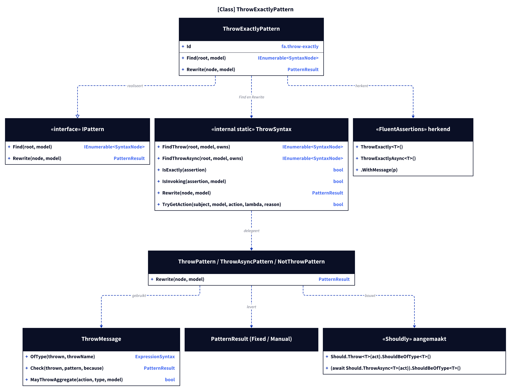
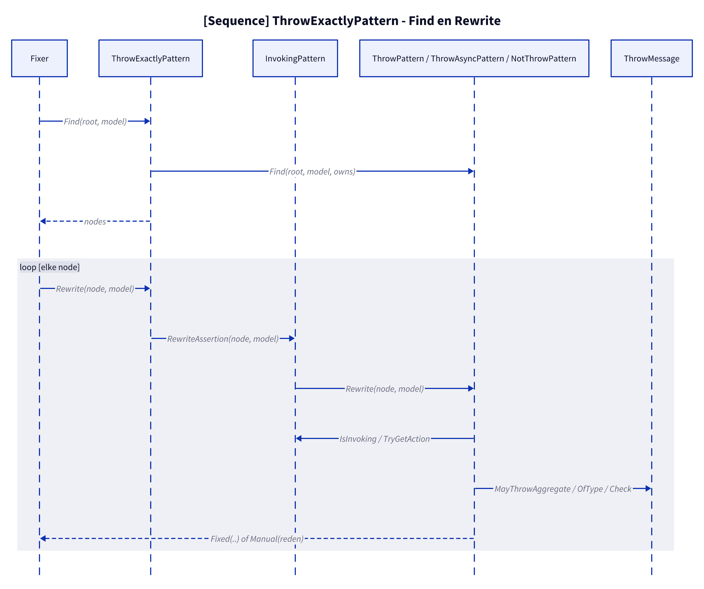
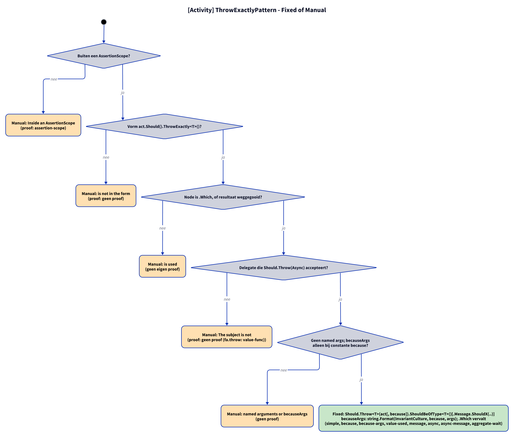

# Models: fa.throw-exactly

`act.Should().ThrowExactly<T>()` becomes `Should.Throw<T>(act).ShouldBeOfType<T>()`; `await act.Should().ThrowExactlyAsync<T>()` becomes `(await Should.ThrowAsync<T>(act)).ShouldBeOfType<T>()`; `.WithMessage` as in `fa.throw`. Facts from `src/Unshackle.Core/Fixes/FluentAssertions/Patterns/ThrowExactlyPattern.cs`, `ThrowSyntax.cs`, `ThrowPattern.cs`, `ThrowAsyncPattern.cs`, `NotThrowPattern.cs` and `ThrowMessage.cs`.

**Figure 1.** Classes around `ThrowExactlyPattern`. Omitted: `Fixer`, `IFix` and the usings (see [../modellen/klassen.md](../modellen/klassen.md)).

<!-- kingmadoc:diagram img/fa-throw-exactly-modellen-1.d2 -->

| Element | Path | Role |
| --- | --- | --- |
| `ThrowExactlyPattern` | `src/Unshackle.Core/Fixes/FluentAssertions/Patterns/ThrowExactlyPattern.cs` | This pattern, Id `fa.throw-exactly`: claims the nodes |
| `ThrowSyntax` | `src/Unshackle.Core/Fixes/FluentAssertions/Patterns/ThrowSyntax.cs` | `FindThrow`/`FindThrowAsync` with `IsExactly`; `Rewrite` picks the rewriting pattern by name; `TryGetAction` builds `() => ...` (for `InvokingPattern`) |
| `ThrowPattern`, `ThrowAsyncPattern`, `NotThrowPattern` | `src/Unshackle.Core/Fixes/FluentAssertions/Patterns/` | Rewrite (also ThrowExactly and Invoking) |
| `ThrowMessage` | `src/Unshackle.Core/Fixes/FluentAssertions/Patterns/ThrowMessage.cs` | `OfType`, message check, AggregateException heuristic |

**Figure 2.** Order of `Find` and `Rewrite`.

<!-- kingmadoc:diagram img/fa-throw-exactly-modellen-2.d2 -->

| Step | Place | What happens |
| --- | --- | --- |
| Find | `ThrowExactlyPattern.Find` | `ThrowSyntax.FindThrow` + `FindThrowAsync` with filter `IsExactly && !IsInvoking` (Invoking subjects belong to `InvokingPattern`) |
| Rewrite | `ThrowSyntax.Rewrite` | Picks `ThrowPattern`/`ThrowAsyncPattern` by the name of the assertion |
| Outcome | `PatternResult.Fixed` / `Manual` | Shouldly call or reason |

**Figure 3.** Decision tree; proofs in `src/Unshackle.Tests/Proofs/FluentAssertions/ThrowExactly/`.

<!-- kingmadoc:diagram img/fa-throw-exactly-modellen-3.d2 -->

| Question | If no: Manual reason | Proof |
| --- | --- | --- |
| Outside an AssertionScope? | Inside an AssertionScope | `assertion-scope` |
| Form act.Should().ThrowExactly<T>()? | is not in the form | `no proof` |
| Node is `.Which`, or result discarded? | is used | no own proof (`.Which` is Fixed: `value-used`) |
| Delegate that Should.Throw(Async) accepts? | The subject is not | `no proof (fa.throw: value-func)` |
| No named args; becauseArgs only with constant `because`? | named arguments or becauseArgs | no proof (`because-args` is Fixed with `string.Format`) |

## See also

- [fa-throw-exactly-plan.md](fa-throw-exactly-plan.md) - plan
- [fa-throw-exactly-verify.md](fa-throw-exactly-verify.md) - verification
- `src/Unshackle.Core/Fixes/FluentAssertions/Patterns/ThrowExactlyPattern.cs` - the pattern
- `src/Unshackle.Tests/Proofs/FluentAssertions/ThrowExactly/` - the proofs
- [../README.md](../README.md)
