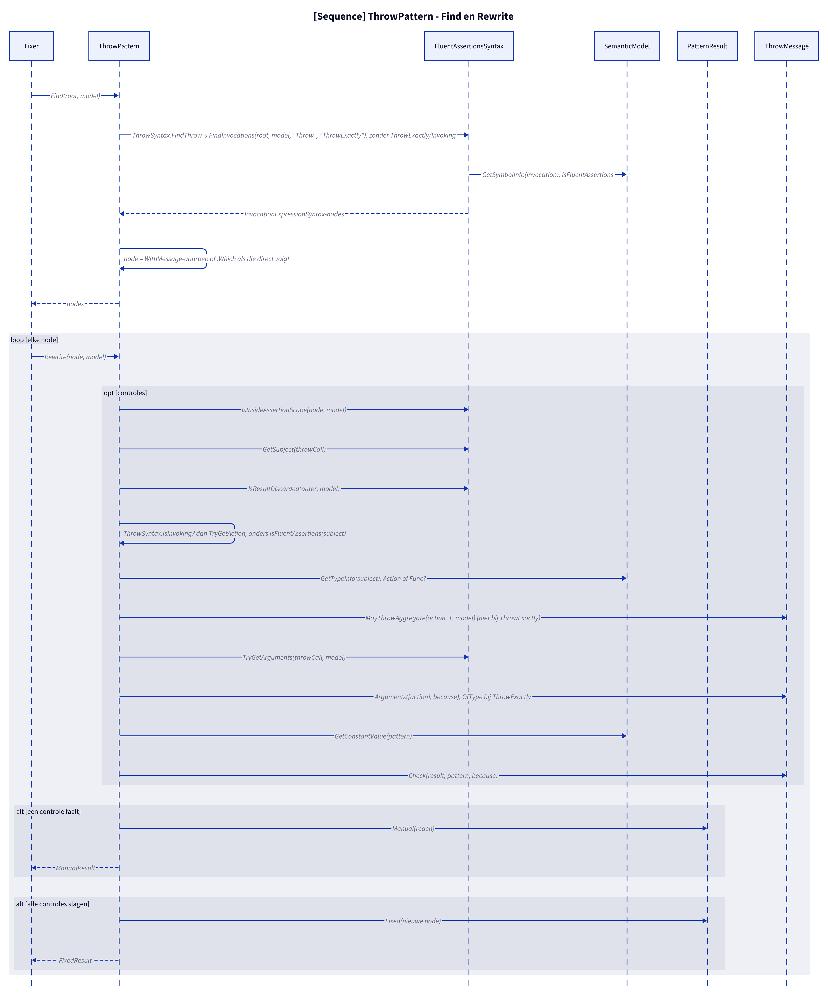

# Modellen: fa.throw

act.Should().Throw<T>() naar Should.Throw<T>(act). Feiten uit `src/Unshackle.Core/Fixes/FluentAssertions/Patterns/ThrowPattern.cs`.

**Figure 1.** Klassen rond `ThrowPattern`: wat hij implementeert, gebruikt en aanmaakt. Weggelaten: `Fixer`, `IFix` en de usings-afhandeling (zie [../modellen/klassen.md](../modellen/klassen.md)).

<!-- kingmadoc:diagram img/fa-throw-modellen-1.d2 -->

| Element | Pad | Rol |
| --- | --- | --- |
| `IPattern` | `src/Unshackle.Core/Abstractions/IPattern.cs` | Contract: `Find` en `Rewrite` |
| `ThrowPattern` | `src/Unshackle.Core/Fixes/FluentAssertions/Patterns/ThrowPattern.cs` | Dit patroon, Id `fa.throw` |
| `ThrowSyntax` | `src/Unshackle.Core/Fixes/FluentAssertions/Patterns/ThrowSyntax.cs` | `FindThrow` (node: Throw-aanroep, `WithMessage`-aanroep of `.Which`), `IsExactly`, `IsInvoking`, `TryGetAction` |
| `FluentAssertionsSyntax` | `src/Unshackle.Core/Fixes/FluentAssertions/FluentAssertionsSyntax.cs` | Gedeelde bouwstenen: `FindInvocations`, `IsInsideAssertionScope`, `GetSubject`, `IsResultDiscarded`, `IsFluentAssertions`, `TryGetArguments` |
| `PatternResult`, `FixedResult`, `ManualResult` | `src/Unshackle.Core/Models/` | Uitkomst: `Fixed` met nieuwe node(s) en namespaces, of `Manual` met reden |
| «FluentAssertions» herkend | - | `Throw<T>()`; `ThrowExactly<T>()` (via `ThrowExactlyPattern`); `WithMessage(pattern)`; `.Which` |
| «Shouldly» aangemaakt | - | `Should.Throw<T>(act[, because])`; `.ShouldBeOfType<T>()` bij ThrowExactly; `thrown.Message.ShouldContain / ShouldStartWith / ShouldEndWith / ShouldBe` |
| Herkende typen | - | `Action`; `Func<T> met referentietype`; `Invoking(...)` (via `InvokingPattern`) |
| `ThrowMessage` | `src/Unshackle.Core/Fixes/FluentAssertions/Patterns/ThrowMessage.cs` | Gedeeld met `ThrowAsyncPattern`: `Check` vertaalt de `WithMessage`-wildcard naar `Message.ShouldX(...)`; `MayThrowAggregate`; `OfType` |

**Figure 2.** `Fixer` roept `Find` en per node `Rewrite` aan; `Rewrite` doet de controles via `FluentAssertionsSyntax` en `SemanticModel` en levert `Fixed` of `Manual`. Weggelaten: het vervangen van de node en de usings door de `Fixer`.

<!-- kingmadoc:diagram img/fa-throw-modellen-2.d2 -->

| Stap | Plek | Wat gebeurt er |
| --- | --- | --- |
| Find | `ThrowPattern.Find` | `ThrowSyntax.FindThrow` zoekt FA-aanroepen `Throw` (ThrowExactly- en Invoking-subjects horen bij `ThrowExactlyPattern`/`InvokingPattern`, die deze `Rewrite` aanroepen); een direct volgende `WithMessage` of `.Which` wordt de node |
| Controles | `ThrowPattern.Rewrite` | `IsInsideAssertionScope`; `GetSubject(throwCall)`; `IsResultDiscarded(outer, model)` (niet bij `.Which`); `IsInvoking`/`TryGetAction` of `IsFluentAssertions(GetSymbolInfo(subject))`; `GetTypeInfo(subject)`; `MayThrowAggregate`; `TryGetArguments(throwCall, model)`; `Arguments([action], because)`; `OfType`; `GetConstantValue(pattern)`; `Check(result, pattern, because)` |
| Manual | `PatternResult.Manual` | Eerste mislukte controle geeft `ManualResult` met reden (zie figuur 3) |
| Fixed | `PatternResult.Fixed` | Nieuwe node; trivia en usings regelt de `Fixer` |

**Figure 3.** Beslisboom van `Rewrite`: 13 vragen in de volgorde van de code, elk blad noemt de proof in `src/Unshackle.Tests/Proofs/FluentAssertions/Throw/` die het bewijst (`<naam>.before.cs` met `.after.cs` of `.manual.txt`).

<!-- kingmadoc:diagram img/fa-throw-modellen-3.d2 -->

| Vraag of selector | Bij nee: Manual-reden | Proof |
| --- | --- | --- |
| Buiten een AssertionScope? | Inside an AssertionScope | `ThrowExactly/assertion-scope`, `Invoking/assertion-scope` |
| Precies één typeargument? | Throw without exactly one type argument | geen proof, bewaakt in code |
| Vorm x.Should().Throw<T>()? | Throw<T>(...) is not in the form x.Should().Throw<T>() | geen proof, bewaakt in code |
| Node is `.Which`, of resultaat weggegooid? | The result of Throw<T>() is used (.Which/.And/.WithInnerException/.Where or a value) | `chain`, `edge-inner-exception` |
| `Invoking`: `TryGetAction` lukt; anders subject niet met FluentAssertions gebouwd? | Invoking-receiver niet stabiel, waardetype of geen lambda; The subject is built with FluentAssertions | `Invoking/side-effect-receiver`, `value-type`, `method-group` |
| Subject is Action of Func naar referentietype? | The subject is not an Action or a Func returning a reference type | `value-func` |
| ThrowExactly, of geen AggregateException-risico (`MayThrowAggregate`)? | FluentAssertions unwraps AggregateException; Shouldly does not | `aggregate-wait`, `aggregate-method-group` |
| Geen named args op Throw; becauseArgs alleen bij constante `because`? | named arguments, or becauseArgs whose because is no constant format string | geen proof, bewaakt in code |
| Geen named args, één waarde op WithMessage? | WithMessage(...) with named arguments or becauseArgs | geen proof, bewaakt in code |
| Patroon is een constante string? | pattern is not a string constant | `message-variable` |
| Alleen een * vooraan of achteraan? | wildcards other than a leading or trailing * | `message-wildcard` |
| Geen regeleinde naast een `*`? | pattern contains a line break | `message-contains-line-break` |

| Voorwaarde | Fixed-vorm | Proofs |
| --- | --- | --- |
| geen WithMessage | `Should.Throw<T>(act[, because])`; `becauseArgs` als `string.Format(CultureInfo.InvariantCulture, because, args)` | `simple`, `because`, `because-args`, `func`, `lambda`, `aggregate-expected`, `aggregate-get-result` |
| `.Which` | `Should.Throw<T>(act)` (geeft de exception terug) | `value-used`, `edge-which-message` |
| ThrowExactly | `Should.Throw<T>(act).ShouldBeOfType<T>()` | `ThrowExactly/*` |
| WithMessage *lit* | `Should.Throw<T>(act).Message.ShouldContain(lit, Case.Insensitive)` | `message-contains` |
| WithMessage lit* | `...Message.ShouldStartWith(lit, Case.Insensitive)` | `message-starts` |
| WithMessage *lit | `...Message.ShouldEndWith(lit, Case.Insensitive)` | `message-ends` |
| WithMessage lit | `...Message.ShouldBe(lit[, because], StringCompareShould.IgnoreCase)`; met regeleinde ook `IgnoreLineEndings` | `message-exact`, `message-exact-because`, `message-because`, `message-because-args`, `message-line-break`, `edge-multiline-message` |

## Zie ook

- [fa-throw-plan.md](fa-throw-plan.md) - plan
- [fa-throw-verify.md](fa-throw-verify.md) - verificatie
- `src/Unshackle.Core/Fixes/FluentAssertions/Patterns/ThrowPattern.cs` - het patroon
- `src/Unshackle.Tests/Proofs/FluentAssertions/Throw/` - de proofs
- [../modellen/pattern-beslissing.md](../modellen/pattern-beslissing.md) - generieke beslissing van een pattern
- [../README.md](../README.md)
