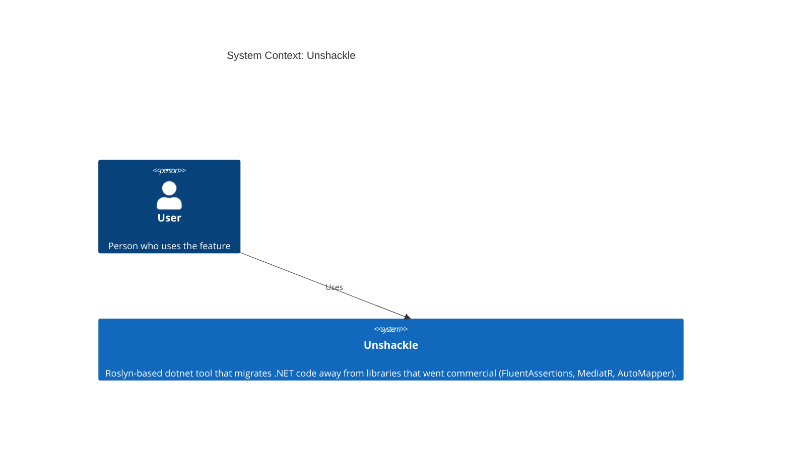
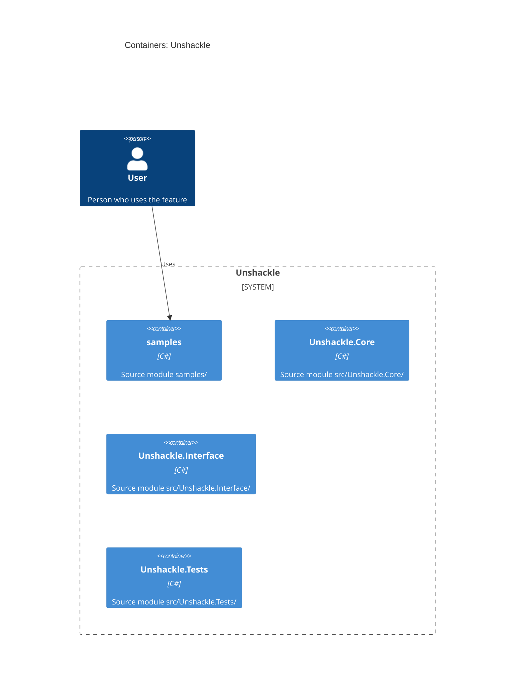

# Feature: fa.throw: act.Should().Throw<T>() (+ WithMessage) wordt Should.Throw<T>(act) (+ Message-check)

| | |
|---|---|
| **Project** | Unshackle |
| **Status** | Approved |
| **Generated** | 2026-10-11 by KingmaDoc |

> Opgesteld uit TAAK-008. Alles gemarkeerd als _(inferred)_ komt uit de codebase-analyse.

## One-sentence summary

fa.throw: `act.Should().Throw<T>()` wordt `Should.Throw<T>(act)`; een direct volgende `.WithMessage(patroon)` wordt een `.Message.ShouldContain/StartWith/EndWith/Be(...)` op hetzelfde statement.

## Scope (in / out)

**In scope**

- Losse `Throw<T>()` op een `Action` of `Func<T>` (T referentietype), met optionele `because` zonder `becauseArgs`.
- Een direct volgende `.WithMessage(p[, because])` met een constante string `p` zonder andere wildcards dan een voorloop- en/of afsluitende `*`.
- `Manual(reden)` voor `ThrowExactly`, ketens, gebruikt resultaat, `Invoking(...)`, andere subjecttypes en niet-vertaalbare patronen.

**Out of scope**

- `ThrowAsync` (rij 7), `NotThrow` (rij 8), `.WithInnerException`, `.Where`, `.WithParameterName` (blijven Manual).
- Beheer van `using`-directives: de `Fixer` doet dat via `IFix`.

## Requirements

- **REQ-1**: WHEN `act.Should().Throw<T>()` als statement op een `Action` staat THE SYSTEM SHALL het vervangen door `Should.Throw<T>(act)` (proof `src/Unshackle.Tests/Proofs/FluentAssertions/Throw/simple.*.cs`).
- **REQ-2**: WHEN het subject een `Func<T>` met T een referentietype is THE SYSTEM SHALL `Should.Throw<T>(func)` geven (proof `.../Throw/func.*.cs`).
- **REQ-3**: WHEN een `because` zonder `becauseArgs` staat THE SYSTEM SHALL die als tweede argument (`customMessage`) van `Should.Throw` overnemen (proof `.../Throw/because.*.cs`).
- **REQ-4**: WHEN de assertion de body van een void-lambda is THE SYSTEM SHALL het herschrijven (proof `.../Throw/lambda.*.cs`).
- **REQ-5**: WHEN `.WithMessage("*x*")` direct op `Throw<T>()` volgt THE SYSTEM SHALL `Should.Throw<T>(act).Message.ShouldContain("x", Shouldly.Case.Insensitive)` geven (proof `.../Throw/message-contains.*.cs`).
- **REQ-6**: WHEN het patroon `x*` of `*x` is THE SYSTEM SHALL `ShouldStartWith` resp. `ShouldEndWith` met `Case.Insensitive` gebruiken (proofs `message-starts.*`, `message-ends.*`).
- **REQ-7**: WHEN het patroon geen wildcards bevat THE SYSTEM SHALL `ShouldBe(x, Shouldly.StringCompareShould.IgnoreCase)` geven (proof `message-exact.*`).
- **REQ-8**: WHEN `WithMessage` een `because` heeft THE SYSTEM SHALL die als `customMessage` van de message-check overnemen; bij `ShouldBe` vóór de `StringCompareShould` (proofs `message-because.*`, `message-exact-because.*`).
- **REQ-9**: IF `ThrowExactly<T>` wordt gebruikt THEN THE SYSTEM SHALL Manual geven, omdat Shouldly's `Throw<T>` ook afgeleide typen accepteert (proof `throw-exactly.*`).
- **REQ-10**: IF `becauseArgs` worden gebruikt (op `Throw` of `WithMessage`) THEN THE SYSTEM SHALL Manual geven (proofs `because-args.*`, `message-because-args.*`).
- **REQ-11**: IF het patroon een `*`/`?` midden in de tekst of een `?` bevat, of geen string-constante is, THEN THE SYSTEM SHALL Manual geven (proofs `message-wildcard.*`, `message-variable.*`).
- **REQ-12**: IF het resultaat wordt gebruikt of verder geketend (`.Which`, `.WithInnerException`, variabele) THEN THE SYSTEM SHALL Manual geven (proofs `chain.*`, `value-used.*`); ook als de assertion zelf een vervolg is (`x.Should().A().And.Throw<T>()`, geen proof: dit compileert niet met FA 7.2.2).
- **REQ-13**: IF het subject met `Invoking(...)` is gebouwd, of een `Func<ValueType>` is THEN THE SYSTEM SHALL Manual geven (proofs `invoking.*`, `value-func.*`).

## Assumptions

- Shouldly 4.3.0 `Should.Throw<T>(Action|Func<object?>, string? customMessage)` accepteert afgeleide exceptions, net als FA's `Throw<T>` (vastgesteld met een proefprogramma).
- FA's `WithMessage` vergelijkt het hele bericht met een hoofdletterongevoelig wildcardpatroon; de vertalingen met `Case.Insensitive` doen hetzelfde.
- De `Fixer` beheert `using Shouldly;`/`using FluentAssertions;` via `IFix`.

## Risks

- Foutmelding krijgt "Additional Info:" in plaats van FA's "because"-voorvoegsel: gedocumenteerd verschil.
- Dit pattern vervangt een heel statement-expressie (subject wordt argument); bij uitvoer met afwijkende opmaak (meerregelig) kan de spacing veranderen.
- `Func<int>` valt onder Manual omdat Shouldly `Func<object?>` verwacht.

## C4 Context (Mermaid)

Who uses the system and which external systems it depends on.

## C4 Container (Mermaid)

The runnable units inside the system _(inferred from source directories)_.

## Open questions

- Geen.
