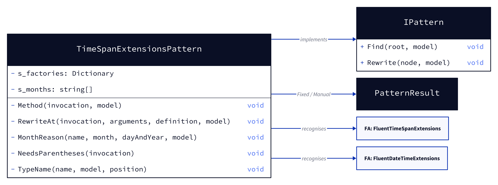
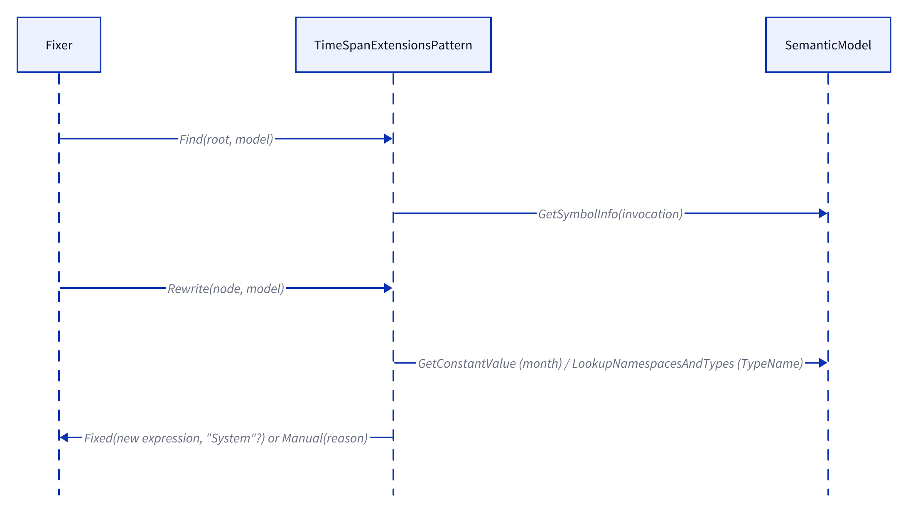

# Models: fa.timespan-extensions

Facts from `src/Unshackle.Core/Fixes/FluentAssertions/Patterns/TimeSpanExtensionsPattern.cs`. The pattern implements `IPattern` directly (no `x.Should()`), and is last in `FluentAssertionsFix.Patterns`.

## Figure 1 — Classes

<!-- kingmadoc:diagram img/fa-timespan-extensions-modellen-1.d2 -->

| Element | Role |
| --- | --- |
| `TimeSpanExtensionsPattern` | Id `fa.timespan-extensions` |
| `s_factories` | `Ticks`→`FromTicks`, `Milliseconds`→`FromMilliseconds`, … `Days`→`FromDays` |
| `s_months` | `January` … `December` → month number |
| `RewriteAt` | `At` on a `DateTime` (TAAK-243): constructor with the date parts, or `d.Date + time`; a month call as the date becomes one constructor |
| `MonthReason` | Manual reason when day and year are both computed (shared by month and `At`) |
| `TypeName` | `TimeSpan`/`DateTime` bare, with `using System`, or `global::System.*` |

## Figure 2 — Order

<!-- kingmadoc:diagram img/fa-timespan-extensions-modellen-2.d2 -->

| Step | What |
| --- | --- |
| Find | Every invocation that binds to `FluentAssertions.Extensions.FluentTimeSpanExtensions` or `FluentDateTimeExtensions`, except a month call that is the date of an `At` call |
| Rewrite | Arguments in order (receiver first), then factory, month or Manual |

## Figure 3 — Decision tree of `Rewrite`

<!-- kingmadoc:diagram img/fa-timespan-extensions-modellen-3.d2 -->

| Leaf | Proof / test |
| --- | --- |
| `TimeSpan.FromX(n)` | `simple`, `static-call`, `no-using-system`, `Rewrite_OwnTimeSpanTypeInScope_QualifiesSystemTimeSpan` |
| `new DateTime(y, m, d)` | `month` |
| Manual: computed day and year | `month-computed` |
| Manual: no direct replacement | `and`, `offset`, `and-no-using-system` |
| `d.Date + t` / `new DateTime(y, m, n) + t` | `at-timespan` |
| `new DateTime(y, m, n, h, min, s)` | `month-at` |
| `new DateTime(d.Year, …, d.Kind)` | `at-variable`, `Rewrite_DateTimeAt_ConstructorWithDateParts` |
| Manual: microseconds / computed date | `at-microseconds`, `at-computed`, `Rewrite_DateTimeAtMicroseconds_Manual` |

The figures are not rendered (no `kingmadoc` CLI on this machine).

## See also

- [fa-timespan-extensions-plan.md](fa-timespan-extensions-plan.md) - plan
- [fa-timespan-extensions-verify.md](fa-timespan-extensions-verify.md) - verification
- `src/Unshackle.Core/Fixes/FluentAssertions/Patterns/TimeSpanExtensionsPattern.cs`
- `src/Unshackle.Tests/Proofs/FluentAssertions/TimeSpanExtensions/`
