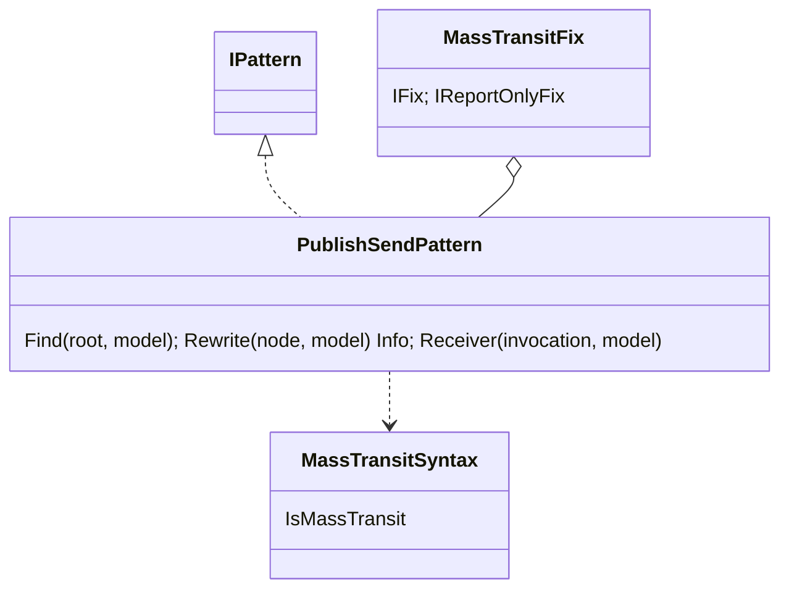
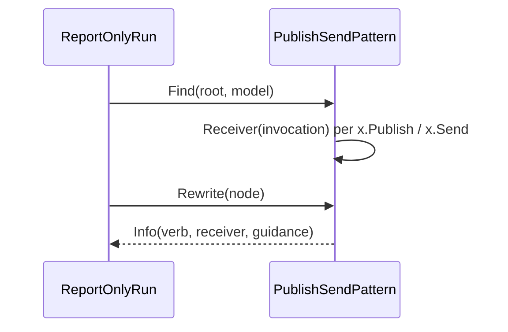
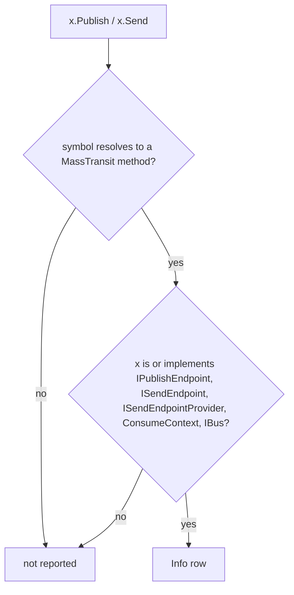

# Models: masstransit.publish-send

Facts from `src/Unshackle.Core/Fixes/MassTransit/Patterns/PublishSendPattern.cs`.

## Figure 1: class diagram

## Figure 2: sequence

## Figure 3: decision tree

| Leaf | Test |
| ---- | ---- |
| Info row | `FixAsync_PublishAndSendOnMassTransitTypes_AreInfo` |
| not reported | `FixAsync_PublishOnOwnOrUnresolvedType_IsNotReported` |

## See also

- [plan](masstransit-publish-send-plan.md), [verify](masstransit-publish-send-verify.md)
