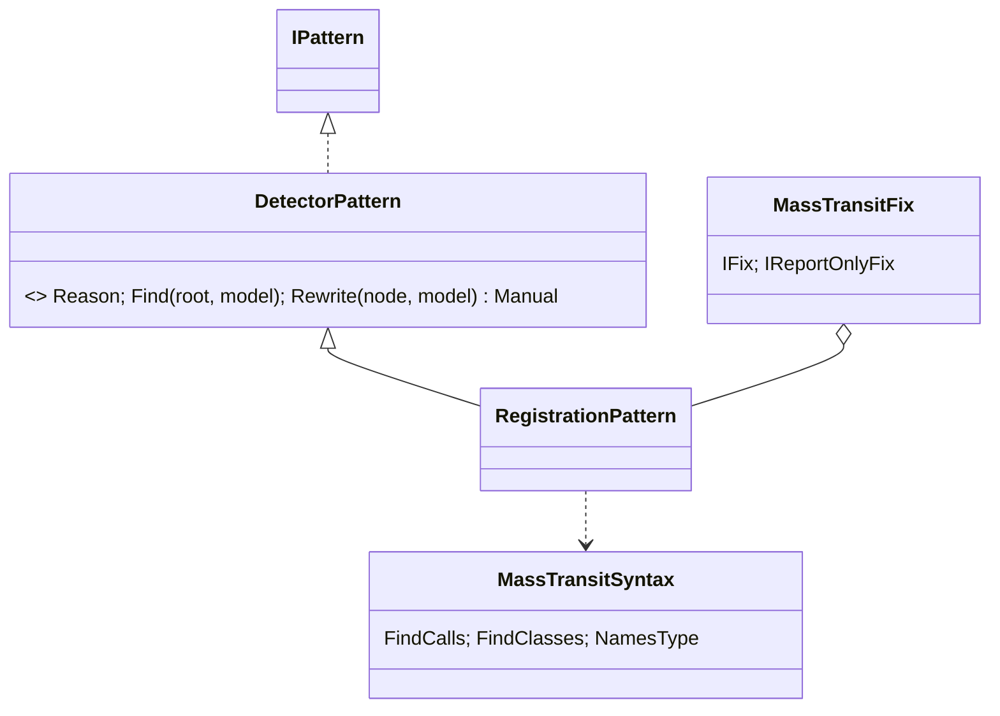
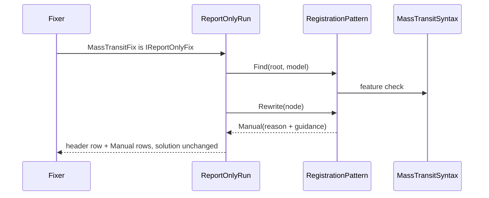
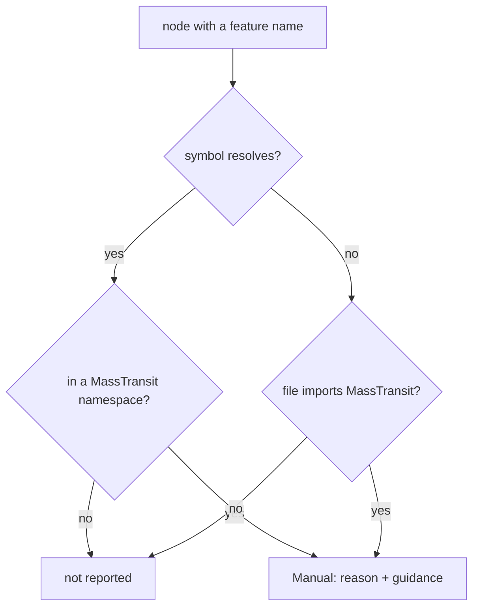

# Models: masstransit.registration

Facts from `src/Unshackle.Core/Fixes/MassTransit/Patterns/RegistrationPattern.cs`, `DetectorPattern.cs` and `MassTransitSyntax.cs`.

## Figure 1: class diagram

## Figure 2: sequence

## Figure 3: decision tree

| Question | Leaf | Proof / test |
| -------- | ---- | ------------ |
| MassTransit feature | Manual | `Registration/add-mass-transit` |
| own look-alike type | not reported | `FixAsync_OwnIConsumerOutsideMassTransit_IsNotReported` |

## See also

- [plan](masstransit-registration-plan.md), [verify](masstransit-registration-verify.md)
