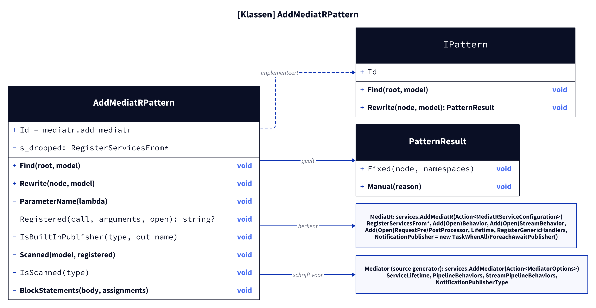
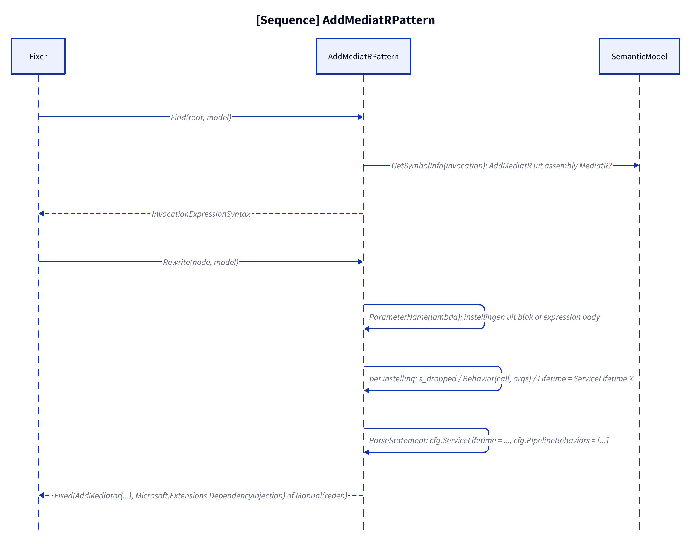
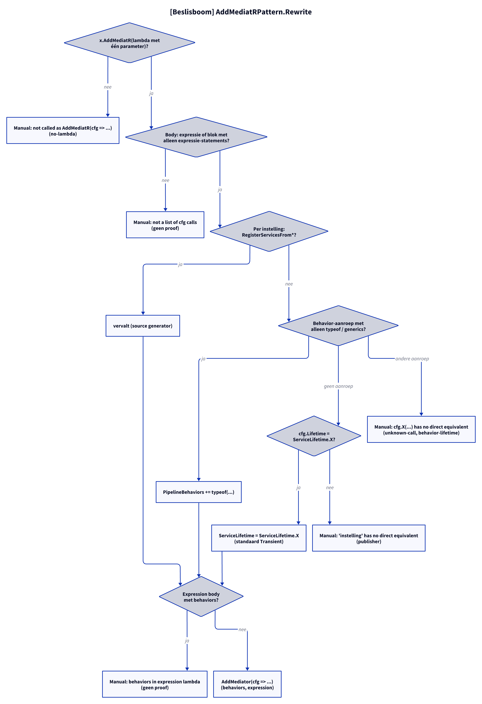

# Models: mediatr.add-mediatr

Facts from `src/Unshackle.Core/Fixes/MediatR/Patterns/AddMediatRPattern.cs`.

## Figure 1: classes

**Figure 1.** `AddMediatRPattern` and the MediatR and Mediator registration.

<!-- kingmadoc:diagram img/mediatr-add-mediatr-modellen-1.d2 -->

| Element             | Role                                                                          |
| ------------------- | ----------------------------------------------------------------------------- |
| `AddMediatRPattern` | Finds `AddMediatR` (symbol from assembly `MediatR`) and writes `AddMediator`  |
| `s_dropped`         | `RegisterServicesFrom*`: dropped, the source generator finds handlers         |
| `Registered`        | `Add(Open)Behavior`, `Add(Open)StreamBehavior`, `Add(Open)RequestPre/PostProcessor` → `typeof(...)` of the implementation |
| `Scanned`           | Closed exception handlers and processors from the own project (MediatR assembly scan) |
| `IsBuiltInPublisher` | `TaskWhenAllPublisher`/`ForeachAwaitPublisher` → `NotificationPublisherType` |
| `MediatorOptions`   | Written by the generator; `ServiceLifetime`, `PipelineBehaviors`, `StreamPipelineBehaviors`, `NotificationPublisherType` |

## Figure 2: sequence

**Figure 2.** From `Fixer` via `Find` and `Rewrite` to `Fixed` or `Manual`.

<!-- kingmadoc:diagram img/mediatr-add-mediatr-modellen-2.d2 -->

| Step         | Method in the code                       | What happens                                            |
| ------------ | ---------------------------------------- | ------------------------------------------------------- |
| Find         | `Find` with `GetSymbolInfo`              | Only the real `AddMediatR` of MediatR (also as candidate symbol) |
| Settings     | `ParameterName`, `Registered`, `s_dropped`, `IsBuiltInPublisher` | Each setting: dropped, behavior/processor/stream behavior, lifetime, publisher or Manual |
| Scan         | `Scanned`, `IsScanned`                   | Order: exception handlers, pre-processors, behaviors, post-processors |
| Write        | `BlockStatements`, `SyntaxFactory.ParseStatement` | Literal assignments, only the indentation; comments before the first |

## Figure 3: decision tree

**Figure 3.** Questions of `Rewrite`.

<!-- kingmadoc:diagram img/mediatr-add-mediatr-modellen-3.d2 -->

| Leaf                                          | Condition                              | Evidence                            |
| --------------------------------------------- | -------------------------------------- | ----------------------------------- |
| Manual "not called as AddMediatR(cfg => ...)" | no lambda                              | `AddMediatR/no-lambda`              |
| Manual "not a list of cfg calls"              | block with other statements            | no proof                            |
| Manual "cfg.X(...) has no direct equivalent"  | unknown call or lifetime argument      | `unknown-call`, `behavior-lifetime` |
| Manual "'...' has no direct equivalent"       | other assignment/expression (own publisher) | no proof                       |
| Manual "several settings in an expression lambda" | expression body with more than one assignment | no proof                 |
| `AddMediator(cfg => ...)`                     | everything known                       | `behaviors`, `expression`, `empty`, `processors`, `publisher`, `edge-publisher-qualified`, `edge-assemblies`, `edge-service-type-behavior`, `generic-handlers` |

## See also

- [mediatr-add-mediatr-plan.md](mediatr-add-mediatr-plan.md)
- [mediatr-add-mediatr-verify.md](mediatr-add-mediatr-verify.md)
- `src/Unshackle.Core/Fixes/MediatR/Patterns/AddMediatRPattern.cs`
- `src/Unshackle.Tests/Proofs/MediatR/AddMediatR/`
